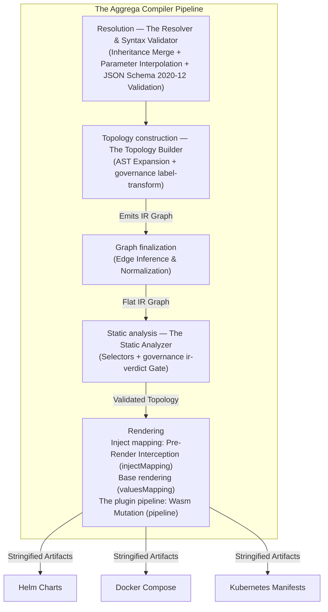

# Compilation Pipeline (High-Level)

This chapter details the internal physics of the Go compiler, defining how abstract YAML is translated into physical configurations across the compilation pipeline, the Intermediate Representation (IR) Graph, and WebAssembly (Wasm) execution sockets.

## The Compilation Pipeline & Execution Flow

Aggrega drops hardcoded orchestration logic in favor of a strict, fixed-order Ahead-of-Time (AOT) compiler pipeline. Triggered by the **CLI Orchestrator**, the compiler acts as a high-speed traffic cop, passing the flat graph between isolated WebAssembly (Wasm) sockets to evaluate the architecture before rendering physical artifacts.

The Wasm sockets run on an embedded host — the Extism toolkit on top of the Wazero engine — behind an **AOT-purity firewall** that denies a plugin any runtime-access capability (network, filesystem, wall-clock, environment, standard I/O), so a plugin cannot break the deterministic, ahead-of-time guarantee. The host ships and runs the publishing-linter today, out of band, via [`aggrega lint`](../language-reference/cli/aggrega-lint.md). The in-band gates described below — the governance socket's label-transform role at topology construction and its IR-verdict role at static analysis, plus the plugin pipeline that closes rendering — carry stable contracts and assemble their payloads. The descriptions that follow teach the pipeline's design; [Status of the Language](../language-reference/10-status.md) tracks which sockets execute today.

The pipeline executes entirely in-memory in a strict, fixed order:

**Resolution — The Resolver & Syntax Validator**

* **Mechanism:** Inheritance Merge, Go Template Interpolation, and JSON Schema 2020-12 Validation.
* **Action:** The CLI fetches all requested entities (Components, Features, Releases). It first checks these definitions for the `extends` keyword. For the Catalog entities, it deep-merges the YAML metadata, and the two kinds part company on the data pillars: a Feature's `schema:` composes with its base's under JSON Schema 2020-12 composition, while an extending Component composes structure only — its attachment slots, topology sockets, self-inject allowlist and named assertions — and receives its base's `schema:` block exactly as the base authored it. For the `Release` object, it deep-merges the `infra` and `parameters` blocks from the parent release.
Next, it performs an in-memory interpolation in three sub-steps: parameter contract validation against the Aggregate's typed `parameters:` declarations; interpolation of the resolved values into the surrounding `values:` strings; withdrawal of the `.parameters` map from every value-template context, leaving it readable to operator-authored path templates alone. Finally, it injects the resolved `infra` blocks into the target component payloads. Once the blueprint is fully concrete, the compiler uses the unified `schema:` declaration from the Catalog (compact form or full JSON Schema 2020-12) to strictly validate the developer's `values` and `infra` configurations locally.
  * **Release Feature schema validation:** Features attached via the Release (both boundary-wide and component-specific) are resolved against their Catalog entities during this step. The compiler validates the Release-provided `infra` blocks against each Feature's `schema:` declaration immediately after catalog resolution, ensuring type safety before the topology is built.
  * **Annotation-driven Feature expansion sub-phase:** After Manifest resolution, Recipe/Provider binding, and Manifest binding-target validation (paths declared under `mappings.features.annotations.<key>.maps` exist in the referenced Feature's `spec.schema`), the compiler runs an annotation-expansion sub-phase before the topology builder. The sub-phase walks Release boundaries outer-to-inner and Aggregate subsystems outer-to-inner, computing the effective per-component annotation set through cascade + override + null-opt-out merge; parses each annotation value as YAML into the Scalar / Structured / Nil sum type; routes each value (scalar or structured-per-subkey) through the Manifest binding's `maps` declaration to the target Feature schema pillar with side-vs-pillar enforcement (Aggregate-side fires `maps.values`; Release-side fires `maps.infra`); validates per-leaf types against the Feature's `spec.schema`; and injects synthetic Feature attachments tagged with `Origin: "annotation"` IR provenance. Schemas are compiled once per build into a resolver-context cache and reused across cascade walks. The expansion runs after binding-target validation and before topology construction, so downstream stages treat synthetic attachments structurally identically to explicit ones (except via provenance inspection). See [13-catalog-and-registry.md §"Annotation-driven Feature expansion"](13-catalog-and-registry.md#11-annotation-driven-feature-expansion) and [`language-reference/providers/well-known-annotations.md`](../language-reference/providers/well-known-annotations.md) for the binding shape, cascade semantics, and cross-side composition rules.

**Topology construction — The Topology Builder & Mutation Gate**

* **Mechanism:** AST Expansion + the governance socket's `label-transform` role.
* **Action:** The compiler natively reads the explicitly declared `uses` structs from the validated components to deterministically draw topological edges between nodes in the graph, leaving the `values` block completely opaque. It then evaluates the **Mutation Gate**, passing the early-stage AST Graph to a governance plugin attached at the `label-transform` role. The plugin evaluates the context and returns JSONPatches to dynamically auto-tag the graph (e.g., injecting the label `compliance.aggrega.ai/data-class: restricted` based on environment scopes).

**Graph finalization**

* **Mechanism:** Edge Inference & Normalization.
* **Action:** The compiler finalizes the flat Intermediate Representation (IR) Graph, preserving the explicit topological edges the topology builder drew. It then normalizes the attached Features and their `values` payloads into a flat dictionary mapped by node ID, preparing the capability-agnostic graph for validation.
  * **IR Payload Normalization:** The IR's structural shape enforces a Single Source of Truth for configuration: the topology layer carries only the graph structure (node identity, edges, metadata labels), and the normalized configuration state lives in a separate in-memory dictionary the compiler passes to downstream plugins. Mutators that change configuration change it in one place; the provider reads the normalized state without risk of drift from redundant storage.

**Static analysis — The Static Analyzer & Validation Gate**

* **Mechanism:** Topological Purity Checks + the governance socket's `ir-verdict` role.
* **Action:** The compiler runs abstract static analysis over the IR Graph. First, it extracts the `selector` strings from the `usesSchema` definitions and evaluates them using a native Go label-matching engine (supporting Kubernetes-style `AND`, `OR` via `in()`, and `NOT` via `!=` semantics) across the explicitly defined graph edges to guarantee cross-node type safety over **declared** sockets. An edge on an ad-hoc socket — one an Aggregate author named and the catalog did not declare — has no catalog entry and therefore no selector, so there is nothing for this check to evaluate and nothing missing; each edge records which of the two it is, and what an ad-hoc edge may carry is bounded by the target's declared `provides` instead. It also evaluates Feature `appliesTo` and `appliesToAnyOf` selectors to verify that attached features are compatible with their target component's labels, and each filled attachment slot's own `selector` against the labels of the Feature filling it. Second, it evaluates every **presence mandate** a node's Component declares — each `features.aggrega.ai/requiredType.<label>` annotation — against that node's final attachment set. The analyzer is where this check belongs because it is the first stage that holds both halves of the rule: the resolved Component entity's annotations and the attachment set the 5-Tier cascade produced, counting Aggregate-attached, subsystem-attached, Release-attached and annotation-expanded attachments alike. A mandate no attachment satisfies halts the build; a mandate whose declaration is malformed halts with a distinct diagnostic, so a broken declaration never reads as a satisfied requirement. Third, it executes the **Validation Gate**, passing the complete graph structure (including all nodes, edges, attached features, and precalculated DFS paths) to a governance plugin attached at the `ir-verdict` role. The enterprise's custom Wasm policy evaluates the topology. If the Wasm plugin returns a failure array (e.g., detecting a continuous path from a `public` node to a `restricted` node without a specific proxy feature), the build halts.

**Rendering**

* **Mechanism:** Pre-Render Interception (`injectMapping`), Late Binding (`valuesMapping`), and Wasm Rendering Sockets (`pipeline`).
* **Action:** The final artifact generation phase is split into three strict temporal sub-phases to guarantee deterministic execution without Wasm overhead:
  * **Inject mapping (pre-render interception):** The Go compiler resolves the Developer's abstract `.context.inject` contract. It then executes the `injectMapping` Go templates from all attached `FeatureRecipes` following the strict 5-Tier Onion Model execution order (Sub-Aggregate → Root Aggregate component → Root Aggregate subsystem → Release boundary outer-to-inner → Release component-specific). The compiler natively deep-merges the resulting dictionaries over the Caller's `.context.inject` memory pipe. This safely rewrites environment variables and connection strings for the Caller before the Base Recipe ever sees them.
  * **Locals preamble:** Before any `provides` template runs, the compiler evaluates the Recipe's `.locals` entries in the order they are written, each against a self-contained node-local context — `.context.instance_id`, `.values`, `.infra`, and the entries of the same block resolved so far, but not `.context.inject` or `.context.uses`. An entry may therefore read a sibling defined above it and receives that sibling's resolved value; author order is part of the contract wherever one entry reads another, and the block is never reordered to make a reference resolve. Resolving locals first is what lets a `provides` template read `.locals`. The Recipe's `.source` template is evaluated against the same context once those locals are resolved, which keeps `.locals` reusable as shorthand across a Recipe's templates and lets authors parameterise `.source` (chart version, path, registry) per boundary.
  * **Base rendering (base Recipe `valuesMapping`):** The compiler evaluates the Base Recipe's `valuesMapping` template. The template reads the intercepted strings from the `.context.inject` pipe (rewritten during inject mapping), and the resulting values dictionary is fed to the provider the Recipe's `capability` names — the helm and helm-chart providers both render through Helm today — to render the base infrastructure artifacts.
  * **Feature rendering (FeatureRecipe Resource Generation):** Every attachment on the node whose bound FeatureRecipe carries its own `source`, `workload`, `artifacts` and/or `valuesMapping` — the Resource Generation pattern, used for auxiliary manifests like a ServiceMonitor, a NetworkPolicy, a sidecar ConfigMap, or a credential-delivery resource — is evaluated in one pass, in the same 5-Tier Onion Model order inject mapping follows. There is one sequence over one attachment set: an operational Feature and a credential Feature travel the same path, and what differs between them is what their FeatureRecipe emits. Each attachment's `.values` and `.infra` are swapped to its own scope; it inherits the base Recipe's evaluated `.locals`; `.attachment_name` names the instance being rendered and `.provides` carries the attachment's own resolved provides, the same bag the consumer reads. The resulting values dictionary is fed to the provider named by the FeatureRecipe's own capability, and the rendered files are appended under `features/<component>/<instance>/` in the boundary's output — the component the Feature is attached to, then the name it is attached under, so one Feature name attached to several components places each under its own component. Inject-only FeatureRecipes — those carrying only `injectMapping`, already handled during inject mapping — are skipped here.
  * **The plugin pipeline (shape validated today; execution deferred):** The compiler reads the Recipe's `pipeline` array and validates its shape. Pipeline execution — designed to apply WebAssembly adapter plugins that execute surgical JSONPatches over the rendered AST (e.g., injecting an Envoy sidecar or a secret VolumeMount), then dispatch the finalized JSON through a pluggable rendering socket to produce the target orchestrator's stringified file format — is designed and tracked but not yet wired into the compiler. A Recipe declaring non-empty `pipeline` steps receives a warning indicating the steps were validated but not executed.

*The base-rendering sub-stages described above reflect what the current compiler executes for Recipes using `source:` + `valuesMapping:` plus FeatureRecipe Resource Generation. Forward-looking sub-stages for `workload:` parsing (inline content or `workload: { $import: <path> }`), Workload → provider-native synthesis, and `artifacts:` evaluation (inline content or per-entry `$import:`) land within base rendering as their respective render paths ship; see [16-recipe-input-composition.md](16-recipe-input-composition.md) for the three-input-kinds composition model, the Workload kind, and the Artifacts mechanism.*

### GitOps-Native Output

To remain strictly unopinionated about deployment execution, the rendering plugins output the generated artifacts into a clean, boundary-isolated directory structure (e.g., `dist/boundaries/aws-core-cluster/`, `dist/boundaries/gcp-data-cluster/`). This allows external GitOps controllers (like ArgoCD or Flux) to seamlessly sync and deploy the infrastructure without the Aggrega compiler ever needing live cluster API credentials.

### Infrastructure Source Map

Aggrega compiles a ~30-line `Aggregate.yaml` into thousands of lines of physical JSON or YAML configuration. Without a way to trace a running resource back to its source, debugging a failure at "main.tf.json line 4,032" forces developers to reconstruct the mapping manually. Aggrega's rendering plugins address this by merging trace identifiers into the provider's native metadata surface — `metadata.labels` for Kubernetes, `tags` for Terraform, and equivalent per-provider conventions — so each rendered object carries a pointer back to the source it came from. The `aggrega.ai/compiler-version` label (documented in [governance-and-compliance §5](11-governance-and-compliance.md#5-compile-time-provenance-stamping)) is the first trace key in this family, emitted on Helm and helm-chart output today.

*Additional trace keys — identifying the source aggregate, the IR node, the feature origin, and the catalog type — are under active development and ship as each provider's renderer adds the injection.*

A broader debug surface is registered as future work. The designed capabilities include trace output of pipeline execution stages for Recipe authors inspecting each sub-pass's inputs and outputs, an error taxonomy that categorizes errors by authoring surface so diagnostics point at the right author, and source-mapped errors that trace a failing generated manifest field back to the template line that produced it. These capabilities are designed and tracked; none is yet part of the shipped compiler.

## The Validator Pipeline

The schema-validation phase of resolution rests on a validator pipeline that converts entity-spec content (compact form, JSON Schema YAML, or mixed) into a unified JSON Schema 2020-12 document with per-leaf provenance, then validates developer-authored instance content against it. Five stages run as pure transformations in order; each is a deterministic function over its declared inputs.

**Stage 1 — Compact-form compilation.** The compiler walks the YAML tree of `schema:`, `parameters:`, and SchemaLibrary content; dispatches per node (compact form leaf vs JSON Schema YAML vs `$ref:` reference vs composition); emits resolved JSON Schema 2020-12. Compact form and JSON Schema YAML may mix at any node boundary via the `$jsonschema:` escape; the compiler handles the mixed case by walking the tree and dispatching per node. The transformation is a pure function: the same compact-form input always produces the same JSON Schema output. See [`language-reference/vocabulary/compact-form-authoring.md`](../language-reference/vocabulary/compact-form-authoring.md) for the keyword vocabulary.

**Stage 2 — `$templates:` and `$instantiate:` resolution.** For SchemaLibrary entries that declare `$templates:` blocks, the compiler walks every consumer that invokes `$instantiate:` with `$args:`, substitutes the parameter values as literal-scalar replacement, and produces concrete schema entries. The substitution runs once per library load; resolved entries are cached. See [`language-reference/entities/schemalibrary.md`](../language-reference/entities/schemalibrary.md) for the library entity's authoring shape.

**Stage 3 — Cross-document `$ref:` expansion.** For SchemaLibrary references via `$ref:` (the identity form `<Library>#/schemas/<entry>`), the compiler walks the reference chain at compile time via resolution-stack threading; the referenced content inlines into the consumer's schema. Each property in the resolved shape carries an `x-aggrega-source` annotation attributing it to the immediate-parent library entry. The expansion preserves cycle detection (cycles halt the build with a chain-naming error), the identity-not-location guardrail (a reference carrying a registry host halts with a steer to the identity form — references address libraries by identity, not physical location), and single-source composition (`$ref:` blocks accept only the bare reference; consumer-side overrides compose via JSON Schema's `allOf:`). See [`language-reference/vocabulary/cross-document-ref.md`](../language-reference/vocabulary/cross-document-ref.md) for the resolution semantics.

**Stage 4 — Bridge synthesis for `usesSchema:` and `featuresSchema:`.** The compiler walks each entity's `usesSchema:` and `featuresSchema:` content, sorted by key, and emits JSON Schema fragments with `x-aggrega-selector:` and `x-aggrega-inject:` extension keywords. The synthesized JSON Schema participates in the same validation pipeline as the developer-facing `schema:` content; the extension keywords carry the topology-selector and inject-allowlist semantics that downstream pipeline stages consume. The synthesis is a pure function over its inputs.

**Stage 5 — Custom merger with provenance.** For entities that declare `extends:`, the compiler walks the parent chain; the parent's resolved JSON Schema becomes the base; the child's overrides apply on top. Every leaf in the resolved schema carries a per-leaf provenance tag (file path, line number, parent-vs-child origin). The merger's output is what the validator engine consumes; the validator engine is unmodified third-party JSON Schema 2020-12 conformance with a deterministic walker around it for ordered finding emission.

The five stages run before the validator engine sees the schema. The engine receives a single resolved JSON Schema 2020-12 document plus the developer's instance content; it produces a validation report. The error formatter consults the provenance tags + `x-aggrega-source` annotations to emit user-facing diagnostics that name source positions clearly — including the originating file for a constraint a Feature inherited from its base rather than authored itself.

The validator pipeline integrates with the broader compilation flow inside static analysis — after selector resolution, so cross-node `uses:` references resolve before validation, and before assertion evaluation, so the assertion templates can reference fully-resolved socket connections.

## Determinism preservation across the pipeline

Every stage of the compilation pipeline preserves the Deterministic Output Invariant: given the same source files plus the same lockfile plus the same compiler version, the build produces byte-identical output. The invariant is foundational — content-addressing in the lockfile requires stable artifact digests; reproducible builds require that a release authored on developer-A's laptop compiles to the same output on developer-B's laptop and on CI; diff-reviewability requires that source changes show up as the only changes in compiled output.

Determinism is preserved by a small number of disciplines that every transformation respects:

* **Sorted iteration.** Every walk over map-shaped YAML iterates with sorted keys. Go's native map iteration is randomized; the compiler sorts before iterating at every stage (compact-form compiler, merger, bridge synthesis, `$templates:` resolver, error formatter, YAML serializer).
* **No time embedding.** Compilation does not embed timestamps in output. A build at 2:00 PM produces the same artifact as a build at 2:00 AM. The merger's provenance metadata uses file:line, not file:timestamp.
* **Workspace-relative paths.** All paths in resolved output are workspace-relative; the path-resolution layer normalises before paths enter any output.
* **No random sources, no external state.** Transformations are pure functions over their declared inputs (entity content, parent chain, lockfile). External state is consulted only during resolution (OCI artifact fetching), and resolved content is content-addressed by digest.
* **Canonical YAML serialisation.** Output uses alphabetical key order at every depth (with documented exceptions: arrays preserve input order; `enum:` arrays preserve input order); 2-space indentation; Unix LF line endings; unquoted strings where YAML allows; `true`/`false` boolean form; null omitted for absent fields.
* **`$defs:` alphabetical order.** Schema `$defs:` entries are emitted in alphabetical key order in resolved JSON Schema. `$defs:` is conceptually a dictionary, not an ordered list; alphabetical order makes diffs predictable across reorganisations of the source.
* **Parallelism does not surface to output.** The compiler can parallelise independent units (different entities can compile concurrently). Parallel results are gathered into a deterministic structure (e.g., sorted by entity name) before being serialised.

A CI test compiles the entire catalog testdata twice in fresh environments and asserts byte-identical output. The two-build byte-identity test catches map-iteration-order leaks, timestamp embedding, path-representation issues, floating-point unstable arithmetic, concurrent-map-access race conditions, and iteration-over-hash-sets-without-sorting. The test runs on every PR touching the validator or any transformation in the pipeline.

The Deterministic Output Invariant applies at **build time**: given the same source files + the same lockfile + the same compiler version, byte-identical output. The companion property at **lock time** (given the same source files + the same registry state, the same lockfile) is weaker — registries are mutable (new versions can be published; sidecars can be added; per-component metadata can evolve), so two lock invocations against the same source files at different times can produce different lockfiles. That is the lockfile's purpose, mirroring conventions in npm, Cargo, and Go. From a fresh lockfile, the build produces deterministic output. The two-moment separation is what makes registry-side mutability tolerable: a sidecar published at time T2 changes the next lock invocation; it does not change builds against the lockfile generated at T1.
