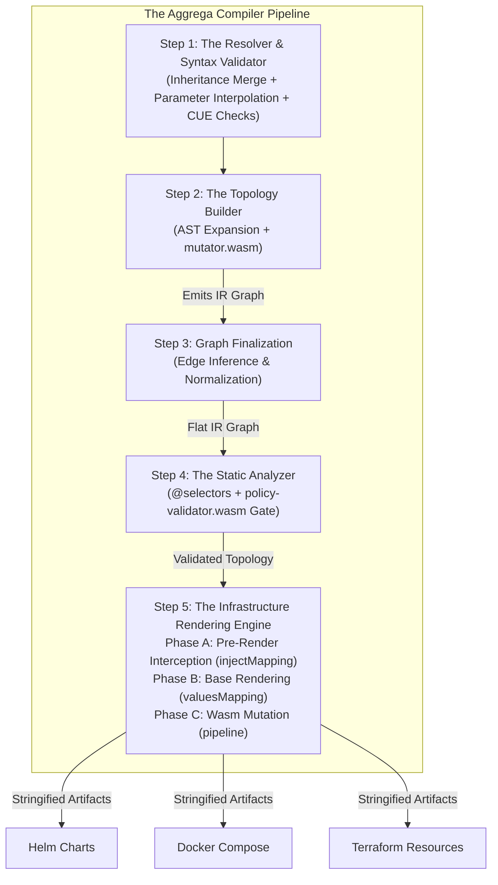

# Compilation Pipeline (High-Level)

This chapter details the internal physics of the Go engine, defining how abstract YAML is translated into physical configurations via the 5-Step compilation pipeline, the Intermediate Representation (IR) Graph, and WebAssembly (Wasm) execution sockets.

## The Compilation Pipeline & Execution Flow

Aggrega drops hardcoded orchestration logic in favor of a strict 5-step Ahead-of-Time (AOT) compiler pipeline. Triggered by the **CLI Orchestrator**, the Go engine acts as a high-speed traffic cop, passing the flat graph between isolated WebAssembly (Wasm) sockets to evaluate the architecture before rendering physical artifacts.

The pipeline executes entirely in-memory in a strict, fixed order:

**1. The Resolver & Syntax Validator**

* **Mechanism:** Two-Tiered Inheritance Merge, Go Template Interpolation, and CUE Lang Validation.
* **Action:** The CLI fetches all requested entities (Components, Features, Releases). It first checks these definitions for the `extends` keyword. For the Catalog entities, it performs a **Two-Tiered Merge** (deep-merging YAML metadata and auto-unifying CUE schemas `ParentSchema & ChildSchema`). For the `Release` object, it deep-merges the `infra` and `parameters` blocks from the parent release.
Next, it performs an in-memory interpolation, exclusively injecting the resolved `parameters` into the abstract `Aggregate` template strings (**where `parameters` safely fulfill their lifecycle and are purged**). Finally, it injects the resolved `infra` blocks into the target component payloads. Once the blueprint is fully concrete, the compiler uses the unified `cueSchema` from the Catalog to strictly validate the developer's `values` and `infra` configurations locally.
  * **Release Feature CUE Validation:** Features attached via the Release (both boundary-wide and component-specific) are resolved against their Catalog entities during this step. The compiler validates the Release-provided `infra` blocks against each Feature's `cueSchema` immediately after catalog resolution, ensuring type safety before the topology is built.
  * **`requiredFeatures` Completeness Check:** If a Component declares `requiredFeatures` in its catalog spec, the compiler verifies the requirement is satisfied by the **merged** feature list (Aggregate-attached + subsystem-attached + Release-attached). This check runs after Release merging, so Ops-injected features satisfy developer-declared requirements. If a required feature type is missing from the combined list, the compiler halts.

**2. The Topology Builder & Mutation Gate**

* **Mechanism:** AST Expansion + The `mutator.wasm` Socket.
* **Action:** The compiler natively reads the explicitly declared `uses` structs from the validated components to deterministically draw topological edges between nodes in the graph, leaving the `values` block completely opaque. It then evaluates the **Mutation Gate**, passing the early-stage AST Graph to the `mutator.wasm` plugin. This plugin evaluates the context and returns JSONPatches to dynamically auto-tag the graph (e.g., injecting the label `compliance.aggrega.ai/data-class: restricted` based on environment scopes).

**3. Graph Finalization**

* **Mechanism:** Edge Inference & Normalization.
* **Action:** The engine finalizes the flat Intermediate Representation (IR) Graph, preserving the explicit topological edges drawn in Step 2. It then normalizes the attached Features and their `values` payloads into a flat dictionary mapped by node ID, preparing the target-agnostic graph for validation.
  * **IR Payload Normalization:** The IR's structural shape enforces a Single Source of Truth for configuration: the topology layer carries only the graph structure (node identity, edges, metadata labels), and the normalized configuration state lives in a separate in-memory dictionary the compiler passes to downstream plugins. Mutators that change configuration change it in one place; the Provider Engine reads the normalized state without risk of drift from redundant storage.

**4. The Static Analyzer & Validation Gate**

* **Mechanism:** Topological Purity Checks + The `policy-validator.wasm` Socket.
* **Action:** The compiler runs abstract static analysis over the IR Graph. First, it extracts the `selector` strings from the `usesSchema` definitions and evaluates them using a native Go label-matching engine (supporting Kubernetes-style `AND`, `OR` via `in()`, and `NOT` via `!=` semantics) across the explicitly defined graph edges to guarantee cross-node type safety. It also evaluates Feature `appliesTo`, `appliesToExpressions`, and `appliesToAnyOf` structured selectors to verify that attached features are compatible with their target component's labels. Second, it executes the **Validation Gate**, passing the complete graph structure (including all nodes, edges, attached features, and precalculated DFS paths) to the `policy-validator.wasm` socket. The enterprise's custom Wasm policy evaluates the topology. If the Wasm plugin returns a failure array (e.g., detecting a continuous path from a `public` node to a `restricted` node without a specific proxy feature), the build halts.

**5. The Infrastructure Rendering Engine**

* **Mechanism:** Pre-Render Interception (`injectMapping`), Late Binding (`valuesMapping`), and Wasm Rendering Sockets (`pipeline`).
* **Action:** The final artifact generation phase is split into three strict temporal sub-phases to guarantee deterministic execution without Wasm overhead:
  * **Phase A (Pre-Render Interception):** The Go compiler resolves the Developer's abstract `.context.inject` contract. It then executes the `injectMapping` Go templates from all attached `FeatureRecipes` following the strict 5-Tier Onion Model execution order (Sub-Aggregate → Root Aggregate component → Root Aggregate subsystem → Release boundary outer-to-inner → Release component-specific). The compiler natively deep-merges the resulting dictionaries over the Caller's `.context.inject` memory pipe. This safely rewrites environment variables and connection strings for the Caller before the Base Recipe ever sees them.
  * **Phase B preamble:** Before the base render runs, the compiler evaluates the Recipe's `.locals` and `.source` templates. Both evaluations are self-contained — they read `.values`, `.infra`, and the node's `.provides`, but not `.context.inject` or `.context.uses` — which keeps `.locals` reusable as shorthand across a Recipe's templates and lets authors parameterise `.source` (chart version, path, registry) per boundary.
  * **Phase B (base Recipe `valuesMapping`):** The compiler evaluates the Base Recipe's `valuesMapping` template. The template reads the intercepted strings from the `.context.inject` pipe (rewritten by Phase A), and the resulting values dictionary is fed to the provider engine (Helm for the helm and helm-chart providers today) to render the base infrastructure artifacts.
  * **Phase B.5 (FeatureRecipe Resource Generation — non-credential):** Attached FeatureRecipes that carry their own `source` and/or `valuesMapping` — the Resource Generation pattern, used for auxiliary manifests like a ServiceMonitor, a NetworkPolicy, or a sidecar ConfigMap — are evaluated in the same 5-Tier Onion Model order as Phase A. Each FeatureRecipe's `.values` and `.infra` are swapped to the feature's own scope; it inherits the base Recipe's evaluated `.locals`. The resulting values dictionary is fed to the provider engine named by the FeatureRecipe's own `provider:`, and the rendered files are appended under `features/<instance>/` in the boundary's output. Inject-only FeatureRecipes — those carrying only `injectMapping` and already handled in Phase A — are skipped at this sub-pass.
  * **Phase B.6 (FeatureRecipe Resource Generation — credential):** Credential FeatureRecipes attached through the Component's `secretsSchema` are evaluated using the same Resource Generation mechanism, iterating the credential-partitioned secrets bucket rather than the general feature-attachment list. The feature-scoped context carries `.secret_name` and `.inject` populated from the secret entry, letting the FeatureRecipe's `valuesMapping` render the credential-delivery manifest (an `ExternalSecret`, a native Kubernetes `Secret`, a vault-fetch CRD, or the provider's equivalent). Rendered files are appended under `secrets/<name>/` in the boundary's output.
  * **Phase C (pipeline validation; execution deferred):** The compiler reads the Recipe's `pipeline` array and validates its shape. Pipeline execution — designed to apply WebAssembly adapter plugins that execute surgical JSONPatches over the rendered AST (e.g., injecting an Envoy sidecar or a secret VolumeMount), then dispatch the finalized JSON through a pluggable rendering socket to produce the target orchestrator's stringified file format — is designed and tracked but not yet wired into the compiler. A Recipe declaring non-empty `pipeline` steps receives a warning indicating the steps were validated but not executed.

*The Phase B sub-passes described above reflect what the current compiler executes for Recipes using `source:` + `valuesMapping:` plus FeatureRecipe Resource Generation. Forward-looking sub-passes for `workload:` / `workloadFrom:` parsing, Workload → provider-native synthesis, and `artifacts:` / `artifactsFrom:` evaluation land within Phase B as their respective render paths ship; see [16-recipe-input-composition.md](16-recipe-input-composition.md) for the three-input-kinds composition model, the Workload kind, and the Artifacts mechanism.*

### GitOps-Native Output

To remain strictly unopinionated about deployment execution, the rendering plugins output the generated artifacts into a clean, boundary-isolated directory structure (e.g., `dist/boundaries/aws-core-cluster/`, `dist/boundaries/gcp-data-cluster/`). This allows external GitOps controllers (like ArgoCD or Flux) to seamlessly sync and deploy the infrastructure without the Aggrega compiler ever needing live cluster API credentials.

### Infrastructure Source Map

Aggrega compiles a ~30-line `Aggregate.yaml` into thousands of lines of physical JSON or YAML configuration. Without a way to trace a running resource back to its source, debugging a failure at "main.tf.json line 4,032" forces developers to reconstruct the mapping manually. Aggrega's rendering plugins address this by merging trace identifiers into the provider's native metadata surface — `metadata.labels` for Kubernetes, `tags` for Terraform, and equivalent per-provider conventions — so each rendered object carries a pointer back to the source it came from. The `aggrega.ai/compiler-version` label (documented in [governance-and-compliance §5](11-governance-and-compliance.md#5-compile-time-provenance-stamping)) is the first trace key in this family, emitted on Helm and helm-chart output today.

*Additional trace keys — identifying the source aggregate, the IR node, the feature origin, and the catalog type — are under active development and ship as each provider's renderer adds the injection.*

A broader debug surface is registered as future work. The designed capabilities include trace output of pipeline execution stages for Recipe authors inspecting each sub-pass's inputs and outputs, an error taxonomy that categorizes errors by authoring surface so diagnostics point at the right author, and source-mapped errors that trace a failing generated manifest field back to the template line that produced it. These capabilities are designed and tracked; none is yet part of the shipped compiler.
