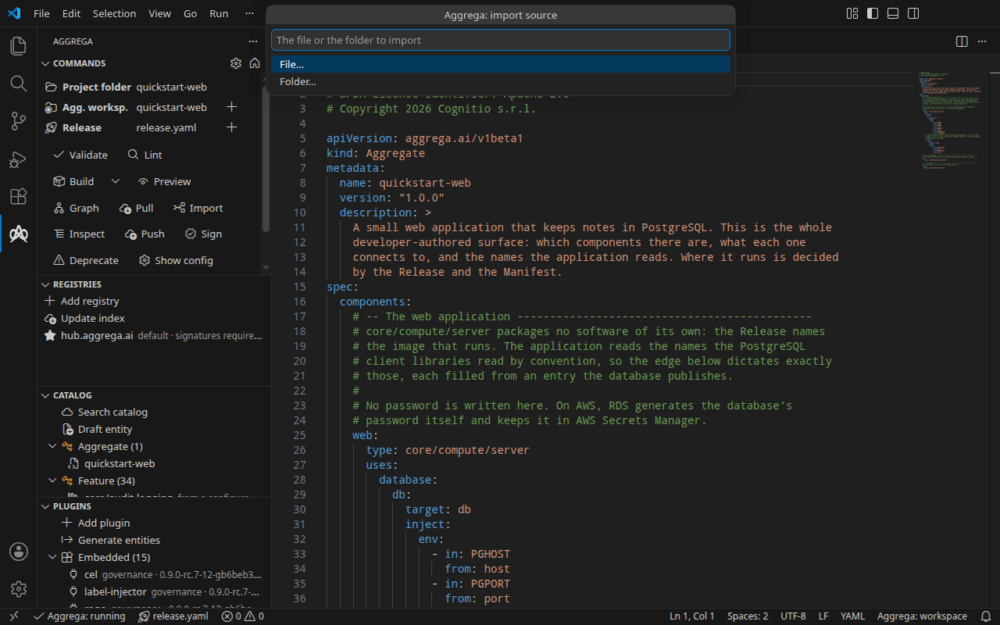

# Import into Aggrega

What an import reads and writes, and the formats it reads, are described in [Import](../import/README.md); this page covers running one from the editor.

**Aggrega: Import into Aggrega** — draft Aggrega authoring files from a source another tool wrote. It is the **Import** button in the Commands panel's Author group too, and **Import into Aggrega** on a file or a folder's right-click menu in the Explorer, which imports the file or folder you clicked: the three are one command, so they ask the same questions, in this order, each in the editor's own input, except that the Explorer entry does not ask for the source.

First the source: **File…** or **Folder…**, then your editor's open dialog for one of that kind — the choice comes first because on Windows and Linux one dialog cannot offer both. Then the folder inside the workspace to draft into, relative to its root, where leaving it empty drafts beneath the workspace root, as `aggrega import` does without `--output-dir`. Then the options, a list in which you may tick **Preview**, **Sync**, both or neither: **Preview** is `--dry-run` — nothing is written, and each file the import would write is shown on the output channel followed by its content — and **Sync** is `--sync`, bringing what an earlier import drafted up to date with the source, changing only what the import wrote, with each part it brings up to date listed on the channel in the words `aggrega import --sync` prints for it; ticking neither writes the drafts whole. Last, the provider capability to draft a Manifest for, such as `compose` or `helm`, where leaving it empty drafts none, as without `--target`. An answer you leave empty, and an option you leave unticked, is not sent at all, so the compiler applies its own default, and dismissing any question or dialog ends the import with nothing sent. A folder that leads out of the workspace, and a capability no Recipe in the workspace's catalog binds to, are refused by the compiler in its own words before anything is written.

The format is recognised from the source's own shape, as at a terminal; where the compiler refuses because no format, or more than one, recognises the source, the editor shows that refusal — which names the formats — and asks for the format to read the source as, then sends the same import again carrying it, and leaving that question empty ends the import with the refusal. It reads the file you name, or the files of the directory you name that its importer reads, and no others. It reaches no network, except to fetch what an import runs on and this machine does not hold yet — one of the compiler's core importers, the first time a format needs it, and the published catalog snapshot the import reads as its catalog behind the workspace's catalog folders — each fetched from the workspace's default registry, verified and kept in the content cache, as `aggrega import` does. The source may sit anywhere on this machine, because it is a file you pointed at rather than one the workspace holds; the drafts always land in the workspace.

It shows progress with a Cancel button, and pressing Cancel stops the conversion rather than only stopping the editor waiting, because the importer runs as a plugin the compiler can unwind mid-run.

The ending says what the source was recognised as, how many files were drafted and where they went, counting the drafts and not `.aggrega-import.json`, the record of what imports wrote there, one entry per import format, that every import writes beside its drafts; the importer's own findings and every file that reached disk, the record included, go to the Aggrega output channel, because they name a place in the source file rather than in a document you authored. When an import that writes its drafts leaves them owing values no source can hold, the editor offers to ask you for them, as described in [Answering the values an import still owes](#answering-the-values-an-import-still-owes).

## Answering the values an import still owes

Some values a draft needs are ones no source can hold — the image your own code is built into, say, the email of an owner account, or where a secret comes from. When an import that writes its drafts leaves such values empty, the editor offers once, in a notification naming how many there are, to ask you for them; dismissing the offer changes nothing. A preview is offered nothing, as `aggrega import --dry-run` asks nothing, because no answer is applied to a preview; its findings on the output channel still name each value still empty. Accept the offer and each value is asked in an input box of its own, in the order the drafts list them: the box is titled with the drafted file and the key the value sits at, and asks in the compiler's own description of the value, the question `aggrega import` asks at a terminal. A secret's box asks where the secret comes from, in the compiler's own words — never the secret itself — and hides what you type. A box you leave empty leaves that value owed, to answer later in the [answers file](../../language-reference/import-answers.md). Pressing Escape in any box ends the questions and sends nothing, the answers you had already typed included.

The editor then sends the import again with your answers, with the same progress and Cancel button, and its findings, its files and its ending reach the output channel as the first import's did. The answers go on a sync, because the drafts are already on disk. The compiler writes each answer into the drafts and keeps it in the answers file `aggrega import` reads, so a later import or sync of that source does not ask for it again; a value that file already answers is not asked at all. A secret answered with anything other than a name for where it comes from is refused by the compiler in its own words and stays owed. Whatever the drafts still owe after the import sent again is offered the same way.
