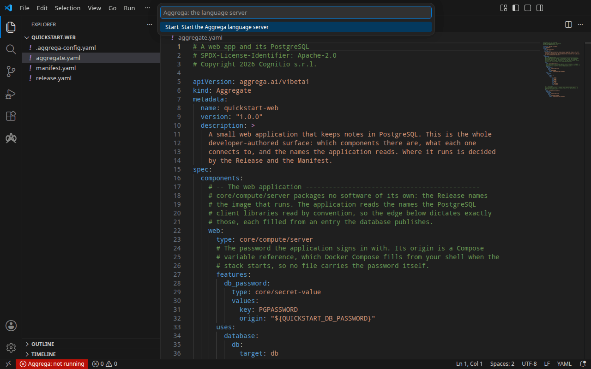

# The language server

**Language server state** — a status-bar indicator on the left, beside the Release indicator, reading **running**, **starting**, or **not running** in red. It is the one surface that is there whatever the compiler is doing, so it is where you find out that nothing is running rather than being left to infer it from surfaces that have gone quiet — and its tooltip says which of the two reasons applies: no folder here is one Aggrega recognises, or there is one and the server is not attached to it. Clicking it offers **Start** when nothing is running and **Restart** when something is, and does the one you choose. See [When the language server is not running](#when-the-language-server-is-not-running).

## When the language server is not running

**Every command this extension contributes exists from the moment it starts, whether or not a
language server is running**, and only two of them wait on a server before the command index lists
them: the one named below, and **Aggrega: Attach a Feature to the connection at the cursor**, which is
listed only in a document the language server reports as an Aggregate or a Release. A command that only came into being once one had attached would be missing
from the command index in exactly the window that needs it most — the one where nothing is running
and you are looking for the way to start it.

**The status-bar indicator on the left is where you find out what is going on.** It reads
**running**, **starting**, or **not running** in red, and its tooltip says why: no folder in this
window is one Aggrega recognises, or there is one and the server is not attached to it. Clicking it
offers **Start** or **Restart** — whichever applies — and does it.

That indicator exists because a command that cannot run explains nothing: the command index leaves
it out rather than saying why, and no editor surface shows a tooltip on a disabled control. The
indicator is where the reason is written down, and it is also where you act on it.

**A start that fails says what is wrong with the compiler's path.** Where `aggrega.server.binaryPath`
names nothing, the notification reads **Aggrega language server failed to start: the compiler at
⟨path⟩ was not found.**; where it names a file that cannot be run, it reads **… ⟨path⟩ is not an
executable file.** Both go on to say to set `aggrega.server.binaryPath` to the aggrega binary, and
carry **Open binary path setting**, which opens the settings screen on that one setting, and **Show
output**. Where the path names nothing, the notification also carries **Download the compiler** and
**Choose another file** ahead of those two, because there is then no compiler to replace: the first
downloads one as [Getting the compiler](install.md#getting-the-compiler) describes, and the second asks for a
compiler file you have and points the setting at it. A file that is there and cannot be run is one you
put there, so that notification offers no download. Any other failure to start gives the reason it was given, after the same opening, and then
names the compiler that was run and the setting that names it. The Aggrega output channel carries the
same account.

**Validate says the server is not running, and offers the way back.** Pressed while no language
server is running, it answers **Aggrega: the language server is not running.** — followed, where the
last start failed, by why, in the words that failure was reported in — with **Show output**, **Open
binary path setting**, and the status-bar indicator's own **Start**.

**The list panels say the server is not running rather than reporting a failure.** With no language
server running, the Registries and Catalog panels each draw **The Aggrega language server is not
running.** in place of their list, with the indicator's own tooltip, and pressing the row starts the
server. The Plugins panel's list comes from running the compiler as a command rather than from the
language server, so where that command could not be started its row says what is wrong with the path
in the notification's words, and pressing it opens the setting.

**Aggrega: Open status bar menu** is left out of the command index while no language server is
answering: everything it offers is an action on a running language server, and your editor does not
list a command that cannot run there. It comes back the moment one is answering.

**A command that works without one stays in the command index**, even though it concerns the server.
**Aggrega: Toggle the artifact-rendering stage while inspecting** writes a preference, and the server reads
that preference when it starts — so a stopped server is the most useful moment to set it, not a
reason to withhold it.

## Lifecycle

The extension manages the language server process's full lifecycle. When it stops the language server — the editor closing, the language server moving to a different Aggrega workspace, or no single workspace being left for it to attach to — it first asks the language server to exit cooperatively, which lets in-flight work finish. If the language server is still working when that grace window closes, it is asked once more — this time to abandon that work rather than finish it. If it still has not exited, the extension falls back to OS-level termination. A restart — the restart command, a change of `aggrega.server.binaryPath`, or a configuration change the extension made itself — does not ask: it terminates the process at the operating-system level and starts a fresh one. Each of these steps is reported to the Aggrega output channel, so a slow shutdown shows which step is taking the time and whether the language server answered at all. The semantics are identical across POSIX and Windows hosts.

**A language server that stops without being asked to is started again, a bounded number of times.** When a running server ends, the extension starts a fresh one; if that one ends too — as it starts, before it has answered the extension's opening request, or once it is running — it is started again in turn, up to `aggrega.server.respawnAttempts` restarts within `aggrega.server.respawnWindowSeconds` seconds. The end after the last of them leaves the server stopped and raises **Aggrega language server has stopped responding.**, naming the command that starts it again, and nothing starts it again by itself after that — so a server that dies every time it starts is started again that many times and no more. The Aggrega output channel says each step in words: that the server stopped unexpectedly and how it ended, each restart and how many the setting allows, a restart that did not come up and why, and that it is not being started again. A stop or restart you asked for — the restart command, a change of `aggrega.server.binaryPath`, or a configuration change the extension made itself — is not counted, and a restart starts the count again from nothing. The first start, and a restart you asked for, are not repeated when they fail: each ends in the notification that the language server failed to start, with the reason.

**Every language server starts the Problems panel from what it reports itself.** As a server starts — the first one, a restart however it was asked for, one started again after the last stopped unexpectedly, one moved to another Aggrega workspace, and one started where none was running — the Problems panel is emptied of everything the previous server reported, and every open YAML file is checked against the new one as soon as it answers. A server cannot take back what it reported, and the one started after it does not know what that was, so a finding left standing would be one no running server stands behind — after a move, one about the workspace you left. The findings blink out and back while the open files are checked. A finding that only another request computes stays out until that request runs again: the build's findings come back when the graph is drawn or a build or preview build runs, a lockfile's drift warning when the graph is drawn — both at once where a graph panel is open on that Release, since it is redrawn as the server comes back — and the publishing-conventions findings when you run Lint. A server that stops and is not replaced — its restarts spent, or no Aggrega workspace left to attach to — leaves the Problems panel as it was.

**The language server reads its configuration when it starts, and keeps it until it stops.** The command line reads it afresh on every run, so an edit to `.aggrega-config.yaml` or to `~/.config/aggrega/config.yaml` changes what a terminal does at once and changes nothing in a language server that is already running. So the extension watches the configuration files the running server reports it read — the file paths **Show config** lists among the files that contributed — and when one of them changes on disk, is deleted or comes back, and so no longer matches what the server read, it raises one warning naming the file and saying the language server reads its configuration when it starts, with a **Restart server** button that runs **Aggrega: Start or restart the language server**. Several writes from one save raise one warning. The warning is not raised again for that file while it is on screen, nor after you dismiss it until the file changes again, and a restart starts the watch over from what the restarted server read. A configuration file that did not exist when the server started was not read, so it is not watched and creating one raises nothing; the next start reads it. Which files are being watched is written to the Aggrega output channel each time a server starts.

**A configuration change the extension makes itself is applied by restarting the language server, without asking.** Adding or removing a registry, seeding a registry from the welcome page, adding or removing a plugin, creating the workspace configuration from the welcome page, and **Aggrega: Set authoring_release in .aggrega-config.yaml…** where it has to create the file are each followed by a restart, shown while it runs as a notification naming the file the server is about to read, and none of them raises the warning: you asked for that change. Where creating the workspace configuration starts the language server itself — none was running, or it was running for another folder — that start reads the new file, and no second restart follows. Once a language server that started after the change has read it, the operation's own ending adds one sentence saying the change is now in effect, rather than a second notification; where the restart failed, or no language server was running to read the change, the sentence is left out, because the change is then in the file and not yet in force. Setting `authoring_release` ends by opening the file rather than in a sentence, so it adds nothing.
