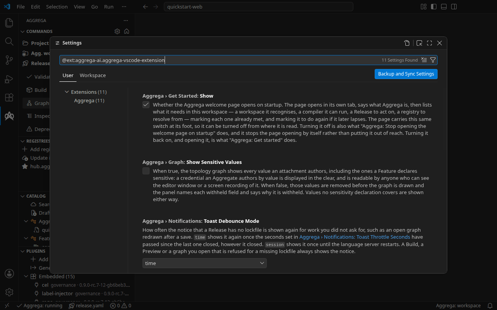

# Settings

**The cog at the top right of the Commands panel opens them** — it is the editor's own settings
page, narrowed to this extension, and it is the only settings surface there is. Everything below is
also reachable from the ordinary Settings editor and from your settings file.

**Every one of these settings is yours, not the project's.** Each describes your own environment or
your own reading habits — where your binary is, how long to wait before revalidating, how many
respawns to tolerate, whether to show values that would be readable over your shoulder, how you want
a panel drawn — so each is confined to your user settings, and to your remote settings when you are
working on a remote or containerised host. That last part matters for the binary path in particular:
the compiler runs on whichever host the extension does, so the path can differ between your laptop
and a container, and each host keeps its own value.

The consequence is deliberate: **a repository cannot pin any of these for whoever opens it.** Writing
one into a workspace `.vscode/settings.json` has no effect — the editor marks it as not applicable
there and goes on using your value. If you want a choice recorded in the workspace itself, the two
Release commands under [Selecting a Release](releases.md#selecting-a-release) are the ones that do that, and
they write `.aggrega/active-release` or `.aggrega-config.yaml` rather than an editor setting.

| Setting | Default | Purpose |
|---------|---------|---------|
| `aggrega.getStarted.show` | `true` | Whether the [welcome page](welcome-page.md) opens on startup. Three surfaces move this one setting and stay in step: the checkbox at the page's own foot, **Aggrega: Stop opening the welcome page on startup**, and **Aggrega: Get started**. Turning it off stops the page opening rather than removing it; turning it back on with **Aggrega: Get started** also opens it. |
| `aggrega.server.binaryPath` | `aggrega` | Path to the `aggrega` binary. A plain name is looked up on `PATH`; a path starting with `~/` (`~\` on Windows) or `${userHome}` is read from your home folder on the host the extension runs on; any other path is used as written. |
| `aggrega.server.debounceMs` | `300` | Debounce window for proactive validate-on-change. |
| `aggrega.server.respawnAttempts` | `5` | How many times, within the window below, the language server is started again after it stops without being asked to, before the extension leaves it stopped and raises the stopped-responding notification. A server started again that stops before it has answered counts the same as one that stops while running. See [Lifecycle](language-server.md#lifecycle). |
| `aggrega.server.respawnWindowSeconds` | `180` | Sliding window, in seconds, over which those restarts are counted. |
| `aggrega.server.restartGraceSeconds` | `5` | Grace window before the extension automatically restarts the language server after a `binaryPath` change. The status bar shows a countdown; the quick-action menu offers Restart now and Cancel restart. |
| `aggrega.server.buildOnInspect` | `false` | Run the artifact-rendering stage while inspecting a graph, so the advisories `aggrega build` raises while rendering also appear as editor problems. It adds none of the checks a build halts on. Inspecting costs more when it runs; nothing is written to disk. |
| `aggrega.graph.showSensitiveValues` | `false` | Show the values a Feature declares sensitive in the topology graph, displaying a by-value credential in the clear; while it is on, the graph request asks the language server for them. Left off, the language server withholds them from the graph it sends, and they are removed again before the graph is drawn. |
| `aggrega.operations.layout` | `buttons` | How the Commands panel draws its groups — `buttons` puts every operation in one wrapping flow of buttons with nothing drawn between one group and the next, `sections` makes each group a section you open under its own title. Same groups, same operations, same order either way. |
| `aggrega.notifications.toastDebounceMode` | `time` | How often the notice that a Release has no lockfile is shown again for work you did not ask for, such as an open graph redrawn after a save: `time` shows it again once `toastThrottleSeconds` have passed since the last one closed, `session` shows it once until the language server restarts. A Build, a Preview or a graph you open that is refused for a missing lockfile always shows the notice. |
| `aggrega.notifications.toastThrottleSeconds` | `300` | Seconds after the missing-lockfile notice closes before it is shown again for work you did not ask for. Read only when `toastDebounceMode` is `time`. |
