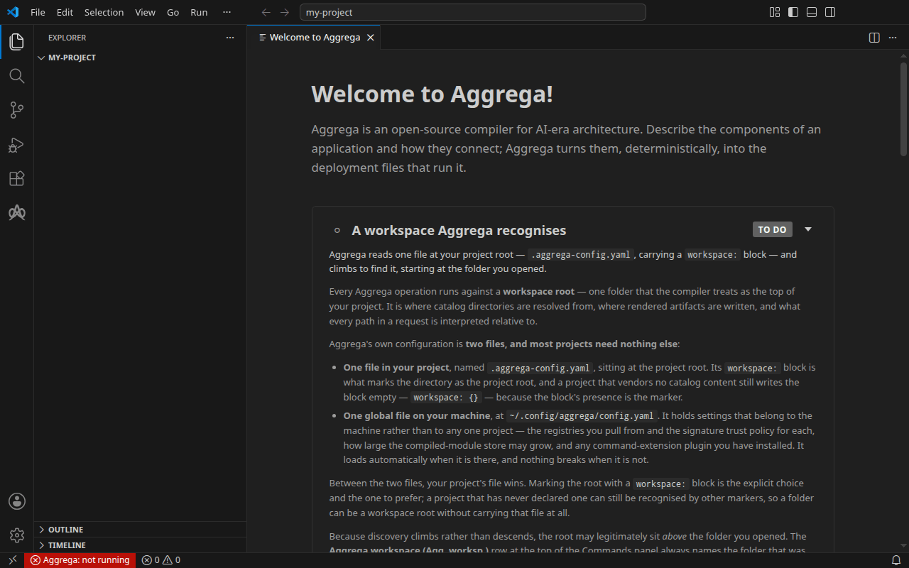
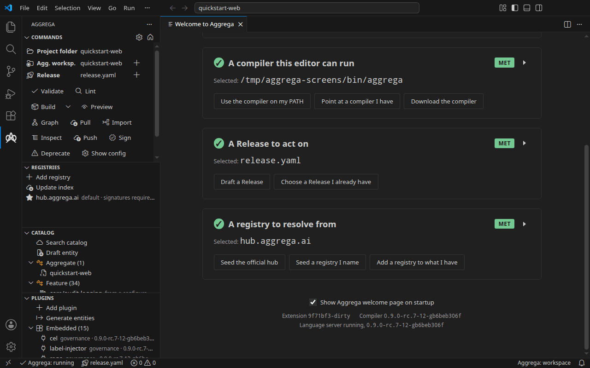

# The welcome page

**Welcome page** — Aggrega's own page in its own editor tab, saying what Aggrega is and then listing what the extension needs in this workspace, marking each condition **Met** or **To do**. Each step offers a way to create the thing and a way to point at one you already have, explains the condition, and a step already met asks you nothing. A step marked **Met** goes back to **To do** if its condition lapses. A step already met opens folded, so the page opens on the work that remains. Each step also shows what it currently stands at — the workspace root, the compiler, the Release, the registries — set larger and heavier than the guidance, introduced by **Selected:**, under the title when the step is folded and immediately above the buttons when it is open, and saying so in words where you have not chosen yet — **None selected.** where there is something to choose, **None available.** where there is nothing to choose from at all. Its foot carries the checkbox that decides whether it opens on startup, the same switch the settings screen holds, below that the versions of the extension and of the compiler you are running, and last whether the language server is running and which version it reports. A house icon in the Commands panel title bar opens it again at any time. It costs the Aggrega view no space.

**Welcome to Aggrega!** opens in its own editor tab. It says what Aggrega is, then lists what the
extension needs in the workspace you have open:

1. **A workspace Aggrega recognises** — the discovery described under [Prerequisites](install.md#prerequisites).
2. **A compiler this editor can run** — the `aggrega` binary named in `aggrega.server.binaryPath`.
3. **A Release to act on** — building, previewing and the topology graph each act on one Release.
4. **A registry to resolve from** — pulling dependencies and searching the published catalog resolve
   against the registries your configuration names.

Each step explains what the condition is for and how the editor reaches it, so the page is somewhere
to read about the product rather than only a checklist.

**Each step offers more than one way through, and one of them is always "I already have this."** You
can create a workspace configuration or point the editor at a folder that already carries one; use
the compiler on your `PATH`, select a build you have somewhere else, or download one; draft a Release or choose one
of yours; seed the official hub, name your own registry, or add one to a configuration you already
have. Nothing here is a dead end that hands you a file dialog and leaves the step still to do.

**A step you have already met is checked off and asks you nothing.** The page reads what is true
rather than putting the same questions to everybody, so if you built your configuration from the
command line and then opened the editor, every step arrives ticked.

**Every step folds, and the page opens showing what is still needed.** A caret at the top right of
each step opens and closes it. A step whose condition is already satisfied opens folded away, and one
that is not opens with its explanation in front of you — so the reading is about the work you still
have rather than the work you have done. **A folded step keeps its title and every one of its
buttons**, and hides only the explanation: once you know what a step is for, you can still act on it
without reading it again.

The arrangement is decided when the page is created and is yours after that. A step that becomes
satisfied while you are reading it updates its mark and **stays open** — it does not fold away under
your cursor — and a caret you press stays where you put it, however many times the page refreshes
around it. Closing and reopening the page reads the conditions again and arranges itself afresh. So
does the page drawn in place of one you had open when your editor restarts its extensions — as it does
when a folder is added to a window open on one folder: the page you had is closed and a new one drawn
in the same group of tabs, whether or not the page is set to open on startup, so the window goes on
holding one page and that page follows the workspace you are in.

**Each step also shows what it currently stands at**, so the page answers *which one* and not only
*whether*: the workspace root, the compiler, the Release and the registries the configuration
declares. The value is set larger and heavier than the explanation around it, because a value drawn
in the same weight as a wall of text is one you have to hunt for. A folded step shows it under the
title, so you can confirm your selection without unfolding anything; an open one shows it at the foot
of the explanation, immediately above the buttons, where it is the last thing read before you act.
A chosen value is introduced by **Selected:**, set smaller and lighter than the value itself so the
label points at the value rather than competing with it.

**Where you have not chosen yet, the step says so in words rather than leaving a blank line**, which
would read as the page having failed to draw — and it distinguishes two states a reader acts on
differently. **None selected.** means there is something to choose and you are on none of it.
**None available.** means there is nothing here to choose from at all, so pressing the step's
"I already have one" could only show you an empty list and what you want is its other way through.
Only the two steps that offer a list can read **None available.** — the workspace and the Release.
A compiler is named and a registry is registered outright, so neither of those steps has a list that
could be empty. The registry step keeps a third reading, **Not read yet.**, for when the compiler
could not be asked: telling you that you have configured none when nothing was able to answer would
say more than the page knows.

**A step's mark follows its condition in both directions.** Each step carries its standing in words
beside the mark — **Met** or **To do** — because the mark itself is a glyph and a glyph alone leaves
its meaning to be guessed at. A step reads **Met** when its condition becomes true and **To do**
again if the condition later lapses — a compiler that stops
answering, a Release that is deselected. The page reads what is true each time it refreshes rather
than remembering what was once true, so it never reports something you have since lost. Where a lapse
matters it is also reported where you are already looking: the status bar carries a compiler that has
stopped answering, and the **Project folder**, **Aggrega workspace** and **Release** rows at the top
of the Commands panel name the current selection.

It is an ordinary editor tab rather than a dialog on purpose: every step asks you to point at
something in your own workspace, and a dialog would be covering the files that hold the answers. It
sits in the editor area rather than in the Aggrega view, so it costs the sidebar no space and can say
what the product is — which a narrow column has no room for. It is Aggrega's own tab, reached and
closed on its own terms, and it offers no route into the editor's own welcome page.

**The page carries that decision at its foot, centred, and the Command Palette carries it too.**
Both move the one setting, `aggrega.getStarted.show`, written to your own settings — never into the
repository, so your choice does not travel to whoever else opens it. The control at the foot is a
checkbox reading **Show Aggrega welcome page on startup**, ticked while the page opens on startup —
so it reports the setting as it stands rather than offering you the act that would change it. Turn it
off in the settings screen and the checkbox follows; press the checkbox and the settings screen
follows. It is one switch in two places rather than two switches. The checkbox keeps the keyboard focus
when it is pressed, so Space ticks and unticks it in turn.

Turning it off stops the page opening on startup rather than putting it out of reach, and it is not
a one-way door: **Aggrega: Get started** in the Command Palette turns it back on and opens it, and
**Aggrega: Stop opening the welcome page on startup** is the palette's own way to the same setting.

**The Commands panel carries a way back to the page, beside the cog.** It is the house icon at the
top right, and its tooltip reads **Open the welcome page** — so getting back to the page is something
you find by looking at the Aggrega view rather than something you have to know to type. It opens the
page and leaves your startup setting exactly where you put it: looking at the page again does not
turn it back on. The palette command is what does that, because turning it back on is a decision
rather than a glance.

**The page reports what you are running, at its foot.** Two version readings sit there: **Extension**, which
build of this extension your editor has loaded, and **Compiler**, what the `aggrega` binary the
language server is running says about itself. The Extension reading is recorded when the extension is
built, from the state of its source at that moment, in the same form the compiler's own build uses
for its version — so a development window, an installed copy and a copy packaged from an edited tree
each say which one they are:

- a release tag alone, such as `0.2.0`, means the build is exactly that release;
- a tag followed by a count and a commit, such as `0.2.0-3-g1a2b3c4`, means a build from commit
  `1a2b3c4`, three commits after that release — and a commit alone, such as `1a2b3c4`, means a build
  from that commit where no release precedes it;
- a `-dirty` suffix on any of these means the build was made from a copy of the source carrying
  changes that had not been committed;
- `dev` means the build was made where the source's history could not be read.

Neither reading is written into the page — both are read when the page is drawn, so a development
build reports itself as one rather than showing nothing, and restarting onto a different compiler
moves the reading. Where a reading cannot be taken — the extension was built without recording which
build it is, nothing is running to ask, or what is running did not answer — the label stays and says
the version was not reported, so an absent reading is never mistaken for one you failed to notice.

**The page's last line says whether the language server is running, and which build it is.** It reads
**Language server running**, **starting**, **not running** or **failed to start**, in the words the
status bar and the notifications use; **failed to start** means the most recent attempt to start it
failed and none has run since. The Aggrega output channel says why, and so does the notification raised
when the first start or a restart fails. While the server runs, the line adds the version the running
server reported about itself when the extension connected to it, written the way the **Compiler**
reading writes a version. The **Compiler** reading above it is a different fact: it is what the binary
the server was started from says when asked, and the two differ when the file at that path is replaced
while the server started from it goes on running, so the page shows both. A language server that
reports no version of its own reads **version not reported** there, rather than borrowing the binary's.
The line and the two readings above it follow the server as it starts, stops, restarts or fails,
without the page being reopened; the steps keep their marks through a restart.
