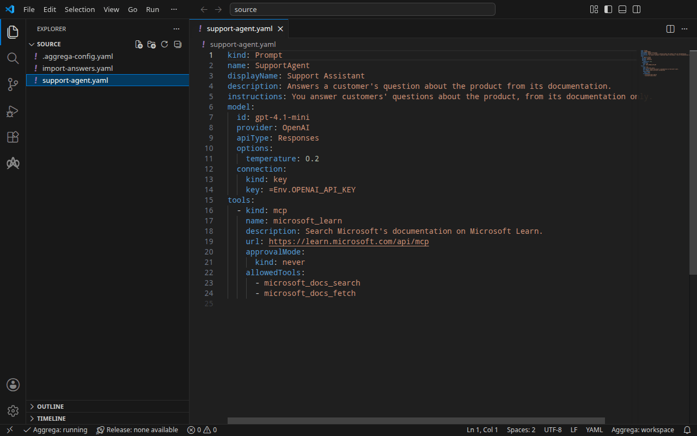
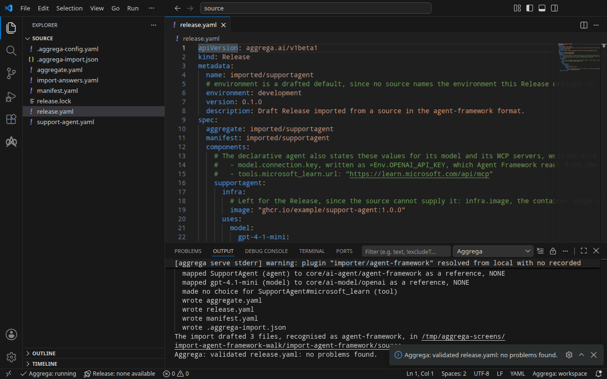
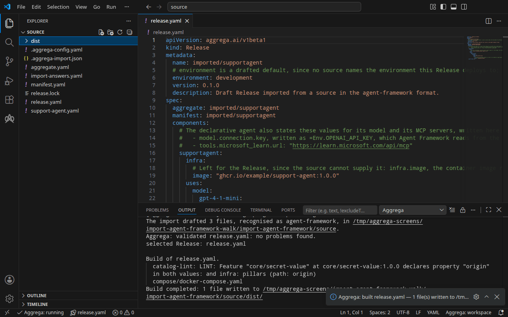

# Import a Microsoft Agent Framework declarative agent

This walkthrough imports a declarative agent of Microsoft Agent Framework — an
assistant answering questions from documentation it searches through an MCP
server — and builds the application for Docker Compose. The import drafts every
file the build reads: the agent and its model, the key the agent presents to
the model as a variable reference, and the realizations of each. It asks once
for the one value no declarative agent holds, the image your application runs
in. Every file and every block of output below comes from a real run; the
declarative agent and each stage of the walkthrough are in the
[import-agent-framework](../../language-reference/examples/import-agent-framework/README.md)
example, where a check script runs the import again, compares what it writes,
what it prints and the blocks this page quotes with the files kept there, and
validates and builds what the import wrote.

## Scaffold the example

You can run this import with the commands on this page, or
[have your AI assistant run it for you](#with-an-ai-assistant).

Write the example into a new folder named after it:

```bash
aggrega scaffold --example import-agent-framework
```

It then prints the commands to run next. The first changes into the new folder;
the one after it, below, changes into its `source` folder, which holds what this
page imports and is where the import runs:

```bash
cd import-agent-framework
```



## The project

An application built on Agent Framework can load an agent from a declarative
agent: a YAML document of kind `Prompt` naming the agent's model, its
instructions and its tools. This one, written for this walkthrough, names
OpenAI's `gpt-4.1-mini` and the MCP server Microsoft Learn publishes:

<!-- quotes: source/support-agent.yaml -->
```yaml
kind: Prompt
name: SupportAgent
displayName: Support Assistant
description: Answers a customer's question about the product from its documentation.
instructions: You answer customers' questions about the product, from its documentation only.
model:
  id: gpt-4.1-mini
  provider: OpenAI
  apiType: Responses
  options:
    temperature: 0.2
  connection:
    kind: key
    key: =Env.OPENAI_API_KEY
tools:
  - kind: mcp
    name: microsoft_learn
    description: Search Microsoft's documentation on Microsoft Learn.
    url: https://learn.microsoft.com/api/mcp
    approvalMode:
      kind: never
    allowedTools:
      - microsoft_docs_search
      - microsoft_docs_fetch
```

The model's key is written as `=Env.OPENAI_API_KEY`, so the file holds no key.
Agent Framework reads that expression from the environment variable
`OPENAI_API_KEY` only where the application loads the declarative agent with
`AgentFactory(safe_mode=False)`, Agent Framework's own security setting, and a
.NET runtime is present; otherwise the key is the expression's text as
written. The application's code, which loads the declarative agent, is never
read by the import, and is not part of the example. Beside the file, an
`.aggrega-config.yaml` makes the folder a workspace:

<!-- quotes: source/.aggrega-config.yaml -->
```yaml
# The workspace key marks this directory as the workspace root, so an import run
# here writes its drafts beside support-agent.yaml.
workspace: {}
# The registry the importer is fetched from the first time an import needs it.
default_registry: hub.aggrega.ai
```

The import references the catalog's Agent Framework agent and OpenAI model
Components, and `--target` drafts a Manifest from its Recipes. The workspace
names no catalog folder, so the import reads the standard-library catalog from
the registry it fetches its importer from: a signed snapshot of the published
catalog, fetched, verified and kept in the workspace's content cache by the
first import, and named by its digest in the record the import writes beside its
drafts. A workspace that names its own catalog folders — in
`AGGREGA_CATALOG_DIRS`, or under `workspace.catalog_dirs` — imports against
those instead.

### What the import asks for

A declarative agent names its model, never the image the application runs in:
you build that image from your project. The catalog holds no default image for
an application built on Agent Framework, so the import asks for it. Run at a
terminal with no answer at hand, it asks:

```text
The drafts leave values empty that the source cannot hold. Answer each one, or press Enter to leave it for later in the answers file:

release.yaml spec.components.supportagent.infra.image
  Container image running the application built on Microsoft Agent Framework.
>
```

and writes the answer into the drafts and into `import-answers.yaml`, beside
`support-agent.yaml`, so the next import reads it from there and asks nothing.
With no terminal — in continuous integration, or through a pipe — it asks
nothing: it writes the file with the key empty, and stops, naming the file.
The example holds the file already, with the image answered,
`ghcr.io/example/support-agent:1.0.0`, which stands for the image you build:

<!-- quotes: source/import-answers.yaml -->
```yaml
# Values the import could not draft from the source, keyed by the drafted file and the key path inside
# it. Write each one beside its key; an import of the same source, and a sync, read them from here and
# ask nothing. A secret is never written here: its key asks where the secret comes from — a variable
# name, ${NAME}, or the name of a Kubernetes Secret.
release.yaml:
  # Container image running the application built on Microsoft Agent Framework.
  spec.components.supportagent.infra.image: "ghcr.io/example/support-agent:1.0.0"
  # The origin of the secret value, written by the operator in the Release. Read exactly as
  # values.origin is. Write it here or in values.origin, never in both. A secret: name where it comes
  # from, never the value.
  spec.components.supportagent.uses.model.gpt-4-1-mini.features.credential.infra.origin: "openai-api-key"
```

The second answer is for a build for Kubernetes, with `--target helm`: there
the agent reads the OpenAI key from a Kubernetes Secret, and the answer is the
Secret's name, `openai-api-key`, never the key. A build for Docker Compose
reads the key from your shell instead, so this import does not use that
answer. [The import answers file](../../language-reference/import-answers.md)
describes the file, the questions and the rules for a secret's answer.

[`aggrega import`](../../language-reference/cli/aggrega-import.md) lists
every flag the command takes, `--answers`, which names an answers file kept
elsewhere, among them.

Change into `source`:

```bash
cd source
```

## Run the import

Name the declarative agent's file. The import reads each declarative agent as a
file of its own and never a directory:

<!-- quotes: import-command -->
```bash
aggrega import support-agent.yaml --target compose
```

On standard output it lists what it wrote:

<!-- quotes: draft/stdout.txt -->
```text
wrote aggregate.yaml
wrote release.yaml
wrote manifest.yaml
wrote .aggrega-import.json
```

On standard error, with `<workspace>` standing for the folder you ran it in:

<!-- quotes: draft/import.txt -->
```text
[… omitted: a warning that the importer runs unverified, printed where its module is read from beside its Plugin entity in a catalog folder rather than fetched]
read as the agent-framework format, with drafted paths relative to <workspace>
warn: the value of tools.microsoft_learn.url of node SupportAgent is carried as written in the Release the draft writes: the field belongs to an MCP server's configuration, which can carry a key, and setting empty_credentials to marked or all writes it empty
info: the answers file <workspace>/import-answers.yaml also answers spec.components.supportagent.uses.model.gpt-4-1-mini.features.credential.infra.origin in release.yaml, which these drafts do not leave empty; those answers are kept there and not applied
mapped SupportAgent (agent) to core/ai-agent/agent-framework as a reference, NONE
mapped gpt-4.1-mini (model) to core/ai-model/openai as a reference, NONE
made no choice for SupportAgent#microsoft_learn (tool)
Pull complete: <workspace>/release.lock (entities=8, source_artifacts=0, external_inputs=0)
```


- **The `warn` line** names a value that can carry a key — an MCP server's
  address — and says it is carried as written. This address carries none.
- **The `info` line** names the answer the Docker Compose drafts do not use,
  kept in the answers file for a build for Kubernetes.
- **The `mapped` lines** say that the agent is an instance of the standard
  library's Agent Framework agent, `core/ai-agent/agent-framework`, and its
  model an instance of `core/ai-model/openai`. Their tier reads `NONE`: the
  Agent Framework import references these Components by what the declarative
  agent names rather than by weighing each against the catalog.
- **The `made no choice` line** is the MCP server, which the import drafts as
  no Component, for the reason the comments in `aggregate.yaml` give.
- **The `Pull complete` line** is the import fetching what the drafted Release
  depends on, as [`aggrega pull`](../../language-reference/cli/aggrega-pull.md)
  does, into `release.lock`, so the drafts validate and build at once. Under
  `--offline` the import pulls nothing and names the `aggrega pull` to run.

## What it writes

The Aggregate, the Release and the Manifest are named `imported/supportagent`,
after the agent's `name`, `SupportAgent`, reduced to `supportagent` — its
`displayName` is not read — under the namespace the importer's
`target_namespace` setting sets, `imported` unless you set another
([Settings](../../language-reference/plugins/core-importers.md#settings)).

`aggregate.yaml` — the agent, wired to its model with the key it presents
declared on the connection, and the model:

<!-- quotes: draft/aggregate.yaml -->
```yaml
# Not read: the application's code, which loads each declarative agent and binds the functions of its function tools; the application runs in the image the Release names for each instance, and loads its declarative agents itself.
apiVersion: aggrega.ai/v1beta1
kind: Aggregate
metadata:
  name: imported/supportagent
  version: 0.1.0
  description: Draft Aggregate imported from a source in the agent-framework format.
spec:
  components:
    # The declarative agent SupportAgent.
    # Read by the application from the declarative agent, and taken by no key of core/ai-agent/agent-framework: instructions, the options of its model requests (temperature).
    # The MCP server microsoft_learn, drafted as no Component and no connection, since Agent Framework sends it to the model's provider as a hosted tool, and the provider, not the application, reaches it at its url, which must therefore be reachable from the provider; its url is written above supportagent's entry in the Release.
    # Stated by the declarative agent for microsoft_learn: its description, "Search Microsoft's documentation on Microsoft Learn."; its approval mode, never; the tools of the server it allows, microsoft_docs_search, microsoft_docs_fetch.
    supportagent:
      type: core/ai-agent/agent-framework
      values:
        display_name: "Support Assistant"
        description: "Answers a customer's question about the product from its documentation."
      uses:
        model:
          gpt-4-1-mini:
            target: gpt-4-1-mini
            # For the compose target, the lines below declare credential on gpt-4-1-mini: a secret the Release alone attaches arrives under the key value, so each is declared with a key of its own and no two arrive under one; the Release attaches its origin, naming this type or none.
            features:
              credential:
                type: core/secret-value
                values:
                  key: OPENAI_API_KEY
    # The model gpt-4.1-mini, which SupportAgent names with the OpenAI provider.
    gpt-4-1-mini:
      type: core/ai-model/openai
      values:
        model: "gpt-4.1-mini"
```

The MCP server is no Component and no connection of the agent: Agent Framework
sends it to the model's provider as a hosted tool, and the provider, not the
application, reaches it at its `url`, which must therefore be reachable from
the provider. The instructions, the options of the model's requests, and the
server's description, approval mode and allowed tools stay in the declarative
agent, which the application reads; the comments name each. OpenAI's API is a
hosted service, so the agent's Component refuses a connection to it that
carries no credential; the connection declares one, under the key
`OPENAI_API_KEY`, the variable the declarative agent reads its key from.

`release.yaml` — the environment, the image, and where the key comes from:

<!-- quotes: draft/release.yaml -->
```yaml
apiVersion: aggrega.ai/v1beta1
kind: Release
metadata:
  name: imported/supportagent
  # environment is a drafted default, since no source names the environment this Release deploys to; change it to name the one it deploys to.
  environment: development
  version: 0.1.0
  description: Draft Release imported from a source in the agent-framework format.
spec:
  aggregate: imported/supportagent
  manifest: imported/supportagent
  components:
    # The declarative agent also states these values for its model and its MCP servers, written here for review:
    #   - model.connection.key, written as =Env.OPENAI_API_KEY, which Agent Framework reads from the environment variable OPENAI_API_KEY only where the application loads the declarative agent with AgentFactory(safe_mode=False), Agent Framework's own security setting, and a .NET runtime is present; otherwise the value is the expression's text as written
    #   - tools.microsoft_learn.url: "https://learn.microsoft.com/api/mcp"
    supportagent:
      infra:
        # Left for the Release, since the source cannot supply it: infra.image, the container image running the application built on Agent Framework, holding its declarative agent
        image: "ghcr.io/example/support-agent:1.0.0"
      uses:
        model:
          gpt-4-1-mini:
            features:
              credential:
                type: core/secret-value
                infra:
                  # Attached by reference, never as a value: the credential supportagent presents to gpt-4-1-mini on its model connection, read from the variable OPENAI_API_KEY, which a target substituting variable references, as Docker Compose does when the stack starts, reads from the environment, so no file carries the value.
                  origin: "${OPENAI_API_KEY}"
    gpt-4-1-mini: {}
```

The environment, `development`, is a default the import writes because no
declarative agent names one; change it where the Release deploys elsewhere.
The image is the answer the import read from `import-answers.yaml`. The key is
the variable reference `${OPENAI_API_KEY}`, named after the variable the
declarative agent reads, never a value. The MCP server's address is written as
the declarative agent states it, for review, and set nowhere else: Agent
Framework hands it to the provider in its request to the model.

`manifest.yaml` — the Compose Recipe of the agent and of the model, and the
realization that writes the key's variable reference into the Compose file as
written:

<!-- quotes: draft/manifest.yaml -->
```yaml
apiVersion: aggrega.ai/v1beta1
kind: Manifest
metadata:
  name: imported/supportagent
  version: 0.1.0
spec:
  mappings:
    components:
      type:
        core/ai-agent/agent-framework: compose/agent-framework
        core/ai-model/openai: compose/openai
    features:
      type:
        core/secret-value: compose/dotenv-secret
```

`release.lock` records the catalog entities the Release resolved to, by
digest, and `.aggrega-import.json` is the record of what the import wrote,
which a later `aggrega import --sync` reads.

## Validate and build

```bash
aggrega validate --release release.yaml
aggrega build --release release.yaml
```





The validation prints:

```text
  notice: LINT: Feature "core/secret-value" at core/secret-value:1.0.0 declares property "origin" in both values: and infra: pillars (path: origin)
release dependency validation passed: release.yaml (schema-pillar + dependency pillars)
```

and the build, with `<workspace>` standing for the folder you ran it in:

```text
  notice: LINT: Feature "core/secret-value" at core/secret-value:1.0.0 declares property "origin" in both values: and infra: pillars (path: origin)
[… omitted: a total build time, which differs per run]
Build completed: 1 file written to <workspace>/dist
```

The `notice` line is advisory: the secret Feature accepts its `origin` from the
Aggregate's `values` or the Release's `infra`, and the notice reports that one
leaf is declared in both. It changes no verdict.

The agent's service in `dist/compose/docker-compose.yaml`:

```yaml
services:
  supportagent:
    image: ghcr.io/example/support-agent:1.0.0
    environment:
      OPENAI_BASE_URL: https://api.openai.com/v1
      OPENAI_MODEL: gpt-4.1-mini
      OPENAI_API_KEY: ${OPENAI_API_KEY}
    [… omitted: the labels the build writes on every service, naming the Aggregate, the component, the environment and the compiler's version]
    networks:
      - compose
```

The application receives the model's address, its name and its key in the
variables Agent Framework's OpenAI clients read, so the declarative agent's
`=Env.OPENAI_API_KEY` reads the key the Release attached where the application
loads it as [The project](#the-project) describes. No variable carries the MCP
server's address, which the provider reaches. The model gets no service of its
own: the agent reaches the OpenAI API at its own address. The key is a variable
reference, filled from your shell when the stack starts. The service publishes
no port on your machine: the rendered file gives it none.

## With an AI assistant

An AI assistant [set up with Aggrega's tools](../../ai-assistants/set-up.md)
can do the same: paste this prompt into it.

<!-- copyable -->

> Use the Aggrega tools only, and create no folder yourself. If the Workspace folder holds no `import-agent-framework` folder yet, call the `scaffold` tool once with `example` set to `import-agent-framework` and no `dir`: it writes the example into a new `import-agent-framework` folder, whose `source` folder holds what this page imports. Then call the `import` tool with `workspace_root` set to `import-agent-framework/source`, `source` set to `support-agent.yaml` and `target` set to `compose`: it reads the answers it needs from `import-answers.yaml` beside `support-agent.yaml`, writes its drafts into `import-agent-framework/source` and pulls what they need. Then call the `validate` tool with `workspace_root` set to `import-agent-framework/source` and `release` set to `release.yaml`, and the `build` tool with `workspace_root` set to `import-agent-framework/source`, `release` set to `release.yaml` and `write` set to true. Tell me which files the build wrote; they are under `import-agent-framework/source/dist/`.

## Open it in VS Code

With the
[Aggrega extension for Visual Studio Code](../editor/install.md#installing-the-extension)
installed, open the folder `import-agent-framework/source` in VS Code, where
the import wrote its drafts. The folder holds one Release, the drafted
`release.yaml`, so the editor selects it for you, and it checks the drafts
against that Release as you edit them, marking what it finds in the file and in
the Problems panel. **Aggrega: Show topology graph**, in the Command Palette,
draws the Release's components and the connections between them.
**Aggrega: Build**, **Aggrega: Preview build** and **Aggrega: Pull** act on the
same Release, and each is also a button on the **Commands** panel of the
**Aggrega** view in the activity bar; Build writes its files into the folder's
`dist/`. [Use Aggrega in Visual Studio Code](../editor/README.md) covers the rest.

## Run it

You build the image from the project, with a Dockerfile of your own: the
application's code, with Agent Framework installed and the declarative agent
inside. Docker Compose runs the image's own command as the agent's service,
since the Recipe sets none, so that command must keep running, and must serve
requests if you want to reach the agent. Your program decides the address, the
route and the reply.

The run below used such an image: Python with Agent Framework's
`agent-framework-core`, `agent-framework-openai` and
`agent-framework-declarative` packages, a .NET runtime — the image set
`DOTNET_ROOT` to its directory and `DOTNET_SYSTEM_GLOBALIZATION_INVARIANT=1` —
`support-agent.yaml`, and, as the image's command, a small HTTP server of the
program's own on port 8000. The server loads the declarative agent with
`AgentFactory(safe_mode=False)`, so its `=Env.OPENAI_API_KEY` reads the key the
build delivers, and runs the agent once for each `POST /ask`. Build your image
at the project's root, write its name in place of
`ghcr.io/example/support-agent:1.0.0` in `import-answers.yaml`, and import
again with `--sync`, which writes the new answer into the drafts and pulls
again; then build:

```bash
docker build -t docs-assistant:local .
aggrega import support-agent.yaml --sync
aggrega build --release release.yaml
```

With `docs-assistant:local` as the answer, the sync names the one value it
changed, among the lines it prints:

```text
changed spec.components.supportagent.infra.image in release.yaml
```

Then set the key in your shell and start the stack:

```bash
export OPENAI_API_KEY='your OpenAI key'
docker compose -p docs-assistant -f dist/compose/docker-compose.yaml up -d --wait
```

`-p` names the project, as the run step of
[How an import runs](README.md#how-an-import-runs) explains.

## Test it

The request below reaches the program this walkthrough's image runs: the
declarative agent behind a small HTTP server on port 8000, answering
`POST /ask`. Your own program decides its own address, route and reply. The
service publishes no port and the image carries no HTTP client, so the request
comes from a container started on the stack's network, `docs-assistant_compose`.
Send it once the program listens, a few seconds after the stack starts:

```bash
docker run --rm --network docs-assistant_compose curlimages/curl:8.11.1 -sS -X POST \
  http://supportagent:8000/ask -H 'Content-Type: application/json' \
  -d '{"question": "In one short sentence: what is Azure Container Apps?"}'
```

```text
{"error": "the agent failed: ChatClientException: (\"<class 'agent_framework_openai._chat_client.OpenAIChatClient'> service failed to complete the prompt: Error code: 401 - Incorrect API key provided: sk-place************-key. [… omitted: where to find an API key, and the same error repeated as the exception it wraps]"}
```

The run set `OPENAI_API_KEY` to a placeholder, so the reply is OpenAI's
refusal of it, passed on by the program. The key OpenAI refused is that
placeholder, shown masked, so the declarative agent's `=Env.OPENAI_API_KEY`
read it from the environment the build delivers.

Stop the stack with:

```bash
docker compose -p docs-assistant -f dist/compose/docker-compose.yaml down
```

On Kubernetes, import with `--target helm` and push the image to a registry
your cluster pulls from, naming it in `import-answers.yaml`. Then create the
Secret `openai-api-key` and apply the build, as the run step of
[How an import runs](README.md#how-an-import-runs) describes. The agent's
Deployment has no Service, so forward a local port to it. The command runs
until you stop it:

```bash
kubectl port-forward deploy/supportagent 8000:8000
```

```text
Forwarding from 127.0.0.1:8000 -> 8000
Forwarding from [::1]:8000 -> 8000
```

From another terminal, send the same request to the forwarded port:

```bash
curl -sS -X POST http://127.0.0.1:8000/ask -H 'Content-Type: application/json' \
  -d '{"question": "In one short sentence: what is Azure Container Apps?"}'
```

```text
{"error": "the agent failed: ChatClientException: (\"<class 'agent_framework_openai._chat_client.OpenAIChatClient'> service failed to complete the prompt: Error code: 401 - Incorrect API key provided: sk-place************-key. [… omitted: where to find an API key, and the same error repeated as the exception it wraps]"}
```
