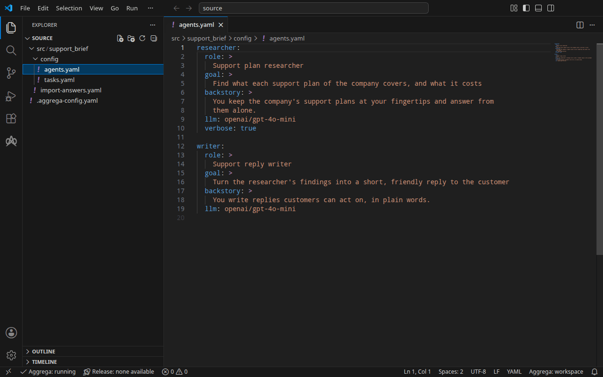
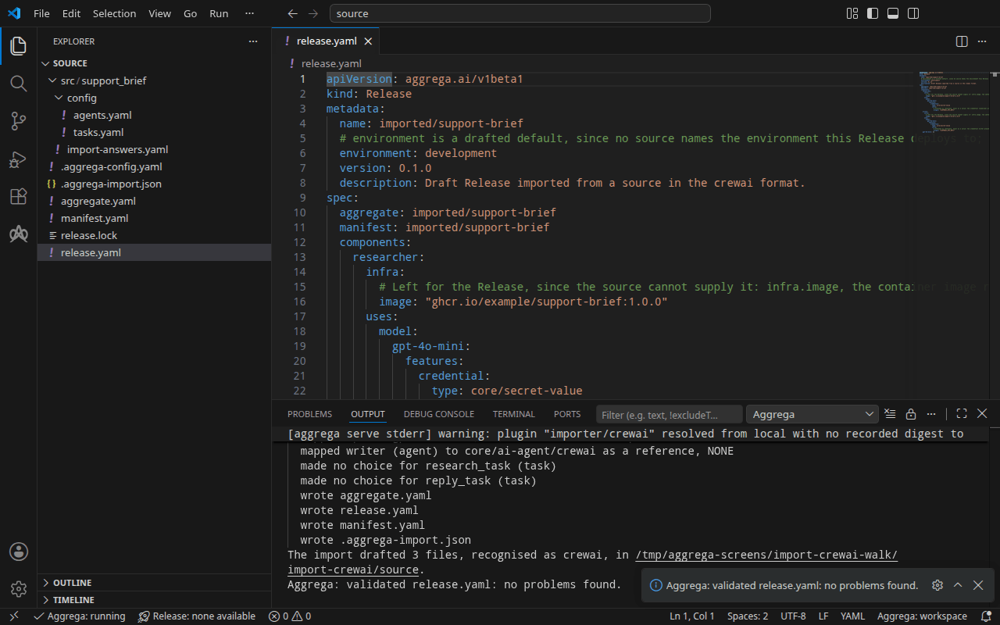
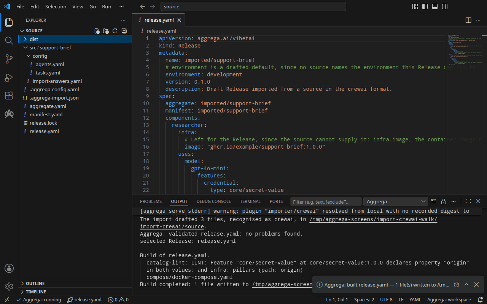

# Import a CrewAI project

This walkthrough imports the agent and task declarations of a CrewAI project —
a crew of two agents answering a customer's question about support plans — and
builds the crew for Docker Compose. The import drafts every file the build
reads: both agents and their model, the key each presents to the model as a
variable reference, and the realizations of each. It asks once for the one
value no declaration holds, the image the crew's program runs in. Every file
and every block of output below comes from a real run; the declarations and
each stage of the walkthrough are in the
[import-crewai](../../language-reference/examples/import-crewai/README.md)
example, where a check script runs the import again, compares what it writes,
what it prints and the blocks this page quotes with the files kept there, and
validates and builds what the import wrote.

## Draft the example

You can run this import with the commands on this page, or
[have your AI assistant run it for you](#with-an-ai-assistant).

Write the example into a new folder named after it:

```bash
aggrega draft --example import-crewai
```

It then prints the commands to run next. The first changes into the new folder;
the one after it, below, changes into its `source` folder, which holds what this
page imports and is where the import runs:

```bash
cd import-crewai
```



## The project

A CrewAI project keeps its crew's behaviour in a program and declares its
agents and its tasks in configuration files. This one, written for this
walkthrough, is in CrewAI's classic layout, and the import reads its two
declaration files, under
`src/support_brief/config/`. The program — a classic project's `crew.py`, the
tools it defines — is never read, so the example holds only the declarations.

`agents.yaml` declares the two agents, both on OpenAI's `gpt-4o-mini`:

<!-- quotes: source/src/support_brief/config/agents.yaml -->
```yaml
researcher:
  role: >
    Support plan researcher
  goal: >
    Find what each support plan of the company covers, and what it costs
  backstory: >
    You keep the company's support plans at your fingertips and answer from
    them alone.
  llm: openai/gpt-4o-mini
  verbose: true

writer:
  role: >
    Support reply writer
  goal: >
    Turn the researcher's findings into a short, friendly reply to the customer
  backstory: >
    You write replies customers can act on, in plain words.
  llm: openai/gpt-4o-mini
```

`tasks.yaml` assigns one task to each:

<!-- quotes: source/src/support_brief/config/tasks.yaml -->
```yaml
research_task:
  description: >
    Find the support plans that answer the customer's question: {question}
  expected_output: >
    The plans that apply, each with what it covers and what it costs
  agent: researcher

reply_task:
  description: >
    Write a reply to the customer's question from the researcher's findings
  expected_output: >
    A reply of at most five sentences
  agent: writer
```

At the project's root, an `.aggrega-config.yaml` makes the folder a workspace:

<!-- quotes: source/.aggrega-config.yaml -->
```yaml
# The workspace key marks this directory as the workspace root, so an import run
# here writes its drafts beside src/.
workspace: {}
# The registry the importer is fetched from the first time an import needs it.
default_registry: hub.aggrega.ai
```

The import references the catalog's agent and model Components, and `--target`
drafts a Manifest from its Recipes. The workspace names no catalog folder, so
the import reads the standard-library catalog from the registry it fetches its
importer from: a signed snapshot of the published catalog, fetched, verified and
kept in the workspace's content cache by the first import, and named by its
digest in the record the import writes beside its drafts. A workspace that names
its own catalog folders — in `AGGREGA_CATALOG_DIRS`, or under
`workspace.catalog_dirs` — imports against those instead.

### What the import asks for

The declarations name each agent's model, never the image the crew's program
runs in: you build that image from your project. So the import asks for it,
once for each agent. At a terminal it asks a question for each, and writes the
answers into the drafts and into the answers file, `import-answers.yaml`,
inside the directory it imports, `src/support_brief/`, so the next import reads
them from there and asks nothing. With no terminal — in continuous
integration, or through a pipe — it asks nothing: it writes the file with the
keys empty, and stops, naming the file. The example holds the file already, with
both agents on the same image, `ghcr.io/example/support-brief:1.0.0`, which
stands for the image you build:

<!-- quotes: source/src/support_brief/import-answers.yaml -->
```yaml
# Values the import could not draft from the source, keyed by the drafted file and the key path inside
# it. Write each one beside its key; an import of the same source, and a sync, read them from here and
# ask nothing. A secret is never written here: its key asks where the secret comes from — a variable
# name, ${NAME}, or the name of a Kubernetes Secret.
release.yaml:
  # Container image running the CrewAI application code.
  spec.components.researcher.infra.image: "ghcr.io/example/support-brief:1.0.0"
  # The origin of the secret value, written by the operator in the Release. Read exactly as
  # values.origin is. Write it here or in values.origin, never in both. A secret: name where it comes
  # from, never the value.
  spec.components.researcher.uses.model.gpt-4o-mini.features.credential.infra.origin: "openai-api-key"
  # Container image running the CrewAI application code.
  spec.components.writer.infra.image: "ghcr.io/example/support-brief:1.0.0"
  # The origin of the secret value, written by the operator in the Release. Read exactly as
  # values.origin is. Write it here or in values.origin, never in both. A secret: name where it comes
  # from, never the value.
  spec.components.writer.uses.model.gpt-4o-mini.features.credential.infra.origin: "openai-api-key"
```

The two `origin` answers are for a build for Kubernetes, with `--target helm`:
there each agent reads the OpenAI key from a Kubernetes Secret, and the answer
is the Secret's name, `openai-api-key`, never the key. A build for Docker
Compose reads the key from your shell instead, so this import does not use
those answers. [The import answers file](../../language-reference/import-answers.md)
describes the file, the questions and the rules for a secret's answer.

[`aggrega import`](../../language-reference/cli/aggrega-import.md) lists
every flag the command takes, `--answers`, which names an answers file kept
elsewhere, among them.

Change into `source`:

```bash
cd source
```

## Run the import

Name the crew's directory. The import reads the declarations in it and nothing
else:

<!-- quotes: import-command -->
```bash
aggrega import src/support_brief --target compose
```

On standard output it lists what it wrote:

<!-- quotes: draft/stdout.txt -->
```text
wrote aggregate.yaml
wrote release.yaml
wrote manifest.yaml
wrote .aggrega-import.json
```

On standard error, with `<workspace>` standing for the folder you ran it in:

<!-- quotes: draft/import.txt -->
```text
[… omitted: a warning that the importer runs unverified, printed where its module is read from beside its Plugin entity in a catalog folder rather than fetched]
read as the crewai format, with drafted paths relative to <workspace>
info: the answers file <workspace>/src/support_brief/import-answers.yaml also answers spec.components.researcher.uses.model.gpt-4o-mini.features.credential.infra.origin in release.yaml, spec.components.writer.uses.model.gpt-4o-mini.features.credential.infra.origin in release.yaml, which these drafts do not leave empty; those answers are kept there and not applied
mapped researcher (agent) to core/ai-agent/crewai as a reference, NONE
mapped openai/gpt-4o-mini (llm) to core/ai-model/openai as a reference, NONE
mapped writer (agent) to core/ai-agent/crewai as a reference, NONE
made no choice for research_task (task)
made no choice for reply_task (task)
Pull complete: <workspace>/release.lock (entities=8, source_artifacts=0, external_inputs=0)
```


- **The `info` line** names the answers the Docker Compose drafts do not use,
  kept in the answers file for a build for Kubernetes.
- **The `mapped` lines** say that each agent is an instance of the standard
  library's CrewAI agent, `core/ai-agent/crewai`, and that the model both name,
  `openai/gpt-4o-mini`, is an instance of `core/ai-model/openai`. Their tier
  reads `NONE`: the CrewAI import references these Components by what the
  declarations name, an agent and a model provider, rather than by weighing
  each against the catalog.
- **The `made no choice` lines** say that the tasks are drafted as nothing: a
  task is logic the crew's program runs.
- **The `Pull complete` line** is the import fetching what the drafted Release
  depends on, as [`aggrega pull`](../../language-reference/cli/aggrega-pull.md)
  does, into `release.lock`, so the drafts validate and build at once. Under
  `--offline` the import pulls nothing and names the `aggrega pull` to run.

## What it writes

The Aggregate, the Release and the Manifest are named `imported/support-brief`:
a project's `config/agents.yaml` and `config/tasks.yaml` name no crew — its name
lives in the program, which the import does not read — so a directory import of
them is named after the directory, `support_brief`, written as a name segment,
under the namespace the importer's `target_namespace` setting sets, `imported`
unless you set another
([Settings](../../language-reference/plugins/core-importers.md#settings)).

`aggregate.yaml` — one instance per agent, each wired to the model it names
with the key it presents declared on the connection, and the model, opening
with comments that say what was read and what was not:

<!-- quotes: draft/aggregate.yaml -->
```yaml
# CrewAI declarations read:
#   - config/agents.yaml
#   - config/tasks.yaml
# Not read: the crew's program, which runs its agents and its tasks and defines its tools; it runs in the image the Release names for each agent.
# Tasks the crew's program runs, drafted as no Component:
#   - research_task, assigned to researcher
#   - reply_task, assigned to writer
apiVersion: aggrega.ai/v1beta1
kind: Aggregate
metadata:
  name: imported/support-brief
  version: 0.1.0
  description: Draft Aggregate imported from a source in the crewai format.
spec:
  components:
    researcher:
      type: core/ai-agent/crewai
      values:
        role: "Support plan researcher\u000A"
        goal: "Find what each support plan of the company covers, and what it costs\u000A"
        backstory: "You keep the company's support plans at your fingertips and answer from them alone.\u000A"
        allow_delegation: false
        log_level: DEBUG
      uses:
        model:
          gpt-4o-mini:
            target: gpt-4o-mini
            # For the compose target, the lines below declare credential on gpt-4o-mini: a secret the Release alone attaches arrives under the key value, so each is declared with a key of its own and no two arrive under one; the Release attaches its origin, naming this type or none.
            features:
              credential:
                type: core/secret-value
                values:
                  key: OPENAI_API_KEY
    writer:
      type: core/ai-agent/crewai
      values:
        role: "Support reply writer\u000A"
        goal: "Turn the researcher's findings into a short, friendly reply to the customer\u000A"
        backstory: "You write replies customers can act on, in plain words.\u000A"
        allow_delegation: false
        log_level: INFO
      uses:
        model:
          gpt-4o-mini:
            target: gpt-4o-mini
            # For the compose target, the lines below declare credential on gpt-4o-mini: a secret the Release alone attaches arrives under the key value, so each is declared with a key of its own and no two arrive under one; the Release attaches its origin, naming this type or none.
            features:
              credential:
                type: core/secret-value
                values:
                  key: OPENAI_API_KEY
    # The model openai/gpt-4o-mini.
    gpt-4o-mini:
      type: core/ai-model/openai
      values:
        model: "gpt-4o-mini"
```

`role`, `goal` and `backstory` are carried as declared, the line break each
folded block ends with included. `log_level` is `DEBUG` for the researcher,
declared `verbose`, and `INFO` for the writer, which is not. An agent that
declares no `allow_delegation` is drafted with `false`. The model is a hosted
service, so the agent's Component refuses a connection to it that carries no
credential; each connection declares one, under the key `OPENAI_API_KEY`.

`release.yaml` — the environment, each agent's image and published port, and
where each key comes from:

<!-- quotes: draft/release.yaml -->
```yaml
apiVersion: aggrega.ai/v1beta1
kind: Release
metadata:
  name: imported/support-brief
  # environment is a drafted default, since no source names the environment this Release deploys to; change it to name the one it deploys to.
  environment: development
  version: 0.1.0
  description: Draft Release imported from a source in the crewai format.
spec:
  aggregate: imported/support-brief
  manifest: imported/support-brief
  components:
    researcher:
      infra:
        # Left for the Release, since the source cannot supply it: infra.image, the container image running the crew's program
        image: "ghcr.io/example/support-brief:1.0.0"
        # Published on this machine's loopback address, 127.0.0.1: reachable from this machine only, by any process running on it. Delete this line to keep the service internal.
        published_port: 8000
      uses:
        model:
          gpt-4o-mini:
            features:
              credential:
                type: core/secret-value
                infra:
                  # Attached by reference, never as a value: the credential researcher presents to gpt-4o-mini on its model connection (the source names no variable for it, so it is read from the one OpenAI's client libraries read the API key from), read from the variable OPENAI_API_KEY, which a target substituting variable references, as Docker Compose does when the stack starts, reads from the environment, so no file carries the value.
                  origin: "${OPENAI_API_KEY}"
    writer:
      infra:
        # Left for the Release, since the source cannot supply it: infra.image, the container image running the crew's program
        image: "ghcr.io/example/support-brief:1.0.0"
        # Published on this machine's loopback address, 127.0.0.1: reachable from this machine only, by any process running on it. Delete this line to keep the service internal.
        published_port: 8001
      uses:
        model:
          gpt-4o-mini:
            features:
              credential:
                type: core/secret-value
                infra:
                  # Attached by reference, never as a value: the credential writer presents to gpt-4o-mini on its model connection (the source names no variable for it, so it is read from the one OpenAI's client libraries read the API key from), read from the variable OPENAI_API_KEY, which a target substituting variable references, as Docker Compose does when the stack starts, reads from the environment, so no file carries the value.
                  origin: "${OPENAI_API_KEY}"
    gpt-4o-mini: {}
```

The environment, `development`, is a default the import writes because no
declaration names one; change it where the Release deploys elsewhere. Each
image is the answer the import read from `import-answers.yaml`. Each agent is
published on your machine's loopback address, forwarding to the port its
program listens on, `infra.port`, 8000 unless you set it: the researcher on
8000 and the writer on 8001, since two services of one Release cannot publish
the same port. The
declarations name no variable for the key, so each connection reads it from
`${OPENAI_API_KEY}`, the variable OpenAI's client libraries read, as a variable
reference and never a value.

`manifest.yaml` — the Compose Recipe of each type, and the realization that
writes a key's variable reference into the Compose file as written:

<!-- quotes: draft/manifest.yaml -->
```yaml
apiVersion: aggrega.ai/v1beta1
kind: Manifest
metadata:
  name: imported/support-brief
  version: 0.1.0
spec:
  mappings:
    components:
      type:
        core/ai-agent/crewai: compose/crewai
        core/ai-model/openai: compose/openai
    features:
      type:
        core/secret-value: compose/dotenv-secret
```

`release.lock` records the catalog entities the Release resolved to, by
digest, and `.aggrega-import.json` is the record of what the import wrote,
which a later `aggrega import --sync` reads.

## Validate and build

```bash
aggrega validate --release release.yaml
aggrega build --release release.yaml
```





The validation prints:

```text
  notice: LINT: Feature "core/secret-value" at core/secret-value:1.0.0 declares property "origin" in both values: and infra: pillars (path: origin)
release dependency validation passed: release.yaml (schema-pillar + dependency pillars)
```

and the build, with `<workspace>` standing for the folder you ran it in:

```text
  notice: LINT: Feature "core/secret-value" at core/secret-value:1.0.0 declares property "origin" in both values: and infra: pillars (path: origin)
[… omitted: a total build time, which differs per run]
Build completed: 1 file written to <workspace>/dist
```

The `notice` line is advisory: the secret Feature accepts its `origin` from the
Aggregate's `values` or the Release's `infra`, and the notice reports that one
leaf is declared in both. It changes no verdict.

The researcher's service in `dist/compose/docker-compose.yaml`; the writer's
differs only in its name, in the values its own variables carry and in the
port it publishes:

```yaml
services:
  researcher:
    image: ghcr.io/example/support-brief:1.0.0
    environment:
      OPENAI_BASE_URL: https://api.openai.com/v1
      MODEL: gpt-4o-mini
      CREWAI_ALLOW_DELEGATION: "false"
      CREWAI_BACKSTORY: |
        You keep the company's support plans at your fingertips and answer from them alone.
      CREWAI_GOAL: |
        Find what each support plan of the company covers, and what it costs
      CREWAI_LOG_LEVEL: DEBUG
      CREWAI_ROLE: |
        Support plan researcher
      OPENAI_API_KEY: ${OPENAI_API_KEY}
    ports:
      - 127.0.0.1:8000:8000
    [… omitted: the labels the build writes on every service, naming the Aggregate, the component, the environment and the compiler's version]
    networks:
      - compose
```

The agent receives the model's address and its name as `OPENAI_BASE_URL` and
`MODEL`, the variables CrewAI reads them from, and the key as `OPENAI_API_KEY`.
Its role, goal, backstory, delegation switch and log level arrive under the
names the CrewAI Component gives them by default, for the crew's program to
read; an `inject:` block on the component itself delivers any of them under the
name the program reads instead. Each value the import drafted keeps the line
break its declaration ended with, so the file writes it as a block.
The model gets no service of its own: the agents reach the OpenAI API at its
own address. The key is a variable reference, filled from your shell when the
stack starts. Each service publishes its port on 127.0.0.1 alone: the
researcher's 8000 and the writer's 8001, each forwarding to the program's port
8000 inside its container.

## With an AI assistant

An AI assistant [set up with Aggrega's tools](../../ai-assistants/set-up.md)
can do the same: paste this prompt into it.

<!-- copyable -->

> Use the Aggrega tools only, and create no folder yourself. If the Workspace folder holds no `import-crewai` folder yet, call the `draft` tool once with `example` set to `import-crewai` and no `dir`: it writes the example into a new `import-crewai` folder, whose `source` folder holds what this page imports. Then call the `import` tool with `workspace_root` set to `import-crewai/source`, `source` set to `src/support_brief` and `target` set to `compose`: it reads the answers it needs from `import-answers.yaml` inside the `src/support_brief` folder, writes its drafts into `import-crewai/source` and pulls what they need. Then call the `validate` tool with `workspace_root` set to `import-crewai/source` and `release` set to `release.yaml`, and the `build` tool with `workspace_root` set to `import-crewai/source`, `release` set to `release.yaml` and `write` set to true. Tell me which files the build wrote; they are under `import-crewai/source/dist/`.

## Open it in VS Code

With the
[Aggrega extension for Visual Studio Code](../editor/install.md#installing-the-extension)
installed, open the folder `import-crewai/source` in VS Code, where the import
wrote its drafts. The folder holds one Release, the drafted `release.yaml`, so
the editor selects it for you, and it checks the drafts against that Release as
you edit them, marking what it finds in the file and in the Problems panel.
**Aggrega: Show topology graph**, in the Command Palette, draws the Release's
components and the connections between them. **Aggrega: Build**,
**Aggrega: Preview build** and **Aggrega: Pull** act on the same Release, and
each is also a button on the **Commands** panel of the **Aggrega** view in the
activity bar; Build writes its files into the folder's `dist/`.
[Use Aggrega in Visual Studio Code](../editor/README.md) covers the rest.

## Run it

You build the image from the project, with a Dockerfile of your own. Docker
Compose runs the image's own command as each agent's service, since the Recipe
sets none, so that command must keep running, and must serve requests if you
want to reach the crew. Your program decides the address, the route and the
reply.

The run below used such an image: the crew's program in CrewAI's classic
layout — a `crew.py` building the crew from the two declaration files, as the
import read them — and, as the image's command, a small HTTP server of the
program's own on port 8000, which runs the crew once for each `POST /kickoff`.
Build your image at the project's root, write its name in place of
`ghcr.io/example/support-brief:1.0.0` for both agents in
`src/support_brief/import-answers.yaml`, and import again with `--sync`, which
writes the new answers into the drafts and pulls again; then build:

```bash
docker build -t support-brief:local .
aggrega import src/support_brief --sync
aggrega build --release release.yaml
```

With `support-brief:local` as both answers, the sync names the two values it
changed, among the lines it prints:

```text
changed spec.components.researcher.infra.image in release.yaml
changed spec.components.writer.infra.image in release.yaml
```

Then set the key in your shell and start the stack:

```bash
export OPENAI_API_KEY='your OpenAI key'
docker compose -p support-brief -f dist/compose/docker-compose.yaml up -d --wait
```

`-p` names the project, as the run step of
[How an import runs](README.md#how-an-import-runs) explains.

## Test it

The request below reaches the program this walkthrough's image runs: the
crew behind a small HTTP server on port 8000, answering `POST /kickoff`. Your
own program decides its own route and reply. Send it to the researcher at
<http://127.0.0.1:8000>, the address `published_port` publishes, once the
program listens, a few seconds after the stack starts:

```bash
curl -sS -X POST http://127.0.0.1:8000/kickoff -H 'Content-Type: application/json' \
  -d '{"question": "Which support plan covers a weekend outage, and what does it cost?"}'
```

```text
{
  "error": "the crew failed: AuthenticationError: Error code: 401 - {'error': {'message': 'Incorrect API key provided: sk-place************-key. [… omitted: where to find an API key, and the error's type and code]"
}
```

The run set `OPENAI_API_KEY` to a placeholder, so the reply is OpenAI's
refusal of it, passed on by the program. The crew's request reached the OpenAI
API with the key the build delivered. Both agents run the same image, so the
request could go to either: the writer answers the same at
<http://127.0.0.1:8001>.

Stop the stack with:

```bash
docker compose -p support-brief -f dist/compose/docker-compose.yaml down
```

On Kubernetes, import with `--target helm` and push the image to a registry
your cluster pulls from, naming it in `src/support_brief/import-answers.yaml`.
Then create the Secret `openai-api-key` and apply the build, as the run step of
[How an import runs](README.md#how-an-import-runs) describes. Each agent's
Deployment has no Service, so forward a local port to the researcher's. The
command runs until you stop it:

```bash
kubectl port-forward deploy/researcher 8000:8000
```

```text
Forwarding from 127.0.0.1:8000 -> 8000
Forwarding from [::1]:8000 -> 8000
```

From another terminal, send the same request to the forwarded port:

```bash
curl -sS -X POST http://127.0.0.1:8000/kickoff -H 'Content-Type: application/json' \
  -d '{"question": "Which support plan covers a weekend outage, and what does it cost?"}'
```

```text
{
  "error": "the crew failed: AuthenticationError: Error code: 401 - {'error': {'message': 'Incorrect API key provided: sk-place************-key. [… omitted: where to find an API key, and the error's type and code]"
}
```
