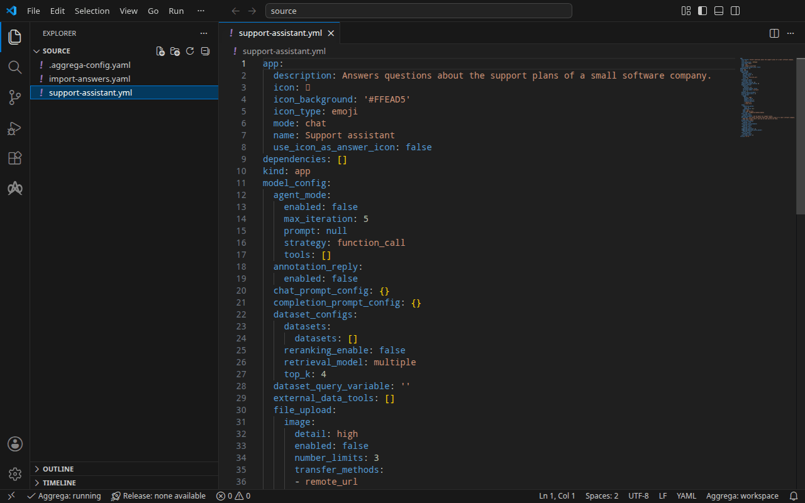
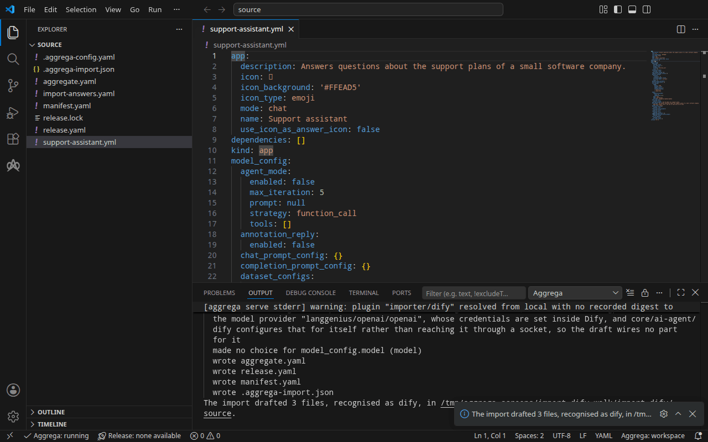
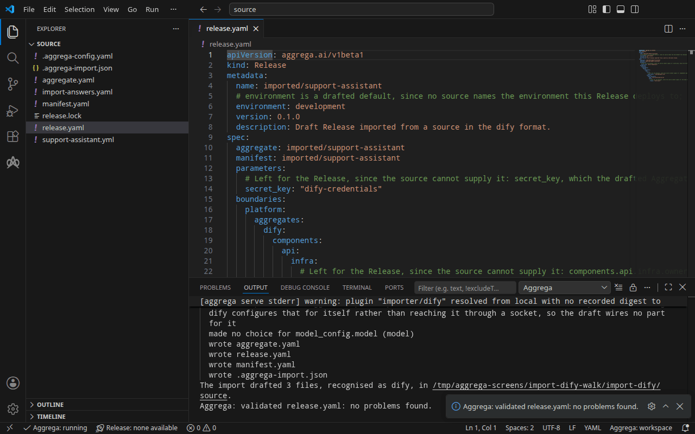
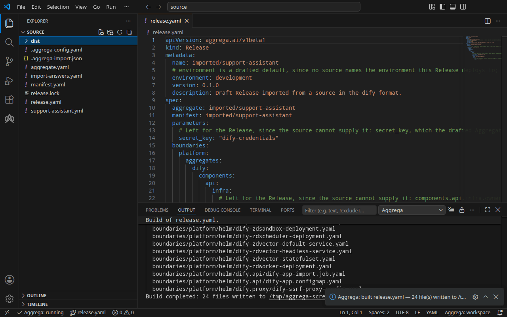

# Import a Dify application

This walkthrough imports an application exported from Dify — a chat assistant
on an OpenAI model — into an Aggregate, a Release and a Manifest that build the
standard library's Dify installation, carrying the application, for
Kubernetes as they are written, then builds them and runs the result. Every
file and every block of output below comes from a real run; the application
and each stage of the walkthrough are in the
[import-dify](../../language-reference/examples/import-dify/README.md)
example, where a check script runs the import again, compares what it writes,
what it prints and the blocks this page quotes with the files kept there, and
validates and builds what the import wrote.

## Scaffold the example

You can run this import with the commands on this page, or
[have your AI assistant run it for you](#with-an-ai-assistant).

Write the example into a new folder named after it:

```bash
aggrega scaffold --example import-dify
```

It then prints the commands to run next. The first changes into the new folder;
the one after it, below, changes into its `source` folder, which holds what this
page imports and is where the import runs:

```bash
cd import-dify
```



## The application

`support-assistant.yml`, written for this walkthrough, is a chat application in
Dify's DSL, the YAML Dify exports for an application, at DSL version `0.7.0`:
an opening statement, a short prompt, and the model it answers with, named by
its provider:

<!-- quotes: source/support-assistant.yml -->
```yaml
  model:
    completion_params:
      stop: []
      temperature: 0.4
    mode: chat
    name: gpt-4o-mini
    provider: langgenius/openai/openai
```

Beside it, an `.aggrega-config.yaml` makes the folder a workspace:

<!-- quotes: source/.aggrega-config.yaml -->
```yaml
# The workspace key marks this directory as the workspace root, so an import run
# here writes its drafts beside support-assistant.yml.
workspace: {}
# The registry the importer is fetched from the first time an import needs it.
default_registry: hub.aggrega.ai
```

and `import-answers.yaml` holds the answers to what no application can hold:
the installation's application secret, the key Dify signs sessions with and
encrypts the model-provider keys it stores under; and the owner account the
application is imported under, its email and its password. On Kubernetes each
secret is read from a Kubernetes Secret, so its answer is that Secret's name;
the same file serves an import for Docker Compose, as
[On Docker Compose](#on-docker-compose) shows:

<!-- quotes: source/import-answers.yaml -->
```yaml
# Values the import could not draft from the source, keyed by the drafted file and the key path inside
# it. Write each one beside its key; an import of the same source, and a sync, read them from here and
# ask nothing. A secret is never written here: its key asks where the secret comes from — a variable
# name, ${NAME}, or the name of a Kubernetes Secret.
release.yaml:
  # Passed down to core/dify's secret_key parameter, which has no default; that parameter's description
  # in core/dify says what the value is.
  spec.parameters.secret_key: "dify-credentials"
  # Email address of the installation's owner account, read only when values.app_definition is set. The
  # step that imports the application creates this account when it performs Dify's first-time setup, and
  # signs in as it; on an installation whose setup has already run, it names an existing account allowed
  # to import applications, and the password attached to the owner_password slot is that account's.
  # Required when values.app_definition is set: the build halts when it is empty. It has no default.
  spec.boundaries.platform.aggregates.dify.components.api.infra.owner_email: "owner@example.com"
  # The origin of the secret value, written by the operator in the Release. Read exactly as
  # values.origin is. Write it here or in values.origin, never in both. A secret: name where it comes
  # from, never the value.
  spec.boundaries.platform.aggregates.dify.components.api.features.owner_password.infra.origin: "dify-owner"
```

`owner@example.com` stands for an email of your own; `dify-credentials` and
`dify-owner` are the Secrets [Run it](#run-it) creates. Without the file, an
import at a terminal asks for each of the three values, one question at a
time, and writes your answers into a new answers file; where nothing can be
asked, it writes that file with the three keys and empty answers, lists them,
and exits with status 1.
[The import answers file](../../language-reference/import-answers.md)
describes the file in full.

The workspace names no catalog folder, so the import reads the standard-library
catalog from the registry it fetches its importer from: a signed snapshot of the
published catalog, fetched, verified and kept in the workspace's content cache
by the first import, and named by its digest in the record the import writes
beside its drafts. A workspace that names its own catalog folders — in
`AGGREGA_CATALOG_DIRS`, or under `workspace.catalog_dirs` — imports against
those instead. Change into `source`:

```bash
cd source
```

## Run the import

The standard library's Dify installation is realized on Kubernetes and on
Docker Compose. This walkthrough names the `helm` target:

<!-- quotes: import-command -->
```bash
aggrega import support-assistant.yml --target helm
```

On standard output it lists what it wrote:

<!-- quotes: draft/stdout.txt -->
```text
wrote aggregate.yaml
wrote release.yaml
wrote manifest.yaml
wrote .aggrega-import.json
```

On standard error, with `<workspace>` standing for the folder you ran it in:

<!-- quotes: draft/import.txt -->
```text
[… omitted: a warning that the importer runs unverified, printed where its module is read from beside its Plugin entity in a catalog folder rather than fetched]
read as the dify format, with drafted paths relative to <workspace>
warn: node model_config.model (model) names the model "gpt-4o-mini" of the model provider "langgenius/openai/openai", whose credentials are set inside Dify, and core/ai-agent/dify configures that for itself rather than reaching it through a socket, so the draft wires no part for it
made no choice for model_config.model (model)
Pull complete: <workspace>/release.lock (entities=25, source_artifacts=0, external_inputs=0)
```



- **The `warn` line** says that the model stays inside Dify: Dify configures
  its model providers, and their keys, for itself, so the draft wires no model.
  Once Dify runs, you install its OpenAI provider and set the provider's key,
  as [Test it](#test-it) shows.
- **The `Pull complete` line** is the pull. With every value answered from the
  answers file, the import pulled the drafted Release's dependencies, as
  `aggrega pull` does, and wrote `release.lock`; the build below needs nothing
  more.

## What it writes

The Aggregate, the Release and the Manifest are named
`imported/support-assistant`, after the application's name, `Support
assistant` under `app`, reduced to `support-assistant` — an application with
no name is named after its file — under the namespace the importer's
`target_namespace` setting sets, `imported` unless you set another
([Settings](../../language-reference/plugins/core-importers.md#settings)).

`aggregate.yaml` — the standard library's Dify installation, `core/dify`, an
Aggregate the draft composes under `aggregates`, with the application carried
as written in its `app_definition` parameter, most of it left out here, and
the installation's `secret_key` passed down from a parameter the draft
declares:

<!-- quotes: draft/aggregate.yaml -->
```yaml
apiVersion: aggrega.ai/v1beta1
kind: Aggregate
metadata:
  name: imported/support-assistant
  version: 0.1.0
  description: Draft Aggregate imported from a source in the dify format.
spec:
  parameters:
    secret_key:
      type: string
      required: true
      minLength: 1
      description: "Passed down to core/dify's secret_key parameter, which has no default; that parameter's description in core/dify says what the value is."
  aggregates:
    # An import sees the Components of the workspace's catalog and none of its Aggregates, so it does not check that the catalog holds core/dify.
    dify:
      type: core/dify
      parameters:
        secret_key: "{{ .parameters.secret_key }}"
        app_definition: |
          app:
            description: Answers questions about the support plans of a small software company.
          [… omitted: the rest of the application, as exported]
          version: 0.7.0
```

The installation is ten components — Dify's API server, its worker, its
scheduler, its web front end, its code sandbox, its plugin runtime, an egress
proxy, PostgreSQL, a Redis-compatible cache and Weaviate — wired to each
other, and the import of the application is a step its API server's Recipe
renders. Its application secret has no default in `core/dify`, so the draft
declares `secret_key` as a parameter of its own, with no default, and passes
it down for the Release to fulfill. The installation's other credentials keep
the defaults `core/dify` gives them, as [Run it](#run-it) describes.

`release.yaml` — the Release, which routes the installation into a boundary,
`platform`, and fulfills what the application cannot supply from the answers
file:

<!-- quotes: draft/release.yaml -->
```yaml
apiVersion: aggrega.ai/v1beta1
kind: Release
metadata:
  name: imported/support-assistant
  # environment is a drafted default, since no source names the environment this Release deploys to; change it to name the one it deploys to.
  environment: development
  version: 0.1.0
  description: Draft Release imported from a source in the dify format.
spec:
  aggregate: imported/support-assistant
  manifest: imported/support-assistant
  parameters:
    # Left for the Release, since the source cannot supply it: secret_key, which the drafted Aggregate declares and passes down to core/dify; that parameter's description there says what the value is
    secret_key: "dify-credentials"
  boundaries:
    platform:
      aggregates:
        dify:
          components:
            api:
              infra:
                # Left for the Release, since the source cannot supply it: components.api.infra.owner_email, the email of the installation's owner account the application is imported under, on the api component of core/dify
                owner_email: "owner@example.com"
              features:
                owner_password:
                  type: core/referenced-secret
                  infra:
                    # Left for the Release, since the source cannot supply it: the name of a Kubernetes Secret already in the namespace holding, under the data key value, the owner account's password.
                    origin: "dify-owner"
```

- **`environment`** is `development`, a default the comment above it says to
  change to the environment the Release deploys to.
- **`secret_key`** is the name of the Secret holding the application secret,
  `dify-credentials`, under the data key the installation names,
  `secret-key`: the Manifest reads every credential from a Secret already in
  the namespace.
- **The owner account** is set on the installation's `api` component, in the
  routing entry that places the installation in its boundary: its email, and
  its password attached as a `core/referenced-secret` naming the Secret that
  holds it, `dify-owner`, under the data key `value`. The comments above the
  answered values say why the import could not draft them.

`manifest.yaml` — a Helm Recipe for each component the installation composes,
and the realization that reads a credential from a Secret already in the
namespace:

<!-- quotes: draft/manifest.yaml -->
```yaml
apiVersion: aggrega.ai/v1beta1
kind: Manifest
metadata:
  name: imported/support-assistant
  version: 0.1.0
spec:
  mappings:
    components:
      type:
        core/datastore/postgres: helm/postgres
        core/datastore/redis: helm/redis
        core/datastore/weaviate: helm/weaviate
        core/ai-agent/dify-ssrf-proxy: helm/dify-ssrf-proxy
        core/ai-agent/dify-sandbox: helm/dify-sandbox
        core/ai-agent/dify-plugin-daemon: helm/dify-plugin-daemon
        core/ai-agent/dify: helm/dify
        core/ai-agent/dify-worker: helm/dify-worker
        core/ai-agent/dify-worker-beat: helm/dify-worker-beat
        core/ai-agent/dify-web: helm/dify-web
    features:
      type:
        core/referenced-secret: helm/k8s-existing-secret
```

`--target` maps the component types of the installation the draft composes as
well as its own. Where the catalog offers several Helm Recipes for one type, as
it does for PostgreSQL, it maps the one named after the type, `helm/postgres`.

`.aggrega-import.json` is the record of what the import wrote, which a later
`aggrega import --sync` reads, and `release.lock` pins every catalog entity the
Release resolves to, by version and digest.

## Validate and build

```bash
aggrega validate --release release.yaml
aggrega build --release release.yaml
```





The validation prints:

```text
  notice: LINT: Feature "core/referenced-secret" at core/referenced-secret:1.0.0 declares property "origin" in both values: and infra: pillars (path: origin)
release dependency validation passed: release.yaml (schema-pillar + dependency pillars)
```

and the build, with `<workspace>` standing for the folder holding the drafts:

```text
  notice: LINT: Feature "core/referenced-secret" at core/referenced-secret:1.0.0 declares property "origin" in both values: and infra: pillars (path: origin)
[… omitted: a total build time, which differs per run]
Build completed: 24 files written to <workspace>/dist
```

The `notice` line is advisory: the secret Feature accepts its `origin` from the
Aggregate's `values` or the Release's `infra`, and the notice reports that one
leaf is declared in both. It changes no verdict.

The build writes the installation's Kubernetes manifests under
`dist/boundaries/platform/helm/`. Among them is the Job that imports the
application, `dify.api/dify-app-import.job.yaml`. It waits for Dify's API
server to answer, performs Dify's first-time setup as the owner account the
Release names where that setup has not run, and imports the application:

```yaml
spec:
  podFailurePolicy:
    rules:
      - action: FailJob
        onExitCodes:
          containerName: import
          operator: In
          values: [2]
  template:
    spec:
      restartPolicy: Never
      containers:
        - name: import
          image: "langgenius/dify-api:1.17.0"
          command: ["python", "/seed/import.py"]
          env:
            - name: DIFY_API_URL
              value: "http://dify-zdapi-default:5001"
            - name: OWNER_EMAIL
              value: "owner@example.com"
            - name: OWNER_PASSWORD
              valueFrom:
                secretKeyRef:
                  name: "dify-owner"
                  key: "value"
          volumeMounts:
            - name: seed
              mountPath: /seed
              readOnly: true
      volumes:
        - name: seed
          configMap:
            name: dify-zdapi-app
```

The application itself is in the ConfigMap beside it. When Dify refuses what
the step sends it, with a client-error reply other than a request timeout or a
rate limit, or by reporting the import failed, the step prints the message
Dify's reply carries and exits with status 2, as it does when the definition
names no application under `app.name`; the Job's `podFailurePolicy` fails the Job at
that attempt, since a retry would be refused the same way; any other failure,
such as the server not answering within about ten minutes, is retried.

## With an AI assistant

An AI assistant [set up with Aggrega's tools](../../ai-assistants/set-up.md)
can do the same: paste this prompt into it.

<!-- copyable -->

> Use the Aggrega tools only, and create no folder yourself. If the Workspace folder holds no `import-dify` folder yet, call the `scaffold` tool once with `example` set to `import-dify` and no `dir`: it writes the example into a new `import-dify` folder, whose `source` folder holds what this page imports. Then call the `import` tool with `workspace_root` set to `import-dify/source`, `source` set to `support-assistant.yml` and `target` set to `helm`: it reads the answers it needs from `import-answers.yaml` beside `support-assistant.yml`, writes its drafts into `import-dify/source` and pulls what they need. Then call the `validate` tool with `workspace_root` set to `import-dify/source` and `release` set to `release.yaml`, and the `build` tool with `workspace_root` set to `import-dify/source`, `release` set to `release.yaml` and `write` set to true. Tell me which files the build wrote; they are under `import-dify/source/dist/`.

## Open it in VS Code

With the
[Aggrega extension for Visual Studio Code](https://github.com/aggrega-ai/aggrega-vscode-extension)
installed, open the folder `import-dify/source` in VS Code, where the import
wrote its drafts. The folder holds one Release, the drafted `release.yaml`, so
the editor selects it for you; once [On Docker Compose](#on-docker-compose) has
drafted a second Release into `compose`, **Aggrega: Select Release…** chooses
the one the editor works on. The editor checks the drafts against the selected
Release as you edit them, marking what it finds in the file and in the Problems
panel. **Aggrega: Show topology graph**, in the Command Palette, draws the
selected Release's components and the connections between them.
**Aggrega: Build**, **Aggrega: Preview build** and **Aggrega: Pull** act on the
same Release, and each is also a button on the **Commands** panel of the
**Aggrega** view in the activity bar; Build writes its files into the folder's
`dist/`. [Use Aggrega in Visual Studio Code](../editor/README.md) covers the rest.

## Run it

Before applying the manifests, create the Secrets they read. A workload naming
a Secret that does not exist does not start. Two hold what the answers file
named: `dify-owner`, holding the owner's password under `value`, and
`dify-credentials`, holding the application secret under `secret-key`. The
installation's four other credentials — its database password and three keys
its components present to each other — keep the defaults `core/dify` gives
them, and on Kubernetes each default is the name of the Secret the manifests
read it from: `dify-db-password-for-evaluation-only` under `db-password`,
`dify-code-execution-key-for-evaluation-only` under `code-execution-key`,
`dify-plugin-daemon-key-for-evaluation-only` under `plugin-daemon-key`, and
`dify-inner-api-key-for-evaluation-only` under `inner-api-key`. Create those
four too, each holding a value of your own; to read them from Secrets named
otherwise, pass the names to `core/dify` in the Aggregate's `dify` entry,
under `parameters`, as `db_password`, `code_execution_key`,
`plugin_daemon_key` and `inner_api_key`.

Set the owner's password in your shell, as `DIFY_OWNER_PASSWORD`, since you
sign in with it below. Dify takes an owner password of at least eight
characters holding a letter and a digit: given any other, the import Job fails
as soon as Dify refuses the setup, and its log reads
`first-time setup was refused with HTTP 422: Validation error for parameter 'payload'`,
the reply Dify gives an owner account it refuses. The wait below waits for the
Job to complete, and a failed Job never completes, so it then runs to its
timeout; run
`kubectl wait --for=condition=failed job/dify-zdapi-app-import --timeout=15m`
in a second terminal beside it, and that wait returns as soon as the Job
fails. Delete the Job and the `dify-owner` Secret, create the Secret again with
a password Dify takes, and apply again.

Write one file for each of the five other Secrets, holding one line: the data
key, `=`, and a value of your own — `dify-credentials.env` with `secret-key=`,
`db-password.env` with `db-password=`, `code-execution-key.env` with
`code-execution-key=`, `plugin-daemon-key.env` with `plugin-daemon-key=` and
`inner-api-key.env` with `inner-api-key=`. Then create the six Secrets. The
cluster holds the values then, so delete the files:

```bash
printf 'value=%s\n' "$DIFY_OWNER_PASSWORD" > dify-owner.env
kubectl create secret generic dify-owner --from-env-file=dify-owner.env
kubectl create secret generic dify-credentials --from-env-file=dify-credentials.env
kubectl create secret generic dify-db-password-for-evaluation-only --from-env-file=db-password.env
kubectl create secret generic dify-code-execution-key-for-evaluation-only --from-env-file=code-execution-key.env
kubectl create secret generic dify-plugin-daemon-key-for-evaluation-only --from-env-file=plugin-daemon-key.env
kubectl create secret generic dify-inner-api-key-for-evaluation-only --from-env-file=inner-api-key.env
rm dify-owner.env dify-credentials.env db-password.env code-execution-key.env plugin-daemon-key.env inner-api-key.env
```

Apply the manifests, as the run step of
[How an import runs](README.md#how-an-import-runs) explains — `-R` reaches the
Job and the two ConfigMaps in `dify.api/` and `dify.proxy/` — then wait for the
import Job and read its log, and wait for the plugin runtime:

```bash
kubectl apply -R -f dist/boundaries/platform/helm/
kubectl wait --for=condition=complete job/dify-zdapi-app-import --timeout=15m
kubectl logs job/dify-zdapi-app-import
kubectl rollout status statefulset/dify-zdplugins
```

```text
service/dify-zdapi-default created
deployment.apps/dify-zdapi created
[… omitted: a line for each of the other Services, Deployments and StatefulSets]
job.batch/dify-zdapi-app-import created
configmap/dify-zdapi-app created
configmap/dify-zdproxy-config created
job.batch/dify-zdapi-app-import condition met
first-time setup done: owner account owner@example.com
imported 'Support assistant' as application 7e03e85c-b13f-4ddc-b539-040470a61d4c
partitioned roll out complete: 1 new pods have been updated...
```

The log names the application's identifier, which [Test it](#test-it) needs.

## Test it

Dify's API answers at `http://127.0.0.1:5001`. On Kubernetes, forward a local
port to the API server's Service, `dify-zdapi-default`, in the namespace you
applied to, and leave the command running in a second terminal:

```bash
kubectl port-forward -n <namespace> svc/dify-zdapi-default 5001:5001
```

On Docker Compose, started as [On Docker Compose](#on-docker-compose) shows,
the Release publishes the API at that address already, and the console at
`http://127.0.0.1:3001`. Open <http://127.0.0.1:3001/signin>, the console's
sign-in page; `/` redirects there. Signing in from that page does not work as
drafted: the page sends its requests to the API at `http://127.0.0.1:5001`,
and Dify's API answers a browser only for pages served from
`http://127.0.0.1:3000`, the console address it assumes, so the browser
refuses each reply.

The application answers through the API, with no browser involved. In a
terminal where `DIFY_OWNER_PASSWORD` is set, sign in as the owner. The console
API takes the password Base64-encoded, and signing in leaves the session in
`cookies.txt`. Every later console request sends the session back, with the
CSRF token from the same file in an `X-CSRF-Token` header; a request without it
is refused with `CSRF token is missing or invalid.`

```bash
printf '{"email": "owner@example.com", "password": "%s"}' "$(printf %s "$DIFY_OWNER_PASSWORD" | base64 | tr -d '\n')" |
  curl -sS -c cookies.txt http://127.0.0.1:5001/console/api/login -H 'Content-Type: application/json' -d @-
CSRF=$(awk '$6 == "csrf_token" {print $7}' cookies.txt)
```

```text
{"result":"success"}
```

Dify's model providers are plugins, and a new installation holds none. Install
Dify's OpenAI provider, at version 1.1.0, the one the run installed; the plugin
runtime fetches it from Dify's marketplace, so the installation must reach the
internet:

```bash
curl -sS -b cookies.txt -H "X-CSRF-Token: $CSRF" -H 'Content-Type: application/json' \
  http://127.0.0.1:5001/console/api/workspaces/current/plugin/install/marketplace \
  -d '{"plugin_unique_identifiers": ["langgenius/openai:1.1.0@1ded02acee56efd5788c86fd447d792e4923e959554a4942f440c7859d164340"]}'
```

```text
{"all_installed":false,"task_id":"01a1dc0a-653d-756b-a104-e5d6d1e43695","task":null}
```

The installation runs in the background. Ask for its task, with the
`task_id` the reply names, until its `status` is `success`:

```bash
curl -sS -b cookies.txt -H "X-CSRF-Token: $CSRF" \
  http://127.0.0.1:5001/console/api/workspaces/current/plugin/tasks/<task id>
```

```text
{"task":{"id":"01a1dc0a-653d-756b-a104-e5d6d1e43695",[… omitted: when it was created and last updated],"status":"success","total_plugins":1,"completed_plugins":1,"plugins":[{"plugin_unique_identifier":"langgenius\/openai:1.1.0@1ded02acee56efd5788c86fd447d792e4923e959554a4942f440c7859d164340",[… omitted: the plugin's status, its icon and its names in four languages]}]}}
```

Write the provider's key into `openai.json`, as
`{"credentials": {"openai_api_key": "your OpenAI key"}}`, set it, and delete
the file:

```bash
curl -sS -b cookies.txt -H "X-CSRF-Token: $CSRF" -H 'Content-Type: application/json' \
  http://127.0.0.1:5001/console/api/workspaces/current/model-providers/langgenius/openai/openai/credentials \
  -d @openai.json
rm openai.json
```

Dify checks the key with one request to the provider before it keeps it, and
answers `{"result":"success"}` for a key the provider accepts. The run set a
placeholder, and Dify refused it with OpenAI's answer:

```text
{"code":"invalid_param","message":"Error code: 401 - {'error': {'message': 'Incorrect API key provided: sk-place*****************-key. You can find your API key at https:\/\/platform.openai.com\/account\/api-keys.', 'type': 'invalid_request_error', 'code': 'invalid_api_key', 'param': None}, 'status': 401}","status":400}
```

An application answers requests made with an API key of its own. Create one,
with the application's identifier from the log of the step that imports it —
on Docker Compose,
`docker compose -p support-assistant -f ../dist/boundaries/platform/compose/docker-compose.yaml logs dify-zdapi-app-import`:

```bash
curl -sS -X POST -b cookies.txt -H "X-CSRF-Token: $CSRF" \
  http://127.0.0.1:5001/console/api/apps/<application id>/api-keys
```

```text
{"id":"8d6c1eb1-cf61-4825-9b04-f32689ed0489","type":"app","token":"[… omitted: the key]","last_used_at":null,"created_at":1794693042}
```

and send the application a message with the key, the reply's `token`:

```bash
curl -sS http://127.0.0.1:5001/v1/chat-messages \
  -H 'Authorization: Bearer <app key>' -H 'Content-Type: application/json' \
  -d '{"inputs": {}, "query": "In one short sentence: what does a support plan cover?", "response_mode": "blocking", "user": "test-it"}'
```

With the placeholder refused, the model has no key, and Dify says so:

```text
{"code":"provider_not_initialize","message":"Model gpt-4o-mini credentials is not initialized.","status":400}
```

The runs on Kubernetes and on Docker Compose got the same replies. With a key
the provider accepts, the reply carries the model's answer at `answer`.

On Kubernetes, stop the port forward, then remove what you applied, the
Secrets and the session file:

```bash
kubectl delete -R -f dist/boundaries/platform/helm/
kubectl delete secret dify-owner dify-credentials dify-db-password-for-evaluation-only dify-code-execution-key-for-evaluation-only dify-plugin-daemon-key-for-evaluation-only dify-inner-api-key-for-evaluation-only
kubectl delete pvc data-dify-zddb-0 storage-dify-zdplugins-0 data-dify-zdvector-0
rm cookies.txt
```

Kubernetes keeps the volume claims a StatefulSet made when the StatefulSet is
deleted, so the third command removes them, and with them the database, the
installed plugin and the vector store. On Docker Compose,
`docker compose -p support-assistant -f ../dist/boundaries/platform/compose/docker-compose.yaml down -v`
removes the stack and its volumes.

## On Docker Compose

The same application imports for Docker Compose with the `compose` target,
from the same answers file. The drafts for Kubernetes already sit in `source`,
so draft the Compose ones into a folder of their own with `--output-dir`; the
import reads the answers file beside the application all the same:

```bash
aggrega import support-assistant.yml --target compose --output-dir compose
```

Docker Compose has no Secret to name, so for `compose` the draft writes the
application secret and the owner's password itself, each as a variable
reference that Docker Compose fills from the environment of whoever starts the
stack. Only the owner's email is owed there. The import keeps the two Secret
names in the answers file without applying them, and says so on standard
error:

```text
info: the answers file <workspace>/import-answers.yaml also answers spec.boundaries.platform.aggregates.dify.components.api.features.owner_password.infra.origin in release.yaml, spec.parameters.secret_key in release.yaml, which these drafts do not leave empty; those answers are kept there and not applied
```

The drafted Release reads the application secret from `DIFY_SECRET_KEY` and
the owner's password from `DIFY_OWNER_PASSWORD`, and publishes the API on port
5001 and the front end, `console`, on 3001 of the loopback address:

```yaml
  parameters:
    # Passed by reference, never as a value: secret_key, which the drafted Aggregate declares and passes down to core/dify; that parameter's description there says what the value is; it is read from the variable DIFY_SECRET_KEY, which a target substituting variable references, as Docker Compose does when the stack starts, reads from the environment, so no file carries the value.
    secret_key: "${DIFY_SECRET_KEY}"
  [… omitted: the boundary, and the owner's email, answered as above]
                # Published on this machine's loopback address, 127.0.0.1: reachable from this machine only, by any process running on it. Delete this line to keep the service internal.
                published_port: 5001
              features:
                owner_password:
                  type: core/referenced-secret
                  infra:
                    # Attached by reference, never as a value: the owner account's password, read from the variable DIFY_OWNER_PASSWORD, which a target substituting variable references, as Docker Compose does when the stack starts, reads from the environment, so no file carries the value.
                    origin: "${DIFY_OWNER_PASSWORD}"
            console:
              infra:
                # Published on this machine's loopback address, 127.0.0.1: reachable from this machine only, by any process running on it. Delete this line to keep the service internal.
                published_port: 3001
```

Each port is reachable from your machine only, as its comment says, and
deleting a line keeps that service on the stack's network alone. The front end
listens on 3000 inside its container and is published on 3001, so it runs
beside another example publishing 3000.

The Manifest maps each component to its Compose Recipe and
`core/referenced-secret` to `compose/dotenv-referenced-secret`, which writes
each reference into the Compose file as it stands. Validate and build from the
new folder:

```bash
cd compose
aggrega validate --release release.yaml
aggrega build --release release.yaml
```

The build writes under `dist` at the workspace root, and the workspace is
still `source`, the folder holding `.aggrega-config.yaml`: the Compose file is
`source/dist/boundaries/platform/compose/docker-compose.yaml`, which from
`compose` is `../dist/boundaries/platform/compose/docker-compose.yaml`, and no
`dist` folder is written inside `compose`. The file carries
`SECRET_KEY: ${DIFY_SECRET_KEY}` and `OWNER_PASSWORD: ${DIFY_OWNER_PASSWORD}`
rather than either value. Set both variables in your shell, or in a `.env`
file beside the Compose file, before you start the stack.

The installation's four other credentials keep the defaults `core/dify` gives
them, and on Docker Compose each default is the value itself, written into the
Compose file as it stands: `DB_PASSWORD: dify-db-password-for-evaluation-only`,
with `POSTGRES_PASSWORD` the same on the database, and likewise
`dify-code-execution-key-for-evaluation-only`,
`dify-plugin-daemon-key-for-evaluation-only` and
`dify-inner-api-key-for-evaluation-only`. Every reader of the catalog holds
these defaults, so they serve evaluation only. To replace one, declare a
string parameter for it in the drafted Aggregate, pass it down in the `dify`
entry's `parameters` under `core/dify`'s name for it — `db_password`,
`code_execution_key`, `plugin_daemon_key` or `inner_api_key` — as the draft
passes `secret_key`, and fulfill it under the Release's `parameters`. A
Release writing `db_password: "${DIFY_DB_PASSWORD}"` builds a Compose file
carrying `DB_PASSWORD: ${DIFY_DB_PASSWORD}` and
`POSTGRES_PASSWORD: ${DIFY_DB_PASSWORD}`, filled from the environment like the
two above.

Start the stack from `compose`, with the owner's password one Dify takes, as
[Run it](#run-it) describes:

```bash
export DIFY_SECRET_KEY='a long random value of your own'
export DIFY_OWNER_PASSWORD='a password of your own'
docker compose -p support-assistant -f ../dist/boundaries/platform/compose/docker-compose.yaml up -d --wait
```

`--wait` returned in about a minute in the run, once every server reported
healthy. The step that imports the application runs beside them and exits once
it has; its log then reads:

```text
first-time setup done: owner account owner@example.com
imported 'Support assistant' as application 7fae73f4-826b-4918-a623-a3383aa0da8c
```

[Test it](#test-it) reaches the installation at the two published ports.
