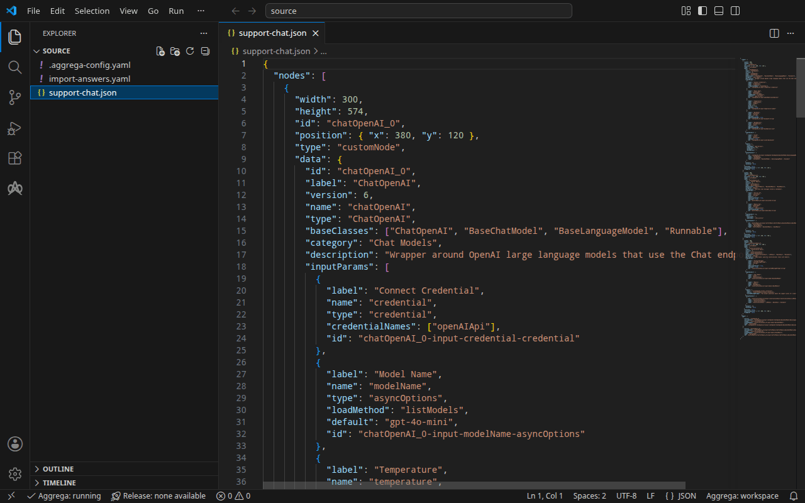
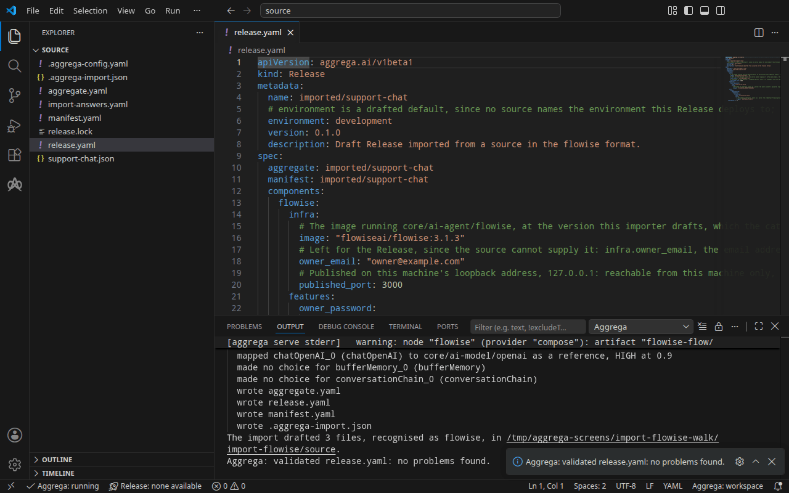
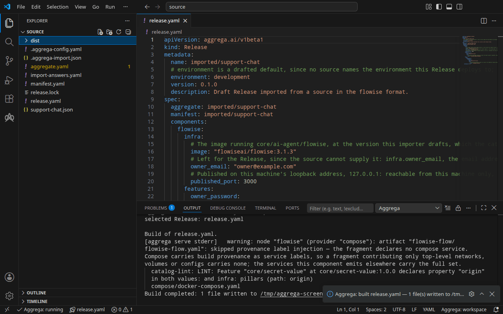

# Import a Flowise chatflow

This walkthrough imports a chatflow exported from Flowise — a conversation
chain with a chat model and a memory — into an Aggregate, a Release and a
Manifest that build Flowise carrying the chatflow for Docker Compose as they
are written, then builds them and runs the result. Every file and every block
of output below comes from a real run; the chatflow and each stage of the
walkthrough are in the
[import-flowise](../../language-reference/examples/import-flowise/README.md)
example, where a check script runs the import again, compares what it writes,
what it prints and the blocks this page quotes with the files kept there, and
validates and builds what the import wrote.

## Draft the example

You can run this import with the commands on this page, or
[have your AI assistant run it for you](#with-an-ai-assistant).

Write the example into a new folder named after it:

```bash
aggrega draft --example import-flowise
```

It then prints the commands to run next. The first changes into the new folder;
the one after it, below, changes into its `source` folder, where the import
runs. That folder carries the chatflow file,
`support-chat.json`, which this page describes rather than quotes:

```bash
cd import-flowise
```



## The chatflow

`support-chat.json`, written for this walkthrough in the shape Flowise's editor
exports a chatflow, holds three nodes and the two edges between them: a
ChatOpenAI node selecting `gpt-4o-mini`,
a Buffer Memory node, and a Conversation Chain node that takes both and answers
with a short system message. The ChatOpenAI node selects no stored credential
and leaves its Base Path empty, so the OpenAI client Flowise runs it on reads
its address and its key from Flowise's environment.

Beside the chatflow, an `.aggrega-config.yaml` makes the folder a workspace:

<!-- quotes: source/.aggrega-config.yaml -->
```yaml
# The workspace key marks this directory as the workspace root, so an import run
# here writes its drafts beside support-chat.json.
workspace: {}
# The registry the importer is fetched from the first time an import needs it.
default_registry: hub.aggrega.ai
```

and `import-answers.yaml` holds the answers to what no chatflow can hold.
Flowise loads no chatflow from a file at start, so the build seeds it through
Flowise's own API under an owner account, and no export names that account:
its email is the one answer an import for Docker Compose needs. An import for
Kubernetes also needs the name of the Kubernetes Secret holding each secret —
the owner's password and the OpenAI key — so the file names those two Secrets
as well (see [On Kubernetes](#on-kubernetes)):

<!-- quotes: source/import-answers.yaml -->
```yaml
# Values the import could not draft from the source, keyed by the drafted file and the key path inside
# it. Write each one beside its key; an import of the same source, and a sync, read them from here and
# ask nothing. A secret is never written here: its key asks where the secret comes from — a variable
# name, ${NAME}, or the name of a Kubernetes Secret.
release.yaml:
  # Email address of the platform's owner account, read only when values.flow_definition is set. The
  # step that seeds the chatflow registers this account when the instance has no owner yet, which makes
  # it the owner, and signs in as it; on an instance that already has one, it names an account allowed
  # to import chatflows, and the password attached to the owner_password slot is that account's.
  # Required when values.flow_definition is set: the build halts when it is empty. It has no default.
  spec.components.flowise.infra.owner_email: "owner@example.com"
  # The origin of the secret value, written by the operator in the Release. Read exactly as
  # values.origin is. Write it here or in values.origin, never in both. A secret: name where it comes
  # from, never the value.
  spec.components.flowise.features.owner_password.infra.origin: "flowise-owner"
  # The origin of the secret value, written by the operator in the Release. Read exactly as
  # values.origin is. Write it here or in values.origin, never in both. A secret: name where it comes
  # from, never the value.
  spec.components.flowise.uses.model.chatopenai-0.features.credential.infra.origin: "openai-api-key"
```

`owner@example.com` stands for an email of your own. Without the file, an
import at a terminal asks for each value, one question at a time, worded from
the description above its key, and writes your answers into a new answers
file; where nothing can be asked, it writes that file with the keys and empty
answers, lists them, and exits with status 1.
[The import answers file](../../language-reference/import-answers.md)
describes the file in full.

The import weighs each node against the Components of the workspace's catalog,
and `--target` drafts a Manifest from its Recipes. The workspace names no
catalog folder, so the import reads the standard-library catalog from the
registry it fetches its importer from: a signed snapshot of the published
catalog, fetched, verified and kept in the workspace's content cache by the
first import, and named by its digest in the record the import writes beside its
drafts. A workspace that names its own catalog folders — in
`AGGREGA_CATALOG_DIRS`, or under `workspace.catalog_dirs` — imports against
those instead. Change into `source`:

```bash
cd source
```

## Run the import

<!-- quotes: import-command -->
```bash
aggrega import support-chat.json --target compose
```

On standard output it lists what it wrote:

<!-- quotes: draft/stdout.txt -->
```text
wrote aggregate.yaml
wrote release.yaml
wrote manifest.yaml
wrote .aggrega-import.json
```

On standard error, with `<workspace>` standing for the folder you ran it in:

<!-- quotes: draft/import.txt -->
```text
[… omitted: a warning that the importer runs unverified, printed where its module is read from beside its Plugin entity in a catalog folder rather than fetched]
read as the flowise format, with drafted paths relative to <workspace>
warn: node chatOpenAI_0 reaches chatopenai-0 through the model connection chatopenai-0 of core/ai-agent/flowise: its Base Path is empty, so the OpenAI client Flowise runs it on reads the address the platform delivers for this connection, OPENAI_BASE_URL, and, since it selects no credential, the key delivered as OPENAI_API_KEY
info: the answers file <workspace>/import-answers.yaml also answers spec.components.flowise.features.owner_password.infra.origin in release.yaml, spec.components.flowise.uses.model.chatopenai-0.features.credential.infra.origin in release.yaml, which these drafts do not leave empty; those answers are kept there and not applied
mapped chatOpenAI_0 (chatOpenAI) to core/ai-model/openai as a reference, HIGH at 0.9
made no choice for bufferMemory_0 (bufferMemory)
made no choice for conversationChain_0 (conversationChain)
  warning: node "flowise" (provider "compose"): artifact "flowise-flow/flowise-flow.yaml": skipped provenance label injection — the fragment declares no compose service. Compose carries build provenance as service labels, so a fragment contributing only top-level networks, volumes or configs carries none; the services this component emits elsewhere carry the full set.
Pull complete: <workspace>/release.lock (entities=8, source_artifacts=0, external_inputs=0)
```


- **The `mapped` line** says the ChatOpenAI node became the standard library's
  OpenAI model, `core/ai-model/openai`, referenced rather than drafted, since it
  matched in the high tier, at 0.9: a component of its own, wired to the
  platform's `model` socket.
- **The `warn` line** says how the chatflow reaches that model: the node reads
  the address and the key the platform delivers for the model connection, so
  the key the Release attaches to the connection is the one the chatflow uses.
- **The `info` line** is about the answers file. It answered the owner's email,
  which the drafts left empty; its two Secret names answer what only an import
  for Kubernetes leaves empty, so they stay in the file, unused here.
- **The `made no choice` lines** say that the memory and the chain stay inside
  the chatflow: no socket of the platform takes them.
- **The last two lines** are the pull. With every value answered, the import
  pulled the drafted Release's dependencies, as `aggrega pull` does, and wrote
  `release.lock`; the build below needs nothing more. The `warning` line is one
  the build prints too, and [Validate and build](#validate-and-build) explains
  it.

## What it writes

The Aggregate, the Release and the Manifest are named `imported/support-chat`,
after the file, `support-chat.json`, since a Flowise export carries no name of
its own, under the namespace the importer's `target_namespace` setting sets,
`imported` unless you set another
([Settings](../../language-reference/plugins/core-importers.md#settings)).

`aggregate.yaml` — one instance of the standard library's Flowise platform,
`core/ai-agent/flowise`, carrying the chatflow as it was exported, most of it
left out here, and the model wired to its `model` socket:

<!-- quotes: draft/aggregate.yaml -->
```yaml
apiVersion: aggrega.ai/v1beta1
kind: Aggregate
metadata:
  name: imported/support-chat
  version: 0.1.0
  description: Draft Aggregate imported from a source in the flowise format.
spec:
  components:
    flowise:
      type: core/ai-agent/flowise
      features:
        # For the compose target, the lines below declare owner_password on flowise: a secret the Release alone attaches arrives under the key value, so each is declared with a key of its own and no two arrive under one; the Release attaches its origin, naming this type or none.
        owner_password:
          type: core/secret-value
          values:
            key: OWNER_PASSWORD
      values:
        # chatflow_id is derived from the exported flow, which gives no identifier of its own.
        chatflow_id: '40d9f5c5-5187-54c1-a9f5-a8dac92f88bb'
        flow_definition: |
          {
            "nodes": [
          [… omitted: the chatflow's nodes, as exported, up to the Conversation Chain's inputs]
                  "inputs": {
                    "model": "{{"{{"}}chatOpenAI_0.data.instance}}",
                    "memory": "{{"{{"}}bufferMemory_0.data.instance}}",
          [… omitted: the rest of the chatflow, as exported]
          }
      uses:
        model:
          chatopenai-0:
            target: chatopenai-0
            # For the compose target, the lines below declare credential on chatopenai-0: a secret the Release alone attaches arrives under the key value, so each is declared with a key of its own and no two arrive under one; the Release attaches its origin, naming this type or none.
            features:
              credential:
                type: core/secret-value
                values:
                  key: OPENAI_API_KEY
    # swap to core/ai-model/azure-openai (score 0.4000) by setting type: core/ai-model/azure-openai
    chatopenai-0:
      type: core/ai-model/openai
      values:
        model: |-
          gpt-4o-mini
```

- **The model** is `core/ai-model/openai`, with the model the node selects,
  `gpt-4o-mini`. The comment above it names another Component of the catalog
  the node resembles, with its score.
- **The two secrets** — the password of the owner account the chatflow is
  seeded under, and the OpenAI key the platform presents to the model — are
  declared here with the variable each arrives under in Flowise's environment,
  `OWNER_PASSWORD` and `OPENAI_API_KEY`. On Docker Compose a secret the Release
  alone attached would arrive under the key `value`, and the two would collide;
  declared here, each has a key of its own. The Release says where each comes
  from.
- **`chatflow_id`** is derived from the chatflow, since an export from Flowise's
  editor carries no identifier of its own, so one chatflow always yields one
  identifier. A Flowise chatflow writes `{{<node id>.data.instance}}` for every
  connection between two nodes, and an Aggregate's text is read as a template,
  so the draft writes each `{{` as `{{"{{"}}`, which the build turns back into
  the two braces.

`release.yaml` — the Release, which deploys the Aggregate with the Manifest:

<!-- quotes: draft/release.yaml -->
```yaml
apiVersion: aggrega.ai/v1beta1
kind: Release
metadata:
  name: imported/support-chat
  # environment is a drafted default, since no source names the environment this Release deploys to; change it to name the one it deploys to.
  environment: development
  version: 0.1.0
  description: Draft Release imported from a source in the flowise format.
spec:
  aggregate: imported/support-chat
  manifest: imported/support-chat
  components:
    flowise:
      infra:
        # The image running core/ai-agent/flowise, at the version this importer drafts, which the catalog's Recipes for it are known to run; the import does not raise or lower it to follow the source.
        image: "flowiseai/flowise:3.1.3"
        # Left for the Release, since the source cannot supply it: infra.owner_email, the email address of the platform's owner account, required while values.flow_definition is set
        owner_email: "owner@example.com"
        # Published on this machine's loopback address, 127.0.0.1: reachable from this machine only, by any process running on it. Delete this line to keep the service internal.
        published_port: 3000
      features:
        owner_password:
          type: core/secret-value
          infra:
            # Attached by reference, never as a value: the owner account's password, required while values.flow_definition is set, read from the variable FLOWISE_OWNER_PASSWORD, which a target substituting variable references, as Docker Compose does when the stack starts, reads from the environment, so no file carries the value.
            origin: "${FLOWISE_OWNER_PASSWORD}"
      uses:
        model:
          chatopenai-0:
            features:
              credential:
                type: core/secret-value
                infra:
                  # Attached by reference, never as a value: the credential flowise presents to chatopenai-0 on its model connection, read from the variable OPENAI_API_KEY, which a target substituting variable references, as Docker Compose does when the stack starts, reads from the environment, so no file carries the value.
                  origin: "${OPENAI_API_KEY}"
    chatopenai-0: {}
```

- **`environment`** is `development`, a default the comment above it says to
  change to the environment the Release deploys to.
- **The image** is Flowise 3.1.3, the version the catalog's Recipes for Flowise
  run.
- **`published_port`** is 3000, the port Flowise serves on, so it answers at
  `http://127.0.0.1:3000` on your machine. As its comment says, any process on
  this machine can reach it there and nothing else can; delete the line to keep
  Flowise on the stack's network alone.
- **`owner_email`** is the answer from the answers file. The comment above it
  says why the import could not draft it.
- **The two secrets** are variable references, `${FLOWISE_OWNER_PASSWORD}` and
  `${OPENAI_API_KEY}`, which Docker Compose fills from your shell when the stack
  starts, so no file carries either value.

`manifest.yaml` — the Compose Recipes of the platform and the model, and the
realization that writes a secret's variable reference into the Compose file as
written:

<!-- quotes: draft/manifest.yaml -->
```yaml
apiVersion: aggrega.ai/v1beta1
kind: Manifest
metadata:
  name: imported/support-chat
  version: 0.1.0
spec:
  mappings:
    components:
      type:
        core/ai-agent/flowise: compose/flowise
        core/ai-model/openai: compose/openai
    features:
      type:
        core/secret-value: compose/dotenv-secret
```

`.aggrega-import.json` is the record of what the import wrote, which a later
`aggrega import --sync` reads, and `release.lock` pins every catalog entity the
Release resolves to, by version and digest.

## Validate and build

```bash
aggrega validate --release release.yaml
aggrega build --release release.yaml
```





The validation prints:

```text
  notice: LINT: Feature "core/secret-value" at core/secret-value:1.0.0 declares property "origin" in both values: and infra: pillars (path: origin)
release dependency validation passed: release.yaml (schema-pillar + dependency pillars)
```

and the build, with `<workspace>` standing for the folder holding the drafts:

```text
  warning: node "flowise" (provider "compose"): artifact "flowise-flow/flowise-flow.yaml": skipped provenance label injection — the fragment declares no compose service. Compose carries build provenance as service labels, so a fragment contributing only top-level networks, volumes or configs carries none; the services this component emits elsewhere carry the full set.
  notice: LINT: Feature "core/secret-value" at core/secret-value:1.0.0 declares property "origin" in both values: and infra: pillars (path: origin)
[… omitted: a total build time, which differs per run]
Build completed: 1 file written to <workspace>/dist
```

The `warning` line is about the part of the Compose file that carries the
chatflow, a top-level `configs` entry, which has no service to put the build's
labels on. The `notice` line is advisory: the secret Feature accepts its
`origin` from the Aggregate's `values` or the Release's `infra`, and the notice
reports that one leaf is declared in both. Neither changes the verdict.

`dist/compose/docker-compose.yaml` holds two services. Flowise itself:

```yaml
  flowise:
    image: flowiseai/flowise:3.1.3
    environment:
      DATABASE_PATH: /home/node/.flowise
      SECRETKEY_PATH: /home/node/.flowise
      OPENAI_BASE_URL: https://api.openai.com/v1
      OPENAI_API_KEY: ${OPENAI_API_KEY}
    ports:
      - 127.0.0.1:3000:3000
    [… omitted: the labels the build writes on every service, naming the Aggregate, the component, the environment and the compiler's version]
    volumes:
      - type: volume
        source: flowise--data
        target: /home/node
    networks:
      - compose
    [… omitted: the service's health check]
```

and the service that seeds the chatflow once Flowise reports healthy, then
exits:

```yaml
  flowise-flow-seed:
    image: flowiseai/flowise:3.1.3
    entrypoint:
      - node
      - /seed/seed.js
    environment:
      FLOWISE_URL: http://127.0.0.1:3000
      OWNER_EMAIL: owner@example.com
      OWNER_PASSWORD: ${FLOWISE_OWNER_PASSWORD}
      CHATFLOW_ID: 40d9f5c5-5187-54c1-a9f5-a8dac92f88bb
      CHATFLOW_NAME: 40d9f5c5-5187-54c1-a9f5-a8dac92f88bb
    [… omitted: the labels the build writes on every service]
    network_mode: service:flowise
    depends_on:
      flowise:
        condition: service_healthy
    restart: "no"
    configs:
      - source: flowise-flow
        target: /seed/flow.json
      - source: flowise-flow-seed
        target: /seed/seed.js
```

It registers the owner account on a fresh Flowise, or signs in as it, and
writes the chatflow at `chatflow_id`. The key and the password are variable
references, filled from your shell when the stack starts. Flowise's Compose
Recipe publishes a port on your machine only where the Release sets
`published_port` in Flowise's `infra`, and then on the loopback address,
127.0.0.1, alone; without it, the service is reached on the stack's network
only.

## With an AI assistant

An AI assistant [set up with Aggrega's tools](../../ai-assistants/set-up.md)
can do the same: paste this prompt into it.

<!-- copyable -->

> Use the Aggrega tools only, and create no folder yourself. If the Workspace folder holds no `import-flowise` folder yet, call the `draft` tool once with `example` set to `import-flowise` and no `dir`: it writes the example into a new `import-flowise` folder, whose `source` folder holds what this page imports. Then call the `import` tool with `workspace_root` set to `import-flowise/source`, `source` set to `support-chat.json` and `target` set to `compose`: it reads the answers it needs from `import-answers.yaml` beside `support-chat.json`, writes its drafts into `import-flowise/source` and pulls what they need. Then call the `validate` tool with `workspace_root` set to `import-flowise/source` and `release` set to `release.yaml`, and the `build` tool with `workspace_root` set to `import-flowise/source`, `release` set to `release.yaml` and `write` set to true. Tell me which files the build wrote; they are under `import-flowise/source/dist/`.

## Open it in VS Code

With the
[Aggrega extension for Visual Studio Code](../editor/install.md#installing-the-extension)
installed, open the folder `import-flowise/source` in VS Code, where the import
wrote its drafts. The folder holds one Release, the drafted `release.yaml`, so
the editor selects it for you, and it checks the drafts against that Release as
you edit them, marking what it finds in the file and in the Problems panel.
**Aggrega: Show topology graph**, in the Command Palette, draws the Release's
components and the connections between them. **Aggrega: Build**,
**Aggrega: Preview build** and **Aggrega: Pull** act on the same Release, and
each is also a button on the **Commands** panel of the **Aggrega** view in the
activity bar; Build writes its files into the folder's `dist/`.
[Use Aggrega in Visual Studio Code](../editor/README.md) covers the rest.

## Run it

Set the key and the owner's password in your shell, start Flowise, then run
the seed:

```bash
export OPENAI_API_KEY='your OpenAI key'
export FLOWISE_OWNER_PASSWORD='a password of your own'
docker compose -p support-chat -f dist/compose/docker-compose.yaml up -d --wait flowise
docker compose -p support-chat -f dist/compose/docker-compose.yaml up flowise-flow-seed
```

`-p` names the project, as the run step of
[How an import runs](README.md#how-an-import-runs) explains. `--wait` returns
once Flowise reports healthy; it names `flowise` alone because it counts any
container that has exited as a failure, and the seed exits by design. The
second command runs the seed, prints its log and returns when it exits:

```text
flowise-flow-seed-1  | registered the owner account owner@example.com
flowise-flow-seed-1  | imported chatflow 40d9f5c5-5187-54c1-a9f5-a8dac92f88bb as "40d9f5c5-5187-54c1-a9f5-a8dac92f88bb"
flowise-flow-seed-1 exited with code 0
```

Where another program on your machine already listens on 127.0.0.1:3000, the
first command stops with
`failed to bind host port 127.0.0.1:3000/tcp: address already in use`: set
`published_port` to a free port and build again. The run below did, with
3002, and used that port in place of 3000.

## Test it

Open <http://127.0.0.1:3000>, the address `published_port` publishes, and sign
in with the owner's email and password: the seed's chatflow is in Flowise.

A chatflow that sets no API key of its own answers its prediction endpoint
without one. Ask it a question:

```bash
curl -sS -X POST http://127.0.0.1:3000/api/v1/prediction/40d9f5c5-5187-54c1-a9f5-a8dac92f88bb \
  -H 'Content-Type: application/json' -d '{"question": "In one short sentence: what is Docker Compose?"}'
```

The run used a placeholder for the OpenAI key, so the answer is OpenAI's
refusal of it, which shows the chatflow ran as far as its call to the model:

```text
{"statusCode":500,"success":false,"message":"401 Unauthorized – check your API key and ensure it has access to the requested model.","stack":{}}
```

With your key, the reply carries the answer at `text`.

On Kubernetes, with the build [On Kubernetes](#on-kubernetes) describes
applied and its seed Job complete, forward a local port to Flowise's Service,
`flowise-default`, in the namespace you applied to, and leave the command
running:

```bash
kubectl port-forward -n <namespace> svc/flowise-default 3000:3000
```

From another terminal, the question above reaches the chatflow at the same
address, unchanged; the run got the same refusal of the placeholder key.

Stop the stack with the command below. `-v` also removes Flowise's data
volume, and with it the owner account and the chatflow the seed wrote:

```bash
docker compose -p support-chat -f dist/compose/docker-compose.yaml down -v
```

## On Kubernetes

The same chatflow imports for Kubernetes with the `helm` target. The drafts
for Docker Compose already sit in `source`, and the import never writes over
an Aggregate there, so draft these into a folder of their own with
`--output-dir`, then validate and build from it:

```bash
aggrega import support-chat.json --target helm --output-dir helm
cd helm
aggrega validate --release release.yaml
aggrega build --release release.yaml
```

The drafts differ where the target does. The Manifest maps the platform to
`helm/flowise`, the model to `helm/openai`, and each secret to
`helm/k8s-existing-secret`, which reads it from a Secret already in the
namespace. The Release attaches the owner's password and the OpenAI key as
`core/referenced-secret`, each naming its Secret, and takes all three answers
from the answers file: the owner's email, `flowise-owner` and `openai-api-key`.

The build writes plain Kubernetes manifests under `dist/helm/` at the
workspace root, `source`, which from `helm` is `../dist/helm/`, the chatflow's
seed among them as a Job. Create the two Secrets in the namespace you apply to,
each holding its value under the data key `value`, then apply the folder as the
run step of [How an import runs](README.md#how-an-import-runs) explains.
