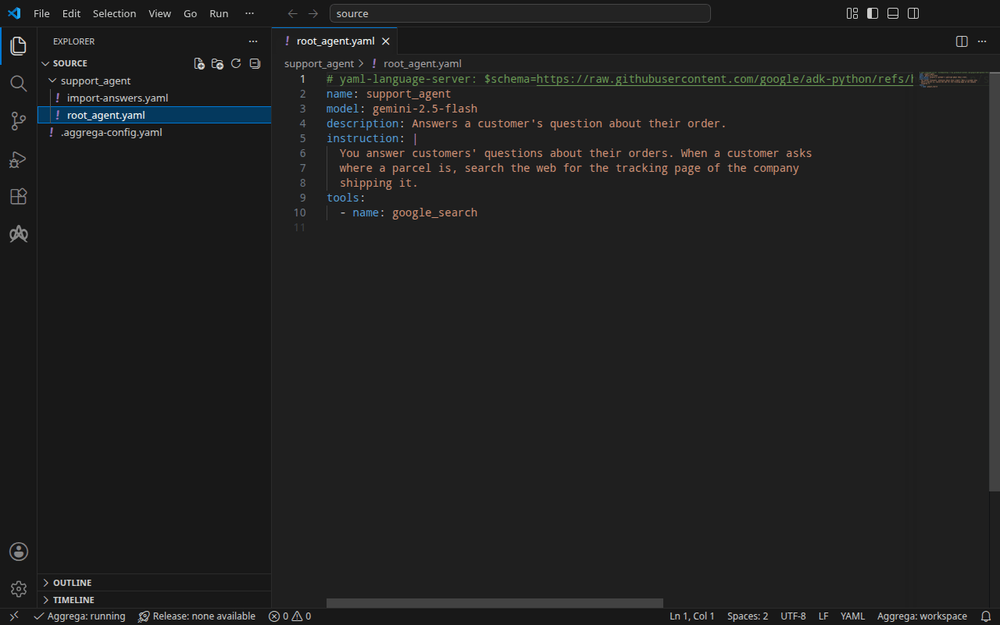
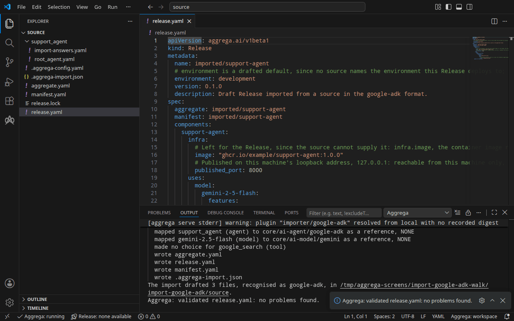
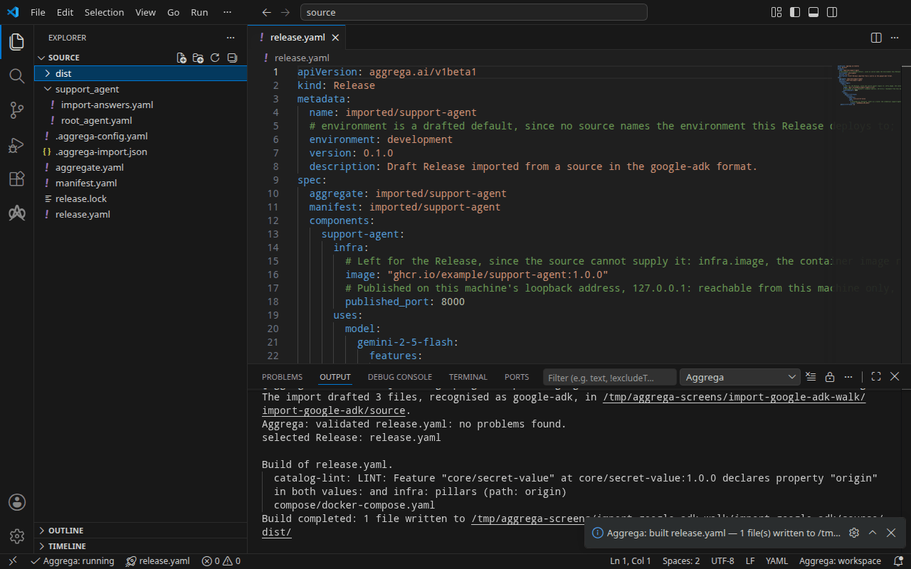

# Import a Google ADK agent

This walkthrough imports the Agent Config of an application built on Google's
Agent Development Kit (ADK) — one agent answering customers' questions about
their orders — and builds the application for Docker Compose. The import drafts
every file the build reads: the agent and its Gemini model, the key the agent
presents to the model as a variable reference, and the realizations of each. It
asks once for the one value no configuration holds, the image the application
runs in. Every file and every block of output below comes from a real run; the
configuration and each stage of the walkthrough are in the
[import-google-adk](../../language-reference/examples/import-google-adk/README.md)
example, where a check script runs the import again, compares what it writes,
what it prints and the blocks this page quotes with the files kept there, and
validates and builds what the import wrote.

## Draft the example

You can run this import with the commands on this page, or
[have your AI assistant run it for you](#with-an-ai-assistant).

Write the example into a new folder named after it:

```bash
aggrega draft --example import-google-adk
```

It then prints the commands to run next. The first changes into the new folder;
the one after it, below, changes into its `source` folder, which holds what this
page imports and is where the import runs:

```bash
cd import-google-adk
```



## The project

ADK can declare an application's agents in Agent Config files instead of code:
`adk create --type=config` writes `root_agent.yaml`, the configuration of the
root agent, and an environment file beside it. This one, written for this
walkthrough, declares one agent on Gemini's `gemini-2.5-flash`, with the
Google Search tool ADK ships:

<!-- quotes: source/support_agent/root_agent.yaml -->
```yaml
# yaml-language-server: $schema=https://raw.githubusercontent.com/google/adk-python/refs/heads/main/src/google/adk/agents/config_schemas/AgentConfig.json
name: support_agent
model: gemini-2.5-flash
description: Answers a customer's question about their order.
instruction: |
  You answer customers' questions about their orders. When a customer asks
  where a parcel is, search the web for the tracking page of the company
  shipping it.
tools:
  - name: google_search
```

The import never reads the environment file, which commonly holds the key the
application sends to Gemini, so the example holds none. At the project's root,
an `.aggrega-config.yaml` makes the folder a workspace:

<!-- quotes: source/.aggrega-config.yaml -->
```yaml
# The workspace key marks this directory as the workspace root, so an import run
# here writes its drafts beside support_agent/.
workspace: {}
# The registry the importer is fetched from the first time an import needs it.
default_registry: hub.aggrega.ai
```

The import references the catalog's ADK agent and Gemini model Components, and
`--target` drafts a Manifest from its Recipes. The workspace names no catalog
folder, so the import reads the standard-library catalog from the registry it
fetches its importer from: a signed snapshot of the published catalog, fetched,
verified and kept in the workspace's content cache by the first import, and
named by its digest in the record the import writes beside its drafts. A
workspace that names its own catalog folders — in `AGGREGA_CATALOG_DIRS`, or
under `workspace.catalog_dirs` — reads those first, with the published snapshot behind them.

### What the import asks for

An Agent Config names the agent's model, never the image the application runs
in: you build that image from your project. The catalog holds no default image
for an application built on ADK, so the import asks for it. At a terminal it
asks, and writes the answer into the drafts and into the answers file,
`import-answers.yaml`, inside the directory it imports, `support_agent/`, so
the next import reads it from there and asks nothing. With no terminal — in
continuous integration, or through a pipe — it asks nothing: it writes the file
with the key empty, and stops, naming the file. The example holds the file
already, with the image answered, `ghcr.io/example/support-agent:1.0.0`, which
stands for the image you build:

<!-- quotes: source/support_agent/import-answers.yaml -->
```yaml
# Values the import could not draft from the source, keyed by the drafted file and the key path inside
# it. Write each one beside its key; an import of the same source, and a sync, read them from here and
# ask nothing. A secret is never written here: its key asks where the secret comes from — a variable
# name, ${NAME}, or the name of a Kubernetes Secret.
release.yaml:
  # Container image running the application built on ADK, serving its API on infra.port on every
  # interface.
  spec.components.support-agent.infra.image: "ghcr.io/example/support-agent:1.0.0"
  # The origin of the secret value, written by the operator in the Release. Read exactly as
  # values.origin is. Write it here or in values.origin, never in both. A secret: name where it comes
  # from, never the value.
  spec.components.support-agent.uses.model.gemini-2-5-flash.features.credential.infra.origin: "google-api-key"
```

The second answer is for a build for Kubernetes, with `--target helm`: there
the agent reads the Gemini API key from a Kubernetes Secret, and the answer is
the Secret's name, `google-api-key`, never the key. A build for Docker Compose
reads the key from your shell instead, so this import does not use that
answer. [The import answers file](../../language-reference/import-answers.md)
describes the file, the questions and the rules for a secret's answer.

[`aggrega import`](../../language-reference/cli/aggrega-import.md) lists
every flag the command takes, `--answers`, which names an answers file kept
elsewhere, among them.

Change into `source`:

```bash
cd source
```

## Run the import

Name the agent's directory. The import reads its `root_agent.yaml`:

<!-- quotes: import-command -->
```bash
aggrega import support_agent --target compose
```

On standard output it lists what it wrote:

<!-- quotes: draft/stdout.txt -->
```text
wrote aggregate.yaml
wrote release.yaml
wrote manifest.yaml
wrote .aggrega-import.json
```

On standard error, with `<workspace>` standing for the folder you ran it in:

<!-- quotes: draft/import.txt -->
```text
[… omitted: a warning that the importer runs unverified, printed where its module is read from beside its Plugin entity in a catalog folder rather than fetched]
read as the google-adk format, with drafted paths relative to <workspace>
info: the answers file <workspace>/support_agent/import-answers.yaml also answers spec.components.support-agent.uses.model.gemini-2-5-flash.features.credential.infra.origin in release.yaml, which these drafts do not leave empty; those answers are kept there and not applied
mapped support_agent (agent) to core/ai-agent/google-adk as a reference, NONE
mapped gemini-2.5-flash (model) to core/ai-model/gemini as a reference, NONE
made no choice for google_search (tool)
Pull complete: <workspace>/release.lock (entities=8, source_artifacts=0, external_inputs=0)
```


- **The `info` line** names the answer the Docker Compose drafts do not use,
  kept in the answers file for a build for Kubernetes.
- **The `mapped` lines** say that the agent is an instance of the standard
  library's ADK agent, `core/ai-agent/google-adk`, and that the model it names
  is an instance of `core/ai-model/gemini`. Their tier reads `NONE`: the ADK
  import references these Components by what the configuration names rather
  than by weighing each against the catalog.
- **The `made no choice` line** says that the Google Search tool is drafted as
  nothing: it is a tool ADK ships, and it runs inside the application.
- **The `Pull complete` line** is the import fetching what the drafted Release
  depends on, as [`aggrega pull`](../../language-reference/cli/aggrega-pull.md)
  does, into `release.lock`, so the drafts validate and build at once. Under
  `--offline` the import pulls nothing and names the `aggrega pull` to run.

## What it writes

The Aggregate, the Release and the Manifest are named `imported/support-agent`,
after the root agent's `name`, `support_agent`, reduced to `support-agent`,
under the namespace the importer's `target_namespace` setting sets, `imported`
unless you set another
([Settings](../../language-reference/plugins/core-importers.md#settings)).

`aggregate.yaml` — the agent, wired to the model with the key it presents
declared on the connection, and the model, opening with comments that say what
was read and what was not:

<!-- quotes: draft/aggregate.yaml -->
```yaml
# Google ADK agent configurations read:
#   - root_agent.yaml
# Not read: the application's code, which defines the tools, callbacks and agents a configuration names by their code, nor the environment file ADK's scaffold writes beside root_agent.yaml; the application runs in the image the Release names for each instance, and loads its configurations itself.
# ADK states that its Agent Config is experimental. An agent's model is a Gemini model by default; ADK serves some other providers' models by name through classes of its own, such as claude-sonnet-4-5 and gpt-4o, and others through a LiteLLM model string.
apiVersion: aggrega.ai/v1beta1
kind: Aggregate
metadata:
  name: imported/support-agent
  version: 0.1.0
  description: Draft Aggregate imported from a source in the google-adk format.
spec:
  components:
    # The agent tree of root_agent.yaml, served from its root agent support_agent.
    # Tools ADK ships, which run inside the application, drafted as no Component: google_search.
    support-agent:
      type: core/ai-agent/google-adk
      values:
        description: "Answers a customer's question about their order."
      uses:
        model:
          gemini-2-5-flash:
            target: gemini-2-5-flash
            # For the compose target, the lines below declare credential on gemini-2-5-flash: a secret the Release alone attaches arrives under the key value, so each is declared with a key of its own and no two arrive under one; the Release attaches its origin, naming this type or none.
            features:
              credential:
                type: core/secret-value
                values:
                  key: GOOGLE_API_KEY
    # The model gemini-2.5-flash.
    gemini-2-5-flash:
      type: core/ai-model/gemini
      values:
        model: "gemini-2.5-flash"
```

ADK serves an application from its root agent, so the draft holds one instance
per agent tree, named after its root agent. The agent's `instruction` is not
carried: the application reads it from its own configuration, which the image
holds.

ADK serves `gemini-2.5-flash` through its Gemini class, which sends its
requests to the Gemini API, so the draft wires the model to the agent's `model`
socket, which admits the Gemini API alone. Gemini is a hosted service, so the
agent's Component refuses a connection to it that carries no credential; the
connection declares one, under the key `GOOGLE_API_KEY`. A model ADK serves any
other way — a name such as `gpt-4o` that ADK serves through a class of its own,
or a LiteLLM model string such as `openai/gpt-4o` — is wired to nothing: a
comment above the instance names it, and the connection is left for you, as
[What an agent tree becomes](../../language-reference/plugins/core-importers.md#what-an-agent-tree-becomes)
describes.

`release.yaml` — the environment, the image, the published port, and where the
key comes from:

<!-- quotes: draft/release.yaml -->
```yaml
apiVersion: aggrega.ai/v1beta1
kind: Release
metadata:
  name: imported/support-agent
  # environment is a drafted default, since no source names the environment this Release deploys to; change it to name the one it deploys to.
  environment: development
  version: 0.1.0
  description: Draft Release imported from a source in the google-adk format.
spec:
  aggregate: imported/support-agent
  manifest: imported/support-agent
  components:
    support-agent:
      infra:
        # Left for the Release, since the source cannot supply it: infra.image, the container image running the application built on ADK, holding its configurations
        image: "ghcr.io/example/support-agent:1.0.0"
        # Published on this machine's loopback address, 127.0.0.1: reachable from this machine only, by any process running on it. Delete this line to keep the service internal.
        published_port: 8000
      uses:
        model:
          gemini-2-5-flash:
            features:
              credential:
                type: core/secret-value
                infra:
                  # Attached by reference, never as a value: the credential support-agent presents to gemini-2-5-flash on its model connection (the source names no variable for it, so it is read from the one Google's Gemini API's client libraries read the API key from), read from the variable GOOGLE_API_KEY, which a target substituting variable references, as Docker Compose does when the stack starts, reads from the environment, so no file carries the value.
                  origin: "${GOOGLE_API_KEY}"
    gemini-2-5-flash: {}
```

The environment, `development`, is a default the import writes because no
configuration names one; change it where the Release deploys elsewhere. The
image is the answer the import read from `support_agent/import-answers.yaml`.
`published_port` is 8000, the port the application listens on, so it answers at
`http://127.0.0.1:8000` on your machine; as its comment says, any process on
this machine can reach it there and nothing else can, and deleting the line
keeps the application on the stack's network alone.
The configuration names no variable for the key, so the connection reads it
from `${GOOGLE_API_KEY}`, the variable the Gemini API's client libraries read,
as a variable reference and never a value.

`manifest.yaml` — the Compose Recipe of each type, and the realization that
writes the key's variable reference into the Compose file as written:

<!-- quotes: draft/manifest.yaml -->
```yaml
apiVersion: aggrega.ai/v1beta1
kind: Manifest
metadata:
  name: imported/support-agent
  version: 0.1.0
spec:
  mappings:
    components:
      type:
        core/ai-agent/google-adk: compose/google-adk
        core/ai-model/gemini: compose/gemini
    features:
      type:
        core/secret-value: compose/dotenv-secret
```

`release.lock` records the catalog entities the Release resolved to, by
digest, and `.aggrega-import.json` is the record of what the import wrote,
which a later `aggrega import --sync` reads.

## Validate and build

```bash
aggrega validate --release release.yaml
aggrega build --release release.yaml
```





The validation prints:

```text
  notice: LINT: Feature "core/secret-value" at core/secret-value:1.0.0 declares property "origin" in both values: and infra: pillars (path: origin)
release dependency validation passed: release.yaml (schema-pillar + dependency pillars)
```

and the build, with `<workspace>` standing for the folder you ran it in:

```text
  notice: LINT: Feature "core/secret-value" at core/secret-value:1.0.0 declares property "origin" in both values: and infra: pillars (path: origin)
[… omitted: a total build time, which differs per run]
Build completed: 1 file written to <workspace>/dist
```

The `notice` line is advisory: the secret Feature accepts its `origin` from the
Aggregate's `values` or the Release's `infra`, and the notice reports that one
leaf is declared in both. It changes no verdict.

The agent's service in `dist/compose/docker-compose.yaml`:

```yaml
services:
  support-agent:
    image: ghcr.io/example/support-agent:1.0.0
    environment:
      PORT: "8000"
      GOOGLE_API_KEY: ${GOOGLE_API_KEY}
    ports:
      - 127.0.0.1:8000:8000
    [… omitted: the labels the build writes on every service, naming the Aggregate, the component, the environment and the compiler's version]
    networks:
      - compose
```

The application receives the port its server listens on as `PORT`, and the key
as `GOOGLE_API_KEY`, which ADK's Gemini client sends to the Gemini API. The
model gets no service of its own: the client sends its requests to the Gemini
API's own address, and reads no other from its environment. The key is a
variable reference, filled from your shell when the stack starts. The ADK
agent's Compose Recipe publishes a port on your machine only where the Release
sets `published_port` in the agent's `infra`, and then on the loopback
address, 127.0.0.1, alone; without it, the service is reached on the stack's
network only.

## With an AI assistant

An AI assistant [set up with Aggrega's tools](../../ai-assistants/set-up.md)
can do the same: paste this prompt into it.

<!-- copyable -->

> Use the Aggrega tools only, and create no folder yourself. If the Workspace folder holds no `import-google-adk` folder yet, call the `draft` tool once with `example` set to `import-google-adk` and no `dir`: it writes the example into a new `import-google-adk` folder, whose `source` folder holds what this page imports. Then call the `import` tool with `workspace_root` set to `import-google-adk/source`, `source` set to `support_agent` and `target` set to `compose`: it reads the answers it needs from `import-answers.yaml` inside the `support_agent` folder, writes its drafts into `import-google-adk/source` and pulls what they need. Then call the `validate` tool with `workspace_root` set to `import-google-adk/source` and `release` set to `release.yaml`, and the `build` tool with `workspace_root` set to `import-google-adk/source`, `release` set to `release.yaml` and `write` set to true. Tell me which files the build wrote; they are under `import-google-adk/source/dist/`.

## Open it in VS Code

With the
[Aggrega extension for Visual Studio Code](../editor/install.md#installing-the-extension)
installed, open the folder `import-google-adk/source` in VS Code, where the
import wrote its drafts. The folder holds one Release, the drafted
`release.yaml`, so the editor selects it for you, and it checks the drafts
against that Release as you edit them, marking what it finds in the file and in
the Problems panel. **Aggrega: Show topology graph**, in the Command Palette,
draws the Release's components and the connections between them.
**Aggrega: Build**, **Aggrega: Preview build** and **Aggrega: Pull** act on the
same Release, and each is also a button on the **Commands** panel of the
**Aggrega** view in the activity bar; Build writes its files into the folder's
`dist/`. [Use Aggrega in Visual Studio Code](../editor/README.md) covers the rest.

## Run it

Docker Compose runs your image as the rendered service above, `PORT`
included. The image must listen at that port on every interface, not on
127.0.0.1, the default address of ADK's API server. ADK's own API server,
`adk api_server`, serves the configuration directory as it is, so the image
needs no code of yours. A `Dockerfile` at the project's root, beside
`support_agent/`:

```dockerfile
FROM python:3.12-slim
RUN pip install --no-cache-dir google-adk==2.13.0
COPY support_agent/ /app/agents/support_agent/
CMD ["sh", "-c", "exec adk api_server --host 0.0.0.0 --port \"$PORT\" --auto_create_session /app/agents"]
```

`adk api_server` serves the agent directories in the folder it names, and the
command passes `PORT` to it. `--auto_create_session` opens a session the first
time a request to `/run` names it, so one request reaches the agent. Build the image, write its name in place of
`ghcr.io/example/support-agent:1.0.0` in `support_agent/import-answers.yaml`,
and import again with `--sync`, which writes the new answer into the drafts and
pulls again; then build:

```bash
docker build -t support-agent:local .
aggrega import support_agent --sync
aggrega build --release release.yaml
```

Then set the key in your shell and start the stack:

```bash
export GOOGLE_API_KEY='your Gemini API key'
docker compose -p support-agent -f dist/compose/docker-compose.yaml up -d --wait
```

`-p` names the project, as the run step of
[How an import runs](README.md#how-an-import-runs) explains. `--wait` returns
once the container runs, since the build gives the service no health check,
and the server answers a moment later, so repeat a request it refuses.

## Test it

Send the agent a message at <http://127.0.0.1:8000>, the address
`published_port` publishes. The request names a user and a session, and `/run`
opens the session on its first message:

```bash
curl -sS -X POST http://127.0.0.1:8000/run -H 'Content-Type: application/json' \
  -d '{"app_name": "support_agent", "user_id": "u1", "session_id": "s1", "new_message": {"role": "user", "parts": [{"text": "Where is my order 1234? Answer in one short sentence."}]}}'
```

The reply, Gemini's, comes back as a list of the events the turn added to the
session. The run used a placeholder for the key, so Gemini refused it: the
request answered HTTP 500, `Internal Server Error`, and the service's log,
`docker compose -p support-agent -f dist/compose/docker-compose.yaml logs support-agent`,
names the reason:

```text
google.genai.errors.ClientError: 400 INVALID_ARGUMENT. {'error': {'code': 400, 'message': 'API key not valid. Please pass a valid API key.', 'status': 'INVALID_ARGUMENT', [… omitted: the error's details]}}
```

`curl -sS http://127.0.0.1:8000/list-apps` answers `["support_agent"]`, the
agents the server holds.

Stop the stack with:

```bash
docker compose -p support-agent -f dist/compose/docker-compose.yaml down
```

### On Kubernetes

The same agent imports for Kubernetes with `--target helm`. A cluster pulls
its images from a registry, so push the image you built to one your cluster
reads, and write its name in place of the image answered in
`support_agent/import-answers.yaml`; the run pushed it to a registry on the
cluster's own machine, as `localhost:5000/support-agent:1.0.0`. The second
answer there names the Secret the agent reads the Gemini API key from,
`google-api-key`. The drafts for Docker Compose already sit in `source`, so
draft these into a folder of their own, and build from it:

```bash
aggrega import support_agent --target helm --output-dir helm
cd helm
aggrega build --release release.yaml
```

The build writes plain Kubernetes manifests under `dist/helm/` at the
workspace root, `source`, which from `helm` is `../dist/helm/`. Create the
Secret `google-api-key` in the namespace you apply to, holding the key under
the data key `value`, and apply the folder as the run step of
[How an import runs](README.md#how-an-import-runs) explains. The agent's
Service is `support-agent-default`: forward a local port to it, and leave the
command running:

```bash
kubectl port-forward -n <namespace> svc/support-agent-default 8000:8000
```

From another terminal, the message above reaches the agent at the same
address, unchanged. The run got the same `Internal Server Error`, and
`kubectl logs -n <namespace> deploy/support-agent` names the same refusal of
the placeholder key.
