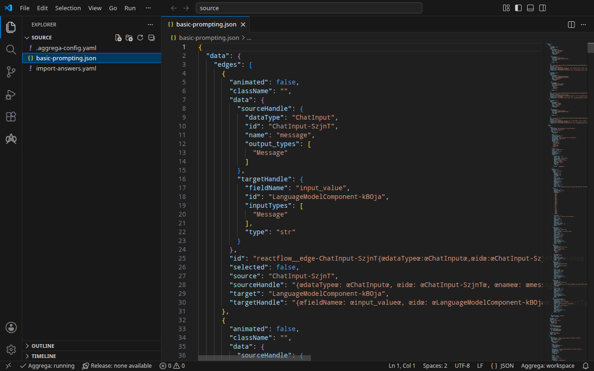
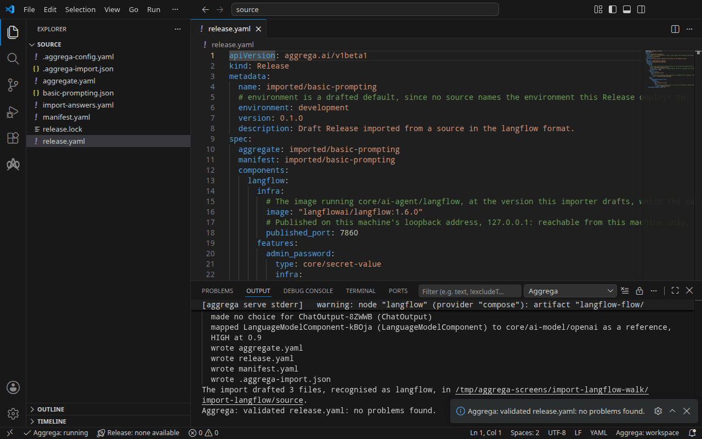
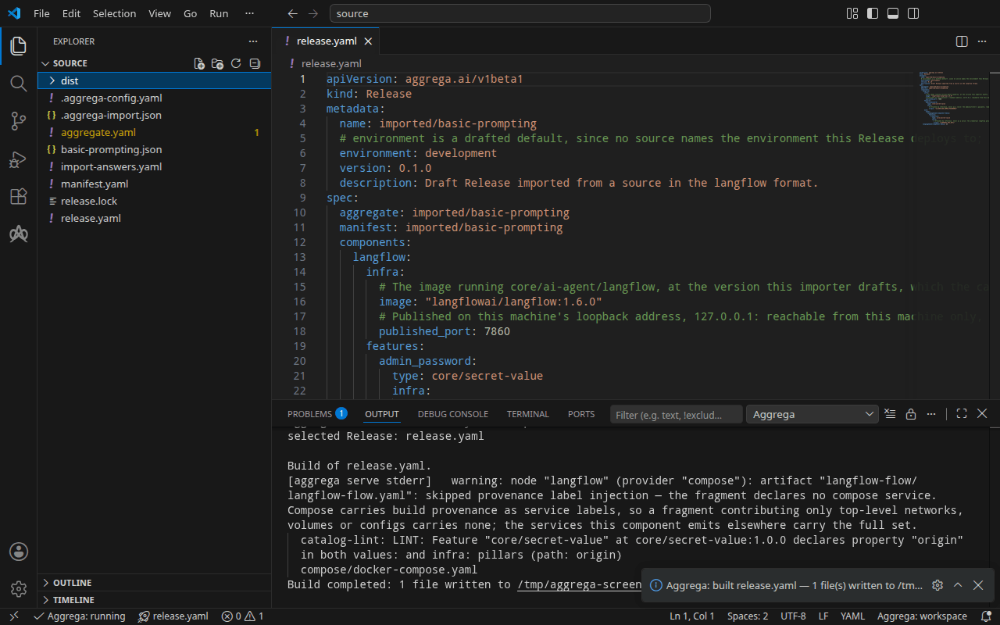

# Import a Langflow flow

This walkthrough imports a flow exported from Langflow — Basic Prompting, the
starter project Langflow 1.6.0 ships — into an Aggregate, a Release and a
Manifest that build Langflow carrying the flow for Docker Compose as they are
written, then builds them and runs the result. Every file and every block of
output below comes from a real run; the flow and each stage of the walkthrough
are in the
[import-langflow](../../language-reference/examples/import-langflow/README.md)
example, where a check script runs the import again, compares what it writes,
what it prints and the blocks this page quotes with the files kept there, and
validates and builds what the import wrote.

## Scaffold the example

You can run this import with the commands on this page, or
[have your AI assistant run it for you](#with-an-ai-assistant).

Write the example into a new folder named after it:

```bash
aggrega scaffold --example import-langflow
```

It then prints the commands to run next. The first changes into the new folder;
the one after it, below, changes into its `source` folder, where the import
runs. That folder carries the flow file,
`basic-prompting.json`, which this page describes rather than quotes:

```bash
cd import-langflow
```



## The flow

Basic Prompting chains four nodes: a Chat Input, a Prompt, a Language Model
that calls OpenAI's `gpt-4.1`, and a Chat Output. As Langflow ships it, it is
one JSON file, `basic-prompting.json`, of about 54 KB, which
carries the source code of each component as well as the flow. Its
Language Model node reads its key from the global variable `OPENAI_API_KEY`,
which Langflow reads from its environment where no variable of that name is
stored.

Beside the flow, an `.aggrega-config.yaml` makes the folder a workspace:

<!-- quotes: source/.aggrega-config.yaml -->
```yaml
# The workspace key marks this directory as the workspace root, so an import run
# here writes its drafts beside basic-prompting.json.
workspace: {}
# The registry the importer is fetched from the first time an import needs it.
default_registry: hub.aggrega.ai
```

and `import-answers.yaml` holds the answers to what no flow can hold. An import
for Docker Compose needs none of them: it attaches each secret by a variable
reference Docker Compose fills from your shell. An import for Kubernetes
attaches each secret by the name of a Kubernetes Secret, which only you can
name, so the file names the two Secrets that import asks for (see
[On Kubernetes](#on-kubernetes)):

<!-- quotes: source/import-answers.yaml -->
```yaml
# Values the import could not draft from the source, keyed by the drafted file and the key path inside
# it. Write each one beside its key; an import of the same source, and a sync, read them from here and
# ask nothing. A secret is never written here: its key asks where the secret comes from — a variable
# name, ${NAME}, or the name of a Kubernetes Secret.
release.yaml:
  # The origin of the secret value, written by the operator in the Release. Read exactly as
  # values.origin is. Write it here or in values.origin, never in both. A secret: name where it comes
  # from, never the value.
  spec.components.langflow.features.admin_password.infra.origin: "langflow-admin"
  # The origin of the secret value, written by the operator in the Release. Read exactly as
  # values.origin is. Write it here or in values.origin, never in both. A secret: name where it comes
  # from, never the value.
  spec.components.langflow.uses.model.languagemodelcomponent-kboja.features.credential.infra.origin: "openai-api-key"
```

Each answer is the name of a Secret, never the secret itself, so the file can be
kept with the flow. [The import answers file](../../language-reference/import-answers.md)
describes the file in full.

The import weighs each node against the Components of the workspace's catalog,
and `--target` drafts a Manifest from its Recipes. The workspace names no
catalog folder, so the import reads the standard-library catalog from the
registry it fetches its importer from: a signed snapshot of the published
catalog, fetched, verified and kept in the workspace's content cache by the
first import, and named by its digest in the record the import writes beside its
drafts. A workspace that names its own catalog folders — in
`AGGREGA_CATALOG_DIRS`, or under `workspace.catalog_dirs` — imports against
those instead. Change into `source`:

```bash
cd source
```

## Run the import

<!-- quotes: import-command -->
```bash
aggrega import basic-prompting.json --target compose
```

On standard output it lists what it wrote:

<!-- quotes: draft/stdout.txt -->
```text
wrote aggregate.yaml
wrote release.yaml
wrote manifest.yaml
wrote .aggrega-import.json
```

On standard error, with `<workspace>` standing for the folder you ran it in:

<!-- quotes: draft/import.txt -->
```text
[… omitted: a warning that the importer runs unverified, printed where its module is read from beside its Plugin entity in a catalog folder rather than fetched]
read as the langflow format, with drafted paths relative to <workspace>
warn: the flow is carried in values.flow_definition with the handles of all 3 of its edges written as Langflow's editor writes them — the same handles, their keys in order with no space between them — since the editor compares an edge's handles with the ones it writes for the nodes the edge joins, character for character, when it opens the flow, and drops every edge whose handles differ
warn: node LanguageModelComponent-kBOja reaches languagemodelcomponent-kboja through the model connection languagemodelcomponent-kboja of core/ai-agent/langflow: its field api_key names the variable OPENAI_API_KEY, which the platform delivers for this connection and Langflow reads as a global variable; no field of it gives its API's address, so the OpenAI client it runs takes OPENAI_BASE_URL, the address the platform delivers for this connection, from the environment
made no choice for ChatInput-SzjnT (ChatInput)
made no choice for Prompt-tOH5D (Prompt)
made no choice for ChatOutput-8ZWWB (ChatOutput)
mapped LanguageModelComponent-kBOja (LanguageModelComponent) to core/ai-model/openai as a reference, HIGH at 0.9
  warning: node "langflow" (provider "compose"): artifact "langflow-flow/langflow-flow.yaml": skipped provenance label injection — the fragment declares no compose service. Compose carries build provenance as service labels, so a fragment contributing only top-level networks, volumes or configs carries none; the services this component emits elsewhere carry the full set.
Pull complete: <workspace>/release.lock (entities=8, source_artifacts=0, external_inputs=0)
```


- **The `mapped` line** says what the Language Model node became: the standard
  library's OpenAI model, `core/ai-model/openai`, referenced rather than
  drafted, since it matched in the high tier, at 0.9. It is a component of its
  own, wired to the platform's `model` socket. By default the draft runs the
  whole flow on the platform that runs Langflow, and gives a component of its
  own only to a node a socket of that platform takes — a model, a tool, a
  vector store — where the node is recognised as one.
- **The first `warn` line** says the flow is carried with each edge's handles
  written as Langflow's editor writes them. Langflow keeps its starter projects
  with a space after every colon and comma of an edge's handles; its editor,
  opening a flow, drops every edge whose handles are not written exactly as it
  writes them, then saves the flow without it. Written so, the flow opens with
  its three connections, and runs with them.
- **The `warn` line naming the node** says how the flow reaches that model. The node reads its
  key from the variable `OPENAI_API_KEY`, and its address from
  `OPENAI_BASE_URL`, and the platform delivers both for the model connection, so
  the flow needs no edit.
- **The `made no choice` lines** name the nodes no socket of the platform takes:
  they stay inside the flow, which Langflow runs as exported.
- **The last two lines** are the pull. Nothing was left to answer, so the import
  pulled the drafted Release's dependencies, as `aggrega pull` does, and wrote
  `release.lock`; the build below needs nothing more. The `warning` line is one
  the build prints too, and [Validate and build](#validate-and-build) explains
  it.

The answers file names two Secrets this import does not ask for: it leaves
nothing empty for them, so it applies neither and leaves the file as it is.

## What it writes

The Aggregate, the Release and the Manifest are named
`imported/basic-prompting`, after the flow's own name, `Basic Prompting`,
reduced to `basic-prompting` — a flow with no name is named after its file —
under the namespace the importer's `target_namespace` setting sets, `imported`
unless you set another
([Settings](../../language-reference/plugins/core-importers.md#settings)).

`aggregate.yaml` — one instance of the standard library's Langflow platform,
`core/ai-agent/langflow`, carrying the flow as it was exported but for its
edges' handles, written as Langflow's editor writes them, more than a thousand
lines of it left out here, and the model it reaches:

<!-- quotes: draft/aggregate.yaml -->
```yaml
apiVersion: aggrega.ai/v1beta1
kind: Aggregate
metadata:
  name: imported/basic-prompting
  version: 0.1.0
  description: Draft Aggregate imported from a source in the langflow format.
spec:
  components:
    langflow:
      type: core/ai-agent/langflow
      features:
        # For the compose target, the lines below declare admin_password on langflow: a secret the Release alone attaches arrives under the key value, so each is declared with a key of its own and no two arrive under one; the Release attaches its origin, naming this type or none.
        admin_password:
          type: core/secret-value
          values:
            key: LANGFLOW_SUPERUSER_PASSWORD
      values:
        flow_id: '0dbee653-41ae-4e51-af2e-55757fb24be3'
        flow_definition: |-
          {
            "data": {
              "edges": [
          [… omitted: the rest of the flow]
          }
      uses:
        model:
          languagemodelcomponent-kboja:
            target: languagemodelcomponent-kboja
            # For the compose target, the lines below declare credential on languagemodelcomponent-kboja: a secret the Release alone attaches arrives under the key value, so each is declared with a key of its own and no two arrive under one; the Release attaches its origin, naming this type or none.
            features:
              credential:
                type: core/secret-value
                values:
                  key: OPENAI_API_KEY
    # swap to core/ai-model/azure-openai (score 0.4000) by setting type: core/ai-model/azure-openai
    languagemodelcomponent-kboja:
      type: core/ai-model/openai
      values:
        model: |-
          gpt-4.1
```

- **The model** is `core/ai-model/openai`, with the model the flow's node
  selects, `gpt-4.1`. The comment above it names another Component of the
  catalog the node resembles, with its score, for a reader who wants that one.
- **The two secrets** — the administrator's password Langflow's editor asks
  for, and the OpenAI key the platform presents to the model — are declared
  here with the variable each arrives under in Langflow's environment,
  `LANGFLOW_SUPERUSER_PASSWORD` and `OPENAI_API_KEY`. On Docker Compose a
  secret the Release alone attached would arrive under the key `value`, and
  the two would collide; declared here, each has a key of its own. The Release
  says where each comes from.
- **`flow_id`** is the identifier the export gives the flow.

`release.yaml` — the Release, which deploys the Aggregate with the Manifest:

<!-- quotes: draft/release.yaml -->
```yaml
apiVersion: aggrega.ai/v1beta1
kind: Release
metadata:
  name: imported/basic-prompting
  # environment is a drafted default, since no source names the environment this Release deploys to; change it to name the one it deploys to.
  environment: development
  version: 0.1.0
  description: Draft Release imported from a source in the langflow format.
spec:
  aggregate: imported/basic-prompting
  manifest: imported/basic-prompting
  components:
    langflow:
      infra:
        # The image running core/ai-agent/langflow, at the version this importer drafts, which the catalog's Recipes for it are known to run; the import does not raise or lower it to follow the source. The source states version "1.5.0" of the platform.
        image: "langflowai/langflow:1.6.0"
        # Published on this machine's loopback address, 127.0.0.1: reachable from this machine only, by any process running on it. Delete this line to keep the service internal.
        published_port: 7860
      features:
        admin_password:
          type: core/secret-value
          infra:
            # Attached by reference, never as a value: the administrator's password, read while values.require_authentication stays true, read from the variable LANGFLOW_ADMIN_PASSWORD, which a target substituting variable references, as Docker Compose does when the stack starts, reads from the environment, so no file carries the value.
            origin: "${LANGFLOW_ADMIN_PASSWORD}"
      uses:
        model:
          languagemodelcomponent-kboja:
            features:
              credential:
                type: core/secret-value
                infra:
                  # Attached by reference, never as a value: the credential langflow presents to languagemodelcomponent-kboja on its model connection, read from the variable OPENAI_API_KEY, which a target substituting variable references, as Docker Compose does when the stack starts, reads from the environment, so no file carries the value.
                  origin: "${OPENAI_API_KEY}"
    languagemodelcomponent-kboja: {}
```

- **`environment`** is `development`, a default the comment above it says to
  change to the environment the Release deploys to.
- **The image** is Langflow 1.6.0, the version the catalog's Recipes for
  Langflow run. The flow was last tested on Langflow 1.5.0, as the comment
  says; the import keeps the version the Recipes run rather than following the
  flow's.
- **`published_port`** is 7860, the port Langflow serves on, so the editor
  answers at `http://127.0.0.1:7860` on your machine. As its comment says, any
  process on this machine can reach it there and nothing else can; delete the
  line to keep Langflow on the stack's network alone.
- **The two secrets** are variable references, `${LANGFLOW_ADMIN_PASSWORD}` and
  `${OPENAI_API_KEY}`, which Docker Compose fills from your shell when the stack
  starts, so no file carries either value.

`manifest.yaml` — the Compose Recipes of the platform and the model, and the
realization that writes a secret's variable reference into the Compose file as
written:

<!-- quotes: draft/manifest.yaml -->
```yaml
apiVersion: aggrega.ai/v1beta1
kind: Manifest
metadata:
  name: imported/basic-prompting
  version: 0.1.0
spec:
  mappings:
    components:
      type:
        core/ai-agent/langflow: compose/langflow
        core/ai-model/openai: compose/openai
    features:
      type:
        core/secret-value: compose/dotenv-secret
```

`.aggrega-import.json` is the record of what the import wrote, which a later
`aggrega import --sync` reads, and `release.lock` pins every catalog entity the
Release resolves to, by version and digest.

## Validate and build

```bash
aggrega validate --release release.yaml
aggrega build --release release.yaml
```





The validation prints:

```text
  notice: LINT: Feature "core/secret-value" at core/secret-value:1.0.0 declares property "origin" in both values: and infra: pillars (path: origin)
release dependency validation passed: release.yaml (schema-pillar + dependency pillars)
```

and the build, with `<workspace>` standing for the folder holding the drafts:

```text
  warning: node "langflow" (provider "compose"): artifact "langflow-flow/langflow-flow.yaml": skipped provenance label injection — the fragment declares no compose service. Compose carries build provenance as service labels, so a fragment contributing only top-level networks, volumes or configs carries none; the services this component emits elsewhere carry the full set.
  notice: LINT: Feature "core/secret-value" at core/secret-value:1.0.0 declares property "origin" in both values: and infra: pillars (path: origin)
[… omitted: a total build time, which differs per run]
Build completed: 1 file written to <workspace>/dist
```

The `warning` line is about the part of the Compose file that carries the flow,
a top-level `configs` entry, which has no service to put the build's labels on.
The `notice` line is advisory: the secret Feature accepts its `origin` from
the Aggregate's `values` or the Release's `infra`, and the notice reports that
one leaf is declared in both. Neither changes the verdict.

`dist/compose/docker-compose.yaml` holds Langflow and a service that runs once
before it:

```yaml
services:
  langflow:
    image: langflowai/langflow:1.6.0
    environment:
      LANGFLOW_CONFIG_DIR: /app/langflow
      LANGFLOW_SAVE_DB_IN_CONFIG_DIR: "true"
      LANGFLOW_AUTO_LOGIN: "false"
      LANGFLOW_SUPERUSER: admin
      LANGFLOW_SUPERUSER_PASSWORD: ${LANGFLOW_ADMIN_PASSWORD}
      OPENAI_BASE_URL: https://api.openai.com/v1
      OPENAI_API_KEY: ${OPENAI_API_KEY}
      LANGFLOW_LOAD_FLOWS_PATH: /app/flows
    ports:
      - 127.0.0.1:7860:7860
    [… omitted: the labels the build writes on every service, naming the Aggregate, the component, the environment and the compiler's version]
    volumes:
      - type: volume
        source: langflow--data
        target: /app/langflow
    networks:
      - compose
    depends_on:
      langflow--data-owner:
        condition: service_completed_successfully
    [… omitted: the service's health check]
    configs:
      - source: langflow-flow
        target: /app/flows/flow.json
  langflow--data-owner:
    image: langflowai/langflow:1.6.0
    entrypoint:
      - chown
      - "1000:0"
      - /app/langflow
    [… omitted: the labels the build writes on every service]
    volumes:
      - type: volume
        source: langflow--data
        target: /app/langflow
    networks:
      - compose
    restart: "no"
    user: "0"
```

The flow reaches Langflow as `/app/flows/flow.json`, from a `configs` entry
holding the flow the Aggregate carries, and Langflow loads it from `LANGFLOW_LOAD_FLOWS_PATH`
at each start. The key and the password are variable references, filled from
your shell when the stack starts. Langflow's Compose Recipe publishes a port
on your machine only where the Release sets `published_port` in Langflow's
`infra`, and then on the loopback address, 127.0.0.1, alone; without it, the
service is reached on the stack's network only.

`langflow--data-owner` runs Langflow's image as root, gives the data volume to
user 1000, group 0, the identity Langflow's image runs as, and exits. Langflow
starts once it has completed: Docker creates the volume owned by root, and
Langflow could not write its data there otherwise.

## With an AI assistant

An AI assistant [set up with Aggrega's tools](../../ai-assistants/set-up.md)
can do the same: paste this prompt into it.

<!-- copyable -->

> Write the Aggrega documentation's runnable example `import-langflow` into a new folder with the `scaffold` tool. Its `source` folder is a workspace: name it as the workspace root on each call that follows. Import `basic-prompting.json` there with the `import` tool, for the target `compose`; the import reads the answers it needs from `import-answers.yaml` beside it. Then validate the Release the import drafted, `release.yaml`, with the `validate` tool, build it with the `build` tool, writing the files into `dist/`, and tell me which files the build wrote.

## Open it in VS Code

With the
[Aggrega extension for Visual Studio Code](https://github.com/aggrega-ai/aggrega-vscode-extension)
installed, open the folder `import-langflow/source` in VS Code, where the import
wrote its drafts. The folder holds one Release, the drafted `release.yaml`, so
the editor selects it for you, and it checks the drafts against that Release as
you edit them, marking what it finds in the file and in the Problems panel.
**Aggrega: Show topology graph**, in the Command Palette, draws the Release's
components and the connections between them. **Aggrega: Build**,
**Aggrega: Preview build** and **Aggrega: Pull** act on the same Release, and
each is also a button on the **Commands** panel of the **Aggrega** view in the
activity bar; Build writes its files into the folder's `dist/`.
[Use Aggrega in Visual Studio Code](../editor/README.md) covers the rest.

## Run it

Set the key and the administrator's password in your shell, then start the
stack:

```bash
export OPENAI_API_KEY='your OpenAI key'
export LANGFLOW_ADMIN_PASSWORD='a password of your own'
docker compose -p basic-prompting -f dist/compose/docker-compose.yaml up -d --wait
```

`-p` names the project, as the run step of
[How an import runs](README.md#how-an-import-runs) explains. `--wait` returns
once `langflow--data-owner` has completed and Langflow reports healthy.

## Test it

Open <http://127.0.0.1:7860>, the address `published_port` publishes, and sign
in as `admin` with the password you set: Basic Prompting is in the editor with
its three connections.

Langflow runs a flow through its API for an API key only, which an
administrator creates once signed in. Sign in:

```bash
curl -sS -X POST http://127.0.0.1:7860/api/v1/login \
  -d username=admin --data-urlencode "password=$LANGFLOW_ADMIN_PASSWORD"
```

```text
{"access_token":"[… omitted: the access token]","refresh_token":"[… omitted: the refresh token]","token_type":"bearer"}
```

create a key with the access token:

```bash
curl -sS -X POST http://127.0.0.1:7860/api/v1/api_key/ \
  -H 'Authorization: Bearer <access_token>' -H 'Content-Type: application/json' -d '{"name": "test-it"}'
```

```text
{"name":"test-it","last_used_at":null,"total_uses":0,"is_active":true,"id":"[… omitted: the key's identifier]","api_key":"[… omitted: the key]","user_id":"[… omitted: the owner's identifier]"}
```

and run the flow with the key:

```bash
curl -sS -X POST 'http://127.0.0.1:7860/api/v1/run/0dbee653-41ae-4e51-af2e-55757fb24be3?stream=false' \
  -H 'x-api-key: <api_key>' -H 'Content-Type: application/json' \
  -d '{"input_value": "In one short sentence: what is Docker Compose?", "input_type": "chat", "output_type": "chat"}'
```

The run used a placeholder for the OpenAI key, so the answer is OpenAI's
refusal of the key, which shows the flow ran as far as its call to the model:

```text
{"detail":"{\"message\":\"Error running graph: Error building Component Language Model: \\n\\nError code: 401 - {'error': {'message': 'Incorrect API key provided: sk-place*****************-key. You can find your API key at https://platform.openai.com/account/api-keys.', 'type': 'invalid_request_error', 'code': 'invalid_api_key', 'param': None}, 'status': 401}\",[… omitted: three empty fields, and a suggestion to update three of the flow's components]}"}
```

With your key, the reply carries the model's answer at
`outputs[0].outputs[0].results.message.text`.

On Kubernetes, with the build [On Kubernetes](#on-kubernetes) describes
applied, forward a local port to Langflow's Service, `langflow-default`, in
the namespace you applied to, and leave the command running:

```bash
kubectl port-forward -n <namespace> svc/langflow-default 7860:7860
```

From another terminal, the three requests above reach Langflow at the same
address, unchanged; the run got the same refusal of the placeholder key.

Stop the stack with the command below. `-v` also removes Langflow's data volume,
and with it the administrator's account, the API key and the flow's run history:

```bash
docker compose -p basic-prompting -f dist/compose/docker-compose.yaml down -v
```

## On Kubernetes

The same flow imports for Kubernetes with the `helm` target. The drafts for
Docker Compose already sit in `source`, and the import never writes over an
Aggregate there, so draft these into a folder of their own with
`--output-dir`, then validate and build from it:

```bash
aggrega import basic-prompting.json --target helm --output-dir helm
cd helm
aggrega validate --release release.yaml
aggrega build --release release.yaml
```

The drafts differ where the target does. The Manifest maps the platform to
`helm/langflow`, the model to `helm/openai`, and each secret to
`helm/k8s-existing-secret`, which reads it from a Secret already in the
namespace. The Release attaches the two secrets as `core/referenced-secret`,
each naming that Secret, and the names are what the answers file holds:

```yaml
      features:
        admin_password:
          type: core/referenced-secret
          infra:
            # Left for the Release, since the source cannot supply it: the name of a Kubernetes Secret already in the namespace holding, under the data key value, the administrator's password, read while values.require_authentication stays true.
            origin: "langflow-admin"
```

Without the answers file, the import asks for both names at a terminal and
writes your answers into a new answers file. Where nothing can be asked, it
writes that file with both keys and empty answers, and ends with status 1 and
this line, `<workspace>` standing for the folder you ran it in:

```text
2 values the drafts leave empty are still owed, listed in the answers file <workspace>/import-answers.yaml: write each beside its key there, then run the import again
```

The build writes plain Kubernetes manifests under `dist/helm/` at the
workspace root, `source`, which from `helm` is `../dist/helm/`. Create the two
Secrets in the namespace you apply to, each holding its value under the data
key `value`, then apply the folder as the run step of
[How an import runs](README.md#how-an-import-runs) explains.
